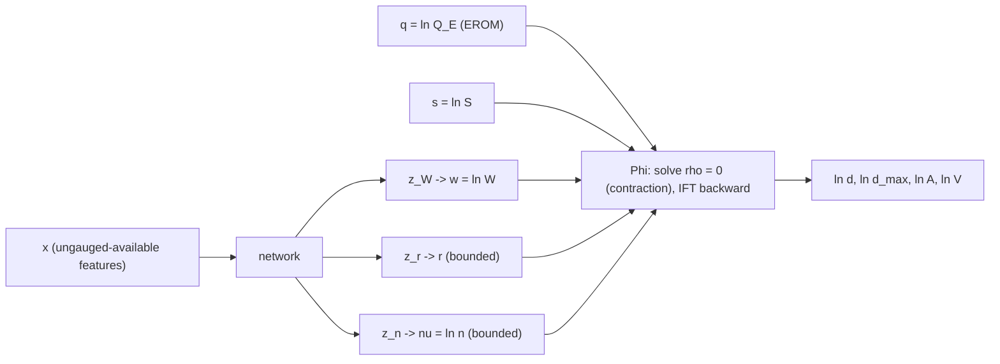

# Phase 2 Gate Deliverable: Mathematical Proofs and Algorithm Design for the Hard Manning–Continuity Layer

> **Project:** ANN_XS_Estimation, Option A (ADL-014). **Phase:** 2, Mathematical Proofing & Algorithm Design. The code-generation lock is ON, and this document contains no executable code.
> **Status:** Approved by the PI, 2026-10-08 (first gate version, `ffe2e5e`). Middle-prompt revision (second commit): §7.7.1 M4 penalty schedule; §3.5 batch action, unit equivariance and boundary differentiability of Φ; §1.1.2 supplementary notation and three symbol de-collisions ($\beta_N$, $\varrho$, $\Psi$); pandoc render check; verification log and register updated.
> **Decisions in force:**
> - **P2-D1 (a):** hand derivations, each re-derived by a second, independent route in this session, plus limiting cases, dimensional checks and labelled hand-computed examples.
> - **P2-D2 (a):** Markdown with GitHub math only.
> - **P2-D3 (a):** full $\kappa$ is the primary M5; $\kappa\equiv1$ is an ablation.
> - **P2-D4 (a):** $M$-member deep ensemble with heteroscedastic log-normal heads.
> - **P2-D5:** the PI deferred to the agent's recommendation and then confirmed it (2026-10-08). **S3 adopted** (§6); **M4 and M6 formalized** (§7.7–§7.8). S1 and S4 stay Phase 3 proposals; their status is only recorded here.
> **Inputs:**
> - `docs/0_point_zero.md` §3, §4, §7;
> - `docs/1_literature_matrix.md` §4, §6;
> - `docs/references.bib`;
> - `option_a_research_design.md` §3–§7. These are leads only; every equation is re-derived here.
> **Conventions:**
> - **Proposition / Theorem:** proven here.
> - **(A·):** an assumption, stated but not proven; each one is listed in §10.3.
> - **Standard result:** named, not re-proven.
> - Values marked *(prov.)* are the provisional values from `0_point_zero.md` §7. They appear **only in labelled examples**. This document fixes no project setting (see the register in §11).

**Contents.**
1. Notation, units and the unit map.
2. Power-law geometry, $P$ and $\kappa$.
3. The physics layer $\Phi$.
4. Invariants 1–7 and domain statements 8–9.
5. Error propagation and effective $n$.
6. Identifiability (S3) and expressivity.
7. Loss functions.
8. Gradient stability.
9. UQ and H1–H4 statistics.
10. Verification log.
11. Deferred to Phase 3.
12. References.

---

## 1. Notation, units and the unit map

### 1.1 Symbols (SI)

| Symbol | Meaning | SI unit | Role |
|---|---|---|---|
| $W$ | top width | m | M5 NN output; target |
| $\bar d$ | mean depth ($A/W$) | m | $\Phi$ output; target |
| $d_{\max}$ | maximum depth | m | $\Phi$ output; supervised via $t$ |
| $A$ | flow area | m² | $\Phi$ output; evaluated |
| $P$ | wetted perimeter | m | derived |
| $R$ | hydraulic radius $A/P$ | m | derived |
| $V$ | mean velocity $Q/A$ | m s⁻¹ | $\Phi$ output; diagnostic |
| $Q_E$ | NHDPlusV2.1 EROM mean annual flow (`QE_MA`) | m³ s⁻¹ | $\Phi$ input at **training and inference** (ADL-006) |
| $Q_{obs}$ | measured HYDROSWOT discharge | m³ s⁻¹ | oracle-Q diagnostic (§7.3) and M6-obs variant (§7.8) only |
| $S$ | NHDPlusV2.1 smoothed reach slope | – | $\Phi$ input |
| $S_{floor}$ | slope floor | – | domain bound (symbolic) |
| $n$ | effective Manning coefficient | $\mathrm{s\,m^{-1/3}}$ | M5 NN output (bounded) |
| $r$ | power-law shape exponent | – | M5 NN output (bounded) |
| $\kappa$ | conveyance correction $R/\bar d=W/P$ | – | derived |
| $a$ | $\bar d/W$ (inverse aspect ratio) | – | derived |
| $\delta$ | $d_{\max}/W$ | – | derived |
| $\beta$ | $2r\delta=2(r+1)a$ | – | derived |
| $F(\beta,r)$ | $P/W$ | – | derived |
| $\eta$ | $\partial\ln F/\partial\ln\beta$; $\varepsilon_\kappa\equiv-\eta$ | – | derived |
| $k$ | $\ln\kappa$ | – | derived |
| $w,\ \ell,\ \nu,\ q,\ s$ | $\ln W,\ \ln\bar d,\ \ln n,\ \ln Q,\ \ln S$ | – | log coordinates (see 1.1.1) |
| $t$ | $\ln(d_{\max}/\bar d)=\ln(1+1/r)$ | – | shape target ("log peakedness") |
| $\rho,\ D$ | Manning residual in $\ln Q$; $D=\partial\rho/\partial\ell$ | – | §3 |
| $z_W,z_r,z_n,z_\sigma$ | network pre-activations | – | §7.6, §9 |
| $n_{\min},n_{\max}$ | bounds on $n$; $\Delta_n=\ln(n_{\max}/n_{\min})$ | $\mathrm{s\,m^{-1/3}}$; – | symbolic |
| $r_{\min},r_{\max}$ | bounds on $r$; $\Delta_r=\ln(r_{\max}/r_{\min})$ | – | symbolic |
| $D_{50}$ | median bed grain size | m | M3, Strickler ablations, H4 |
| $c_S$ | Strickler coefficient | $\mathrm{s\,m^{-1/2}}$ | symbolic |
| $\mu,\ \sigma$ | log-space predictive mean and s.d. | – | §9 |
| $M,\ \alpha$ | ensemble size; interval level | – | symbolic |
| $w_k,\ \lambda_\bullet$ | loss weights | – | symbolic |
| $\omega_i$ | site-normalized observation weights | – | §7.0 |

**1.1.1 Log convention.** Before taking the log, every dimensional quantity is divided by its SI unit, so $w=\ln(W/1\,\mathrm{m})$ and so on. Every residual in this document is a difference of logs of *like* quantities. It is therefore dimensionless and invariant to the choice of units (Proposition 8.1).

**1.1.2 Supplementary symbols (by section).** Every symbol not in the table above. Unless a unit is given, the symbol is dimensionless.

| Symbol | Meaning | SI unit | § |
|---|---|---|---|
| $x$ | lateral coordinate in §2; elsewhere the feature vector | m (§2); – | 2; 6–7 |
| $y(x),\ h(x)$ | bed height above the thalweg; local depth | m | 2 |
| $u,\ \tau,\ v,\ p$ | integration variables; $p=2/r-2$ | – | 2 |
| $C_r$ | constant of Proposition 2.6 | – | 2 |
| $F_\beta,\ F_r,\ k_r$ | partial derivatives of $F$ and of $k$ ($k_r$ at fixed $a$) | – | 2–3 |
| $\ell_0,\ k_0,\ \ell_m$ | wide-channel start; $k$ there; $m$-th iterate | – | 3 |
| $G,\ L,\ L_{loc}$ | Picard map; contraction constant ($\le2/5$); local rate | – | 3.3 |
| $\tau_\ell,\ K_{\max},\ \tau_Q$ | solver tolerance (log units); iteration cap; quadrature tolerance | – | 3, P3-12 |
| $N,\ \boldsymbol Z,\ \boldsymbol Z_i$ | batch size (written $B$ in PHASE_02); batch input matrix; its $i$-th row | – | 3.5 |
| $\chi_L,\ \chi_T$ | factors by which numerical values of length and time scale under a change of units | – | 3.5 |
| $\mathcal D_{nat}$ | natural (open) domain of $\Phi$ | – | 3.5 |
| $u_{mach}$ | unit roundoff | – | 4 |
| $\delta_0$ | $\delta$ at the wide-channel depth | – | 4 |
| $\boldsymbol\theta,\ \boldsymbol\Sigma$ | in §5.1 only: input vector $(q,\nu,w,s,r)$ and its error covariance; elsewhere $\theta$ = network weights | – | 5.1 |
| $S_f,\ S_0,\ S_{ws},\ S_{reach}$ | friction, bed, water-surface and reach slopes | – | 5.2 |
| $n_{true},\ n_{eff},\ n'$ | true, effective and ablation-A1 roughness | $\mathrm{s\,m^{-1/3}}$ | 5.2, 7.10 |
| $\kappa_t,\ \kappa_m$ | true and model conveyance corrections | – | 5.2 |
| $\mathrm{Fr},\ \xi$ | Froude number; log slope noise | – | 5.2 |
| $\mathcal X$ | information available to the model at a site ($x$ with $q,s$) | – | 6 |
| $r_{obs},\ t_{obs},\ a_{obs},\ \nu_{obs}$ | observed shape quantities; back-calculated $\ln n$ (M6 label) | – | 6 |
| $m$ | in Proposition 6.3 only: $\nu-\tfrac23k$; elsewhere iterate or ensemble index | – | 6.3 |
| $\bar D$ | mean-value slope of $\rho$, $\in(1,5/3]$ | – | 6.4, 7.7.1 |
| $\mathcal I_{full},\ \mathcal I_{blind}$ | information routing for the $n$-head | – | 6.5 |
| $\mathcal B$ | attainable depth band | – | 6.5 |
| $\mathcal J_{tr},\ I_j,\ \mathcal K$ | training sites; observations at site $j$; target set | – | 7.0 |
| $e_{ik}$ | log residual | – | 7.0 |
| $\theta$ | network weights | – | 7–8 |
| $\mathbf Q,\ \epsilon_A$ | positive-definite weight matrix (Proposition 7.1; bold, not discharge); observed closure residual | – | 7.2 |
| $\hat\ell^{orc},\ e^{orc}_\ell,\ \Delta_Q$ | oracle-Q depth, its error, discharge term | – | 7.3 |
| $n_S,\ \nu_S$ | Strickler roughness and its log | $\mathrm{s\,m^{-1/3}}$; – | 7.5 |
| $\lambda_p,\ \tau_p,\ \lambda_\Delta,\ \Delta_\theta,\ \pi_S,\ \varpi$ | Strickler prior weight and scale; ridge weight; logit residual; prior position; clip margin | – | 7.5 |
| $R_M,\ R_A,\ \mathcal P$ | Manning and closure residuals; Manning penalty (calligraphic, distinct from the perimeter $P$) | – | 7.7 |
| $\nu_{back}$ | $\ln n$ back-calculated from predicted geometry | – | 7.7 |
| $\lambda_M,\ \lambda_A$ | penalty weights | – | 7.7 |
| $\mathcal F,\ \theta_\lambda,\ \theta_{\mathcal F},\ \theta_{\mathcal P}$ | feasible set; penalized, constrained and least-violation minimizers | – | 7.7 |
| $\mathsf e,\ \lambda_0,\ \gamma,\ \lambda_{\max},\ \mathsf e_{cap}$ | epoch index; schedule start, growth factor, cap; cap epoch | – | 7.7.1 |
| $\varsigma,\ N_b$ | gradient-descent step size; steps per epoch | – | 7.7.1 |
| $\Lambda_D,\ \Lambda_P,\ \Gamma_D,\ h_P$ | gradient-Lipschitz constants of $\mathcal L_{data}$ and $\mathcal P$; bound on $\lVert\nabla\mathcal L_{data}\rVert$; curvature floor of $\mathcal P$ | – | 7.7.1 |
| $\Delta_{\mathcal L},\ \varepsilon_{\mathsf e},\ \mathbf P_T,\ \Xi_{\mathsf e}$ | data-loss gap; inner-optimization error; tangent projector; penalty-to-data gradient ratio | – | 7.7.1 |
| $\hat g_\nu,\ \hat g_w,\ \hat g_t,\ \Pi$ | M6 regressors; projection onto the bounds | – | 7.8 |
| $n_{emp},\ n_J$ | M3 roughness; Jarrett roughness | $\mathrm{s\,m^{-1/3}}$ | 7.9 |
| $c_J,\ c_J',\ a_J,\ b_J,\ S_J,\ \bar r,\ \rho_J$ | Jarrett coefficient (source US units, mapped through $\mathcal U$; unit depends on $b_J$), its log-form constant, exponents, steep threshold, fixed shape, residual | – except $c_J$ | 7.9 |
| $\mathbf J,\ \boldsymbol\Omega,\ C_\Phi$ | in §8: Jacobian of $(w,\ell,t)$; data-weight matrix; gradient constant | – | 8 |
| $\ell_{NLL},\ \beta_N,\ \operatorname{sg}$ | per-point NLL; $\beta$-NLL exponent (renamed from $\beta$ to avoid the geometric $\beta$); stop-gradient | – | 8.5 |
| $\varrho,\ \bar\varrho,\ z_\varrho$ | correlation of $(\ln W,\ln\bar d)$, its cap, pre-activation (renamed from $\rho$ to avoid the Manning residual) | – | 8.5, 9.1 |
| $p^*,\ \mu^*,\ \sigma^*,\ \sigma_{ale},\ \sigma_{epi}$ | ensemble mixture and its moments | – | 9.2 |
| $\Psi,\ Q_p,\ z_p$ | mixture CDF (renamed from $G$ to avoid the Picard map); mixture quantile (log space, not discharge); standard-normal quantile | – | 9.3 |
| $\Phi_{\mathcal N},\ \varphi$ | standard-normal CDF and density | – | 9.3 |
| $d_m,\ \tilde v,\ \tilde m_3$ | standardized member offsets and their moments | – | 9.3 |
| $n^*,\ \bar\nu,\ \bar k$ | ensemble roughness; member means | $\mathrm{s\,m^{-1/3}}$; – | 9.3 |
| $\mathcal T,\ \tilde\omega_i,\ L_i,\ U_i$ | evaluation set; its weights; interval bounds (log space) | – | 9.4 |
| $\hat C_\alpha,\ \bar{\mathcal W}_\alpha,\ u_i,\ \mathcal Q_s,\ \mathcal A$ | coverage; mean log-width; PIT value; size quintile; folded-normal mean | – | 9.4 |
| $\mathrm{RMSE}_k,\ B_k,\ \mathrm M^*,\ B,\ \alpha_b$ | log-RMSE; log bias; strongest comparator; bootstrap replicates; CI level | – | 9.5 |
| $\Delta^{H1},\Delta^{H2},\Delta^{H3},\ L^{(\mathrm M)},\ \mathcal S,\ \mathcal T_{ID},\ \mathcal T_{OOD}$ | hypothesis statistics; skill loss; skill functional; ID and OOD sets | – | 9.5 |
| $\pi^\nu_\partial,\ \vartheta,\ \pi_{lit},\ \mathcal N_{lit},\ \rho_S$ | boundary-clustering share; its threshold; plausibility share; literature range; Spearman correlation | – | 9.5 |
| $F_S$ | slope-floor flag | – | 1.3 |

### 1.2 The unit map $\mathcal U$

The international foot gives, exactly, $\lambda_L = 0.3048\ \mathrm{m\,ft^{-1}}$. $\mathcal U$ is the diagonal positive scaling

| Source quantity | Source unit | Factor (exact) | SI unit |
|---|---|---|---|
| length ($W$, $\bar d$, $d_{\max}$) | ft | $\lambda_L=0.3048$ | m |
| area ($A$) | ft² | $\lambda_L^2=0.09290304$ | m² |
| velocity ($V$, `VE_MA`) | ft s⁻¹ | $\lambda_L=0.3048$ | m s⁻¹ |
| discharge ($Q_{obs}$, `QE_MA`) | ft³ s⁻¹ (cfs) | $\lambda_L^3=0.028316846592$ | m³ s⁻¹ |
| slope | ft/ft or m/m | 1 | – |
| $D_{50}$ | source unit confirmed in Phase 3 (e.g. mm) | e.g. $10^{-3}$ | m |

In log space, $\mathcal U$ is a translation: $\ln X_{SI}=\ln X_{src}+\ln\lambda_X$. $\mathcal U$ is defined **only on the admissible domain** (§1.3). Sentinels (for example, slope $=-9998$) are mapped to *missing* before $\mathcal U$ is applied, and are never scaled. HYDROSWOT and EROM field names are fixed in Phase 3.

**Proposition 1.1 (dimensional consistency of SI Manning).** With $[n]=\mathrm{s\,m^{-1/3}}$, the right-hand side of $Q=n^{-1}AR^{2/3}S^{1/2}$ has the dimension of $Q$, and the depth solution of §3 has the dimension of length.

*Proof.* Manning: $[n^{-1}][A][R]^{2/3}[S]^{1/2} = \mathrm{s^{-1}m^{1/3}}\cdot\mathrm{m^2}\cdot\mathrm{m^{2/3}}\cdot 1=\mathrm{m^3\,s^{-1}}$. Depth: $[Qn/(W\kappa^{2/3}S^{1/2})] = \mathrm{m^3s^{-1}}\cdot\mathrm{s\,m^{-1/3}}\cdot\mathrm{m^{-1}}=\mathrm{m^{5/3}}$, and raising to the power $3/5$ gives m. ∎

**Proposition 1.2 (US-unit factor; never used).** Suppose $Q,A,R$ are expressed in ft-based units while $n$ keeps its SI numeric value. Then Manning becomes $Q=k_{US}\,n^{-1}AR^{2/3}S^{1/2}$ with $k_{US}=\lambda_L^{-1/3}\approx1.4859$. Omitting $k_{US}$ inflates $\bar d$ by the factor $k_{US}^{3/5}\approx1.268$.

*Proof.* Substitute $Q_m=\lambda_L^3Q_{ft}$, $A_m=\lambda_L^2A_{ft}$ and $R_m=\lambda_LR_{ft}$ into SI Manning. This gives $Q_{ft}=\lambda_L^{2+2/3-3}n^{-1}A_{ft}R_{ft}^{2/3}S^{1/2}=\lambda_L^{-1/3}n^{-1}\cdots$. Solving the US form for $\bar d$ gives $\bar d\propto k_{US}^{-3/5}$, so dropping $k_{US}$ multiplies $\bar d$ by $k_{US}^{3/5}$. The numeric values are in §10.2, E5. ∎

**Proposition 1.3 (commutation; a Phase 7 test).** Let $\Phi_{US}$ denote $\Phi$ evaluated in ft-based units with the factor $k_{US}$. Then $\Phi_{SI}\circ\mathcal U=\mathcal U\circ\Phi_{US}$.

*Proof.* By Proposition 1.2, the two Manning forms are the same equation written in different units. The closure relations $A=W\bar d$, $V=Q/A$ and $d_{\max}=\bar d(1+1/r)$ are homogeneous of matching degree, so they commute with any consistent scaling. ∎

This project evaluates $\Phi$ in SI only. The US form appears here only to define the test in Proposition 1.3.

### 1.3 Admissible domain

$$
\mathcal D=\Bigl\{(W,r,n,Q_E,S):\ W>0,\ \ r\in[r_{\min},r_{\max}],\ \ n\in[n_{\min},n_{\max}],\ \ Q_E>0,\ \ S\ge S_{floor}\Bigr\},
$$

with $0<r_{\min}<r_{\max}<\infty$, $0<n_{\min}<n_{\max}<\infty$ and $S_{floor}>0$. *(prov.)* $n\in[0.015,0.25]$, $r\in[0.5,10]$, $S_{floor}=10^{-5}$.

- A slope of $-9998$ means missing. The reach is $\notin\mathcal D$; it gets a QC flag and is **never imputed**.
- A slope with $S=S_{floor}$ is $\in\mathcal D$ but gets the flag $F_S$. **(A1.1)** A recorded floor value means only that the computed slope was $\le S_{floor}$; this is to be confirmed against the NHDPlusV2 user guide in Phase 3.
- $Q_E\le0$ or missing gives $\notin\mathcal D$ and a QC flag (rule in Phase 3).
- $(W,r,n)$ come from the network and lie in $\mathcal D$ by construction (§7.6). $(Q_E,S)$ are data.

---

## 2. Power-law geometry, wetted perimeter and $\kappa$

The bed is $y(x)=d_{\max}\lvert 2x/W\rvert^{r}$ for $\lvert x\rvert\le W/2$ and $r>0$. The free surface is at $y=d_{\max}$, so the local depth is $h(x)=d_{\max}-y(x)\ge0$.

**Proposition 2.1 (mean depth, area, inverse).**

$$
\bar d=d_{\max}\frac{r}{r+1},\qquad A=W\bar d,\qquad r=\frac{\bar d}{d_{\max}-\bar d}\ \ (d_{\max}>\bar d),\qquad t\equiv\ln\frac{d_{\max}}{\bar d}=\ln\!\Bigl(1+\frac1r\Bigr).
$$

*Proof, route 1.* By symmetry, and with $u=2x/W$:

$$
A=2\int_0^{W/2}\!h\,dx=W d_{\max}\!\int_0^1(1-u^r)\,du=Wd_{\max}\frac{r}{r+1}.
$$

Then $\bar d\equiv A/W$.

*Route 2.* $\bar d=d_{\max}-\overline{y}$ with $\overline y=d_{\max}\int_0^1u^r\,du=d_{\max}/(r+1)$.

The inverse follows because $r\mapsto r/(r+1)$ is a strictly increasing bijection from $(0,\infty)$ onto $(0,1)$. ∎

**Proposition 2.2 (wetted perimeter).**

$$
P=W\,F(\beta,r),\qquad F(\beta,r)=\int_0^1\sqrt{1+\beta^2u^{2r-2}}\,du,\qquad \beta=2r\delta=2(r+1)a,\qquad \kappa=\frac{W}{P}=\frac1F .
$$

$F$ is finite for every $r>0$.

*Proof.* The arc length is $P=2\int_0^{W/2}\sqrt{1+y'(x)^2}\,dx$, with $y'(x)=(2rd_{\max}/W)(2x/W)^{r-1}$ for $x>0$. Substituting $u=2x/W$ gives the stated form. Since $\delta=a(r+1)/r$, it follows that $\beta=2(r+1)a$. Finiteness: $\sqrt{1+\beta^2u^{2r-2}}\le1+\beta u^{r-1}$, and $\int_0^1u^{r-1}du=1/r<\infty$. Finally, $\kappa=R/\bar d=(A/P)/(A/W)=W/P$. ∎

**Proposition 2.3 ($\kappa$ bounds).** For $\beta>0$, $1<F<1+2\delta$. Equivalently,

$$
W<P<W+2d_{\max},\qquad \frac{W}{W+2d_{\max}}<\kappa<1 .
$$

*Proof, route 1 (analytic).* For $s\ge0$, $1\le\sqrt{1+s}\le1+\sqrt s$, with both inequalities strict when $s>0$. Take $s=\beta^2u^{2r-2}$ and integrate: $1<F<1+\beta/r=1+2\delta$.

*Route 2 (geometric).* Each half-branch is the graph of a monotone function rising $d_{\max}$ over a run of $W/2$. Its length lies strictly between the run and run + rise, because $ds^2=dx^2+dy^2$ gives $dx\le ds\le dx+dy$, with equality only on degenerate pieces. ∎

The bounds are sharp. The upper bound $\kappa\to1$ is approached as $\delta\to0$ (Proposition 2.6). The lower bound is approached in the rectangular limit (Proposition 2.4c).

**Proposition 2.4 (closed and limiting forms).**
- (a) $r=1$ (triangle): $F=\sqrt{1+\beta^2}$ with $\beta=2\delta$, so $P=\sqrt{W^2+4d_{\max}^2}$.
- (b) $r=2$ (parabola): $F=\tfrac12\bigl[\sqrt{1+\beta^2}+\beta^{-1}\operatorname{arsinh}\beta\bigr]$ with $\beta=4\delta$.
- (c) $r\to\infty$ at fixed $\delta$ (rectangle): $F\to1+2\delta$, $\bar d\to d_{\max}$ and $\kappa\to W/(W+2d_{\max})$.
- (d) $r=\tfrac12$: $F=\sqrt{1+\beta^2}+\beta^2\operatorname{arsinh}(1/\beta)$ with $\beta=\delta$.

*Proof.*
- (a) The integrand is constant.
- (b) Use the antiderivative $\int\sqrt{1+\beta^2u^2}\,du=\tfrac u2\sqrt{1+\beta^2u^2}+\tfrac1{2\beta}\operatorname{arsinh}(\beta u)$.
- (c) The upper bound comes from Proposition 2.3. For the lower bound, fix $\varepsilon\in(0,1)$. On $[0,1-\varepsilon]$ the integrand is $\ge1$. On $[1-\varepsilon,1]$ it is $\ge\beta u^{r-1}$, which integrates to $(\beta/r)\bigl(1-(1-\varepsilon)^r\bigr)=2\delta\bigl(1-(1-\varepsilon)^r\bigr)\to2\delta$. So $\liminf F\ge1-\varepsilon+2\delta$ for every $\varepsilon$.
- (d) Substitute $u=\tau^2$: $F=2\int_0^1\sqrt{\tau^2+\beta^2}\,d\tau$, then use the standard antiderivative. ∎

**Proposition 2.5 ($r<1$: integrable singularity and a regular substitution).** For $r<1$, the integrand of Proposition 2.2 behaves like $\beta u^{r-1}$ as $u\to0$: it is unbounded but integrable. The substitution $u=\tau^{1/r}$, which parameterizes the bank by depth, gives

$$
F(\beta,r)=\frac1r\int_0^1\sqrt{\tau^{\,2(1-r)/r}+\beta^2}\;d\tau ,
$$

whose integrand is continuous and bounded by $r^{-1}\sqrt{1+\beta^2}$ on $[0,1]$ for $r\le1$.

*Proof.* $du=r^{-1}\tau^{1/r-1}d\tau$ and $u^{r-1}=\tau^{1-1/r}$. Then

$$
\sqrt{1+\beta^2\tau^{2-2/r}}\;\tau^{1/r-1}=\sqrt{\tau^{2/r-2}+\beta^2\tau^{0}} .
$$

For $r\le1$ the exponent $2/r-2\ge0$. ∎

*Quadrature rule (specified; numerics in Phase 3/4).* Use the $u$-form for $r\ge1$ and the $\tau$-form for $r<1$. Both integrands are bounded and continuous, and they coincide at $r=1$.
- **Regularity.** An integrand is $C^0$ but not $C^1$ at the endpoint 0 when its exponent lies in $(0,1)$. That happens for the $u$-form with $1<r<3/2$ and for the $\tau$-form with $2/3<r<1$. Plain Gauss–Legendre then converges only algebraically.
- **Recommended rule.** An endpoint-adapted rule (Gauss–Jacobi or double-exponential), with tolerance $\tau_Q$.
- **Acceptance test.** Agreement with the closed forms of Proposition 2.4(a, b, d) and with the limit (c).
- **Seam at $r=1$.** The two branches compute the same $F$, so any jump at $r=1$ equals the quadrature error and must be $<\tau_Q$.

In the $\tau$-form the parameter derivatives are

$$
F_\beta=\frac1r\int_0^1\frac{\beta\,d\tau}{\sqrt{\tau^{p}+\beta^2}},
\qquad
F_r\big|_\beta=-\frac{F}{r}-\frac1{r^3}\int_0^1\frac{\tau^{p}\ln\tau}{\sqrt{\tau^p+\beta^2}}\,d\tau,
\qquad p=\tfrac2r-2 .
$$

Both integrands are bounded for $p>0$, because $\tau^p\ln\tau\to0$.

**Proposition 2.6 (wide-channel limit, with rate).** Fix $r$ and let $a=\bar d/W\to0$. Then $\kappa\to1$, with

$$
1-\kappa\ \sim\
\begin{cases}
\dfrac{2(r+1)^2}{2r-1}\,a^2, & r>\tfrac12,\\[2mm]
9a^2\ln\dfrac1{3a}, & r=\tfrac12,\\[2mm]
C_r\,\bigl(2(r+1)a\bigr)^{1/(1-r)},\quad C_r=\displaystyle\int_0^\infty\!\bigl(\sqrt{1+v^{2r-2}}-1\bigr)dv<\infty, & 0<r<\tfrac12 .
\end{cases}
$$

Uniformly in $r$, $0<1-\kappa<2\delta/(1+2\delta)<2\delta$.

*Proof.* Write $1-\kappa=(F-1)/F$, where $F-1=\int_0^1(\sqrt{1+\beta^2g}-1)\,du$ and $g=u^{2r-2}$.
- **$r>1/2$.** $(\sqrt{1+\beta^2g}-1)/\beta^2\to g/2$, and it is dominated by $g/2$, which is integrable iff $2r-2>-1$. By dominated convergence, $F-1\sim\beta^2/(2(2r-1))$. Substitute $\beta=2(r+1)a$.
- **$r=1/2$.** Expand Proposition 2.4(d): $\beta^2\operatorname{arsinh}(1/\beta)=\beta^2\ln(2/\beta)+O(\beta^4)$. This gives $F-1=\beta^2\ln(1/\beta)+O(\beta^2)$ with $\beta=3a$.
- **$r<1/2$.** Substitute $u=\beta^{1/(1-r)}v$, so that $\beta^2u^{2r-2}=v^{2r-2}$. Then $F-1=\beta^{1/(1-r)}\int_0^{\beta^{-1/(1-r)}}(\sqrt{1+v^{2r-2}}-1)\,dv$. The integrand behaves like $v^{r-1}$ at 0 and like $v^{2r-2}/2$ at $\infty$, so it is integrable on $(0,\infty)$ iff $r<1/2$.
- **Uniform bound.** It follows from Proposition 2.3. ∎

*Remark 2.6a (the extremum at $r=2$).* At fixed $(W,\bar d)$ and leading order in $a$, the function $(r+1)^2/(2r-1)$ is minimized at $r=2$ (value 3). So $\kappa(r)$ is **maximal at $r=2$ and not injective in $r$**. This is used in §6.

**Proposition 2.7 ($\varepsilon_\kappa\in(-1,0]$).** Let $s(u)=\beta^2u^{2r-2}$ and $\eta\equiv\partial\ln F/\partial\ln\beta$. Then

$$
\eta=1-\frac1F\int_0^1\frac{du}{\sqrt{1+s}}\in[0,1),\qquad
\varepsilon_\kappa\equiv\frac{\partial\ln\kappa}{\partial\ln\bar d}\Big|_{W,r}=-\eta\in(-1,0].
$$

For $a>0$ the inclusion is strict, $\eta\in(0,1)$. The supremum $\eta\to1$ is approached only as $a\to\infty$; for example, $\eta=\beta^2/(1+\beta^2)$ at $r=1$.

*Proof, route 1.* $\beta F_\beta=\int s/\sqrt{1+s}\,du=\int\bigl(\sqrt{1+s}-1/\sqrt{1+s}\bigr)du=F-\int(1+s)^{-1/2}du$. The last integral is positive (so $\eta<1$) and at most $1\le F$ (so $\eta\ge0$).

*Route 2.* $F/\beta=\int\sqrt{\beta^{-2}+u^{2r-2}}\,du$ is strictly decreasing in $\beta$, so $\partial\ln F/\partial\ln\beta<1$. $F$ is nondecreasing in $\beta$, so $\eta\ge0$.

Since $\beta\propto a\propto\bar d$ at fixed $(W,r)$, $\partial\ln\kappa/\partial\ln\bar d=-\partial\ln F/\partial\ln\beta$. ∎

**Proposition 2.8 (bounded parameter derivatives of $F$ and $k=\ln\kappa$).** For all $r>0$ and $\beta\ge0$:

$$
0\le F_\beta\le\frac1r,\qquad \lvert F_r\rvert_\beta\le\frac{\beta}{r^2},\qquad
\Bigl\lvert\frac{\partial k}{\partial r}\Big|_{a}\Bigr\rvert\le\min\Bigl\{\frac{2a(2r+1)}{r^2},\ \frac{2r+1}{r(r+1)}\Bigr\}.
$$

In $(\delta,r)$ coordinates, $\lvert\partial\kappa/\partial\delta\rvert\le2$ and $\lvert\partial\kappa/\partial r\rvert_\delta\le2/r$.

*Proof.* Differentiating under the integral (Leibniz rule; justified below):
- $F_\beta=\int\beta u^{2r-2}(1+s)^{-1/2}du=\int u^{r-1}\sqrt{s/(1+s)}\,du\le\int u^{r-1}du=1/r$.
- $F_r=\int\ln u\cdot s(1+s)^{-1/2}du$, so $\lvert F_r\rvert\le\int\lvert\ln u\rvert\sqrt s\,du=\beta\int_0^1\lvert\ln u\rvert u^{r-1}du=\beta/r^2$.
- $k_r\equiv\partial k/\partial r|_a=-(2aF_\beta+F_r)/F$, using $\partial\beta/\partial r|_a=2a$. Hence $\lvert k_r\rvert\le(2a/r+\beta/r^2)/F$.
  - Using $F\ge1$ gives the first bound.
  - Using $F\ge\int\sqrt s=\beta/r$ gives $\lvert k_r\rvert\le 2a/\beta+1/r=1/(r+1)+1/r$, which is the second bound and holds **uniformly in $a$**.
- $\kappa=1/F(2r\delta,r)$:
  - $\lvert\partial\kappa/\partial\delta\rvert=\kappa^2\cdot2rF_\beta\le2$;
  - $\lvert\partial\kappa/\partial r\rvert_\delta=\kappa^2\lvert2\delta F_\beta+F_r\rvert\le\kappa^2\,4\delta/r$, with $\kappa\le\min\{1,1/(2\delta)\}$, so $\le\min\{4\delta,1/\delta\}/r\le2/r$.

*Justification of the Leibniz rule.* On compact $(r,\beta)$-sets with $r\ge r_{\min}>0$, the integrands and their parameter derivatives are dominated by $C\,u^{r_{\min}-1}(1+\lvert\ln u\rvert)$, which is integrable. Dominated convergence applies (standard result). ∎

---

## 3. The physics layer $\Phi$

### 3.1 Definition

Per reach, with no coupling between reaches:

$$
\Phi:\ (z_W,z_r,z_n;\,q,s)\ \longmapsto\ (\ell,\ \ln d_{\max},\ \ln A,\ \ln V),
$$

$$
w=z_W,\quad r=r(z_r),\quad \nu=\nu(z_n)\ \ (\text{§7.6}),\quad \ell=\ell^*(w,r,\nu;q,s),\quad
\ln d_{\max}=\ell+t(r),\quad \ln A=w+\ell,\quad \ln V=q-w-\ell .
$$

Substituting $A=W\bar d$ and $R=\kappa\bar d$ into Manning and taking logs defines the **Manning residual** (in $\ln Q$):

$$
\rho(\ell;w,r,\nu,q,s)=\tfrac53\,\ell+\tfrac23\,k\bigl(e^{\ell-w},r\bigr)+w+\tfrac12 s-\nu-q\;=\;\ln Q_{\text{Manning}}-\ln Q_E .
\tag{3.1}
$$

$\ell^*$ is the root of $\rho$. Equivalently, it is the fixed point of

$$
\bar d=\Bigl(\frac{Q_E\,n}{W\,\kappa(\bar d)^{2/3}S^{1/2}}\Bigr)^{3/5}.
\tag{3.2}
$$



### 3.2 Wide-channel closed form (ablation A1)

With $\kappa\equiv1$, $k\equiv0$, so

$$
\ell_0=\tfrac35\bigl(q+\nu-w-\tfrac12 s\bigr)\iff \bar d=\Bigl(\frac{Q_En}{WS^{1/2}}\Bigr)^{3/5}.
$$

### 3.3 Existence, uniqueness and convergence (full $\kappa$, primary per P2-D3)

**Proposition 3.1 (existence and uniqueness).** For every point of $\mathcal D$, $\rho(\cdot)$ has exactly one root $\ell^*$, and

$$
D\equiv\frac{\partial\rho}{\partial\ell}=\tfrac53-\tfrac23\,\eta\ \in\ \bigl(1,\tfrac53\bigr].
$$

*Proof.* $\partial k/\partial\ell=\partial\ln\kappa/\partial\ln a=-\eta$, and Proposition 2.7 gives $\eta\in[0,1)$, hence $D>1$. Then $\rho(\ell)\ge\rho(0)+\ell$ for $\ell>0$ and $\rho(\ell)\le\rho(0)+\ell$ for $\ell<0$, so $\rho\to\pm\infty$. $\rho$ is continuous (Proposition 2.8), so the intermediate value theorem gives a root, and strict monotonicity makes it unique. ∎

Note that only $\eta<1$ is used. Existence and uniqueness therefore hold for **all** $r>0$ and all aspect ratios; the bounds on $n$ and $r$ matter only for gradients (§8) and for H4.

**Proposition 3.2 (a priori bracket, contraction, monotone iterates).** Let $k_0=k(e^{\ell_0-w},r)\le0$. Then:
1. **Bracket:** $\ell_0+\tfrac25\lvert k_0\rvert\ \le\ \ell^*\ \le\ \ell_0+\tfrac23\lvert k_0\rvert$. In particular, $\bar d^*\ge\bar d_{\kappa=1}$.
2. **Contraction:** the Picard map $G(\ell)=\ell_0-\tfrac25k(e^{\ell-w},r)$, which is (3.2) in logs, has $G'(\ell)=\tfrac25\eta\in[0,\tfrac25)$. $G$ is a global contraction with $L\le2/5$, and its unique fixed point is $\ell^*$ (Banach fixed-point theorem, standard result).
3. **Error bounds:**
   - a priori: $\lvert\ell_m-\ell^*\rvert\le L^m\lvert\ell_0-\ell^*\rvert$;
   - a posteriori: $\lvert\ell_m-\ell^*\rvert\le\tfrac{L}{1-L}\lvert\ell_m-\ell_{m-1}\rvert\le\tfrac23\lvert\ell_m-\ell_{m-1}\rvert$.
4. **Monotone iterates:** starting from $\ell_0$, $\ell_0\le\ell_1\le\dots\le\ell^*$.

*Proof.*
1. $\rho(\ell_0)=\tfrac23k_0\le0$. Since $1<D\le5/3$, $\rho(\ell_0+x)\ge\rho(\ell_0)+x$ and $\rho(\ell_0+x)\le\rho(\ell_0)+\tfrac53x$ for $x\ge0$. Setting each bound to zero brackets the root.
2. Differentiate $G$, using $\partial k/\partial\ell=-\eta$.
3. Banach's estimates with $L\le2/5$.
4. $G$ is nondecreasing and $G(\ell_0)\ge\ell_0$. By induction, $\ell_{m+1}=G(\ell_m)\ge G(\ell_{m-1})=\ell_m$, and $\ell_m\le\ell^*\Rightarrow\ell_{m+1}=G(\ell_m)\le G(\ell^*)=\ell^*$. ∎

*Stopping rule.* Stop when $\lvert\ell_m-\ell_{m-1}\rvert\le\tfrac32\tau_\ell$; this guarantees $\lvert\ell_m-\ell^*\rvert\le\tau_\ell$. The local rate is $L_{loc}=\tfrac25\eta(\ell^*)$, which is small for wide channels: 0.006 in E1 and 0.058 in E2 (§10.2). $\tau_\ell$ and $K_{\max}$ are set in Phase 3.

### 3.4 Implicit-function gradients (no unrolling)

**Proposition 3.3.** $\ell^*$ is $C^1$ in $(w,r,\nu,q,s)$, with

$$
\frac{\partial\ell^*}{\partial q}=\frac{\partial\ell^*}{\partial\nu}=\frac1D=\frac{3/5}{1+\tfrac25\varepsilon_\kappa},\qquad
\frac{\partial\ell^*}{\partial s}=-\frac1{2D},\qquad
\frac{\partial\ell^*}{\partial w}=-\frac{1+\tfrac23\eta}{D},\qquad
\frac{\partial\ell^*}{\partial r}=-\frac{\tfrac23\,k_r}{D}.
$$

The ranges are $1/D\in[\tfrac35,1)$, $\partial\ell^*/\partial w\in(-\tfrac53,-\tfrac35]$ and $\lvert\partial\ell^*/\partial s\rvert\in[\tfrac3{10},\tfrac12)$.

*Proof.* $\rho$ is $C^1$ (Proposition 2.8) and $\partial\rho/\partial\ell=D\ge1\neq0$. The implicit function theorem (standard result) gives $\partial\ell^*/\partial\theta=-\rho_\theta/D$, with:
- $\rho_q=\rho_\nu=-1$;
- $\rho_s=\tfrac12$;
- $\rho_w=1+\tfrac23\eta$, since $\partial k/\partial w=+\eta$;
- $\rho_r=\tfrac23k_r$.

*Second route.* Differentiate the fixed point: $\ell^*=G(\ell^*;q,\dots)$ gives $d\ell^*/dq=\tfrac35+\tfrac25\eta\,d\ell^*/dq$, so $d\ell^*/dq=\tfrac35/(1-\tfrac25\eta)=1/D$. ∎

Derived outputs:
- $\partial\ln d_{\max}/\partial r=\partial\ell^*/\partial r+t'(r)$, with $t'(r)=-1/(r(r+1))$;
- $\partial\ln A/\partial w=(2-4\eta)/(5-2\eta)$;
- $\partial\ln V/\partial q=1-1/D=(2-2\eta)/(5-2\eta)\in(0,\tfrac25]$.

*Algorithm $\Phi$ (language-agnostic, math notation; not code).*

```text
Input  (w, r, ν, q, s) ∈ 𝒟 ;  tolerance τ_ℓ ;  cap K_max
Forward
  ℓ_0 ← (3/5)(q + ν − w − s/2)                          ▷ wide-channel start (lower bound)
  for m = 1 … K_max:
      a ← exp(ℓ_{m−1} − w) ;  β ← 2(r+1)a
      F ← Quad_F(β, r)                                   ▷ u-form if r ≥ 1, τ-form if r < 1
      ℓ_m ← ℓ_0 + (2/5) ln F
      if |ℓ_m − ℓ_{m−1}| ≤ (3/2)τ_ℓ : stop               ▷ guarantees |ℓ_m − ℓ*| ≤ τ_ℓ
  outputs: ℓ, ℓ + ln(1 + 1/r), w + ℓ, q − w − ℓ
Backward (iterates are treated as constants; no gradient through the loop)
  F_β, F_r ← Quad(β, r) at the converged ℓ
  η ← β F_β / F ;  k_r ← −(2a F_β + F_r)/F ;  D ← 5/3 − (2/3)η
  ∂ℓ/∂q = ∂ℓ/∂ν = 1/D ;  ∂ℓ/∂s = −1/(2D) ;  ∂ℓ/∂w = −(1 + 2η/3)/D ;  ∂ℓ/∂r = −(2/3)k_r/D
```

**(A3.1)** The second derivatives of $k$ are bounded on compact subsets of $\mathcal D$; this is plausible by the same domination as in Proposition 2.8, but not proven here. It implies that the gradient error from evaluating the implicit-function gradient at an unconverged root is $O(\tau_\ell)$. Phase 7 checks it by finite differences.

### 3.5 Batch action, dimension preservation and boundary behavior

For a batch of $N$ reaches, stack the inputs row by row:

$$
\boldsymbol\Phi_N:\ \mathbb R^{N\times5}\to\mathbb R^{N\times4},\qquad
\boldsymbol Z=\begin{pmatrix}\boldsymbol Z_1\\ \vdots\\ \boldsymbol Z_N\end{pmatrix},\quad
\boldsymbol Z_i=(z_{W,i},z_{r,i},z_{n,i},q_i,s_i)\ \longmapsto\ \begin{pmatrix}\Phi(\boldsymbol Z_1)\\ \vdots\\ \Phi(\boldsymbol Z_N)\end{pmatrix},
$$

with $\Phi(\boldsymbol Z_i)=(\ell_i,\ln d_{\max,i},\ln A_i,\ln V_i)$ as in §3.1. PHASE_02 writes the batch size as $B$; $N$ is used here because $B$ already denotes the bootstrap count and $B_k$ the log bias (§9.5).

**Proposition 3.4 (row-wise action; no coupling between reaches).**
- (a) $\boldsymbol\Phi_N(\boldsymbol Z)_i=\Phi(\boldsymbol Z_i)$. Hence $\boldsymbol\Phi_N(\Pi\boldsymbol Z)=\Pi\,\boldsymbol\Phi_N(\boldsymbol Z)$ for every permutation matrix $\Pi$, and $\boldsymbol\Phi_{\lvert\mathcal S\rvert}(\boldsymbol Z_{\mathcal S})=\boldsymbol\Phi_N(\boldsymbol Z)_{\mathcal S}$ for every row subset $\mathcal S$. The outputs do not depend on batch size, composition or order.
- (b) The Jacobian is block-diagonal: $\partial\boldsymbol\Phi_N(\boldsymbol Z)_i/\partial\boldsymbol Z_j=\mathbf 0$ for $i\neq j$. For any loss $\sum_i\mathcal L_i(\boldsymbol\Phi_N(\boldsymbol Z)_i)$, therefore, $\partial\mathcal L_i/\partial\boldsymbol Z_j=0$ for $i\ne j$. Neither values nor gradients pass between reaches through $\Phi$. Information is shared across sites only through the network weights $\theta$, and fold-separated training confines that sharing to the training fold.
- (c) **Solver caveat.** (a) and (b) hold exactly for the root $\ell^*$. For the computed iterate, they hold exactly if the stopping rule of §3.3 is applied **per row** (each row is frozen once it meets its own criterion) or a fixed iteration count is used. Under a batch-global rule ("iterate until every row has converged"), the iteration count of row $i$ depends on the other rows. That dependence is at most $\tau_\ell$ in every output coordinate.

*Proof.*
- (a) The transforms (§7.6) and (3.1)–(3.2) involve only the quantities of row $i$, and the root is unique (Proposition 3.1), so $\Phi(\boldsymbol Z_i)$ is a function of $\boldsymbol Z_i$ alone. A row-wise map commutes with permutations and row selections.
- (b) *Route 1:* by (a), output $i$ does not depend on $\boldsymbol Z_j$. *Route 2 (implicit function theorem on the stacked system):* $\boldsymbol\rho_N(\ell_1,\dots,\ell_N;\boldsymbol Z)=\bigl(\rho(\ell_1;\boldsymbol Z_1),\dots,\rho(\ell_N;\boldsymbol Z_N)\bigr)$ has $\partial\boldsymbol\rho_N/\partial\boldsymbol\ell=\operatorname{diag}(D_1,\dots,D_N)$, which is invertible because $D_i>1$, and $\partial\boldsymbol\rho_N/\partial\boldsymbol Z$ is block-diagonal. The implicit Jacobian $-(\partial\boldsymbol\rho_N/\partial\boldsymbol\ell)^{-1}\partial\boldsymbol\rho_N/\partial\boldsymbol Z$ is therefore block-diagonal.
- (c) With per-row freezing, the iterate sequence of row $i$ depends on $\boldsymbol Z_i$ only. Under a global rule, row $i$ stops at some $m\ge m_i$, where $m_i$ is its own stopping index. Proposition 3.2(4) gives $\ell_{m_i,i}\le\ell_{m,i}\le\ell^*_i$, and the stopping rule gives $\ell^*_i-\ell_{m_i,i}\le\tau_\ell$. The other outputs equal $\ell$ plus row-local terms. ∎

*Scope.* The guarantee covers $\Phi$ only. A batch-coupled layer upstream, such as batch normalization in training mode, would couple the rows of $\mathbf z$. Excluding such layers, or using them only in inference mode, is an architecture decision (P3-17).

**Proposition 3.5 (dimension preservation: equivariance under a change of units).** Change the length and time units so that the numerical values of lengths are multiplied by $\chi_L>0$ and those of times by $\chi_T>0$. Since $[n]=\mathrm{T\,L^{-1/3}}$ and $[Q]=\mathrm{L^3T^{-1}}$, the inputs shift by

$$
w\mapsto w+\ln\chi_L,\qquad \nu\mapsto\nu-\tfrac13\ln\chi_L+\ln\chi_T,\qquad q\mapsto q+3\ln\chi_L-\ln\chi_T,\qquad s\mapsto s,\qquad r\mapsto r .
$$

Then

$$
\ell^*\mapsto\ell^*+\ln\chi_L,\qquad \ln d_{\max}\mapsto\ln d_{\max}+\ln\chi_L,\qquad \ln A\mapsto\ln A+2\ln\chi_L,\qquad \ln V\mapsto\ln V+\ln\chi_L-\ln\chi_T,
$$

while $a,\beta,F,\kappa,\eta,k,t$ and $D$ are invariant. Each output therefore transforms exactly as the log of a quantity with its SI dimension ($\mathrm L$, $\mathrm L$, $\mathrm L^2$, $\mathrm{L\,T^{-1}}$), so $\Phi$ maps $\mathcal U$-scaled inputs to $\mathcal U$-scaled outputs. Proposition 1.3 is the special case $\chi_L=1/\lambda_L$, $\chi_T=1$.

*Proof, route 1 (invariance of the residual).* Substitute the shifts and $\ell\mapsto\ell+\ln\chi_L$ into (3.1). Since $a=e^{\ell-w}$ is unchanged, so is $k$. The other terms change by

$$
\bigl(\tfrac53+1+\tfrac13-3\bigr)\ln\chi_L+\bigl(-1+1\bigr)\ln\chi_T=0 .
$$

The shifted $\ell^*$ is therefore a root of the shifted residual, and by uniqueness (Proposition 3.1) it is *the* root. The other outputs follow from their definitions in §3.1.

*Route 2 (dimensional analysis of (3.2)).* By Proposition 1.1, the bracket in (3.2) has dimension $\mathrm m^{5/3}$ and $\kappa$ is dimensionless, so $\bar d$ is a length. $A=W\bar d$ and $V=Q_E/A$ follow. ∎

*Bounds.* $\nu_{\min}$ and $\nu_{\max}$ shift with $\nu$, while $\Delta_n$ is invariant. The transform of §7.6 is therefore unit-consistent provided the bounds are expressed in the same unit system as $\nu$ (SI throughout; D8).

**Proposition 3.6 (well defined and $C^1$ at every boundary of $\mathcal D$).** Let $\mathcal D_{nat}=\{W>0,\ r>0,\ \nu\in\mathbb R,\ Q_E>0,\ S>0\}$. This is an open set containing the closure of $\mathcal D$ in $(r,\nu,S)$. $\Phi$ is well defined and $C^1$ on $\mathcal D_{nat}$, with the partial derivatives of Proposition 3.3 and the uniform bounds

$$
\Bigl\lvert\frac{\partial\ell^*}{\partial q}\Bigr\rvert=\Bigl\lvert\frac{\partial\ell^*}{\partial\nu}\Bigr\rvert<1,\qquad
\Bigl\lvert\frac{\partial\ell^*}{\partial s}\Bigr\rvert<\tfrac12,\qquad
\Bigl\lvert\frac{\partial\ell^*}{\partial w}\Bigr\rvert<\tfrac53,\qquad
\Bigl\lvert\frac{\partial\ell^*}{\partial r}\Bigr\rvert\le\frac{2(2r+1)}{3r(r+1)} .
$$

At each boundary named in PHASE_02:

| Boundary | Status of $\Phi$ | Gradient |
|---|---|---|
| $S=S_{floor}$ | Interior point of $\mathcal D_{nat}$; $\rho$ is affine in $s$. The floor restricts the *data* domain; it is not a singularity of $\Phi$ | $\partial\ell^*/\partial s=-1/(2D)\in(-\tfrac12,-\tfrac3{10}]$. $s$ is data, so no parameter gradient passes through it. Depth finite by D9 |
| $\nu\in\{\nu_{\min},\nu_{\max}\}$ | Interior point of $\mathcal D_{nat}$ ($\rho$ is affine in $\nu$, and every $\nu\in\mathbb R$ is admissible). Not attained in exact arithmetic (invariant 7). If $\sigma(z_n)$ rounds to 0 or 1, $\Phi$ is still defined | $\partial\ell^*/\partial\nu=1/D\in[\tfrac35,1)$ is finite. The transform factor $d\nu/dz_n\to0$, so the chain-rule gradient **vanishes**; it is never undefined (§7.6). Under a hard clip, $\Phi\circ\operatorname{clip}$ has one-sided derivatives $0$ and $1/D$ at the bound and is not differentiable there, which is a further reason for the logistic |
| $r\in\{r_{\min},r_{\max}\}$ | Interior point of $\mathcal D_{nat}$, because $r_{\min}>0$ and $r_{\max}<\infty$. $F(\beta,\cdot)$ is $C^1$ on $(0,\infty)$ for every fixed $\beta>0$ | Bounded as above. Neither the quadrature seam at $r=1$ nor the change of asymptotic rate at $r=\tfrac12$ (Proposition 2.6) is a point of non-smoothness of $F$ at fixed $a>0$ |
| $\kappa\to1$ ($a\to0$) | Not attained ($a=e^{\ell-w}>0$). $\Phi$ and its partials have finite limits: $\eta\to0$, $D\to\tfrac53$, $k\to0$, $k_r\to0$. The limit is the A1 map of §3.2 | Limits $\tfrac35$, $-\tfrac3{10}$, $-\tfrac35$ and $0$ (Proposition 3.3 at $\eta=0$) |
| $\kappa\to W/(W+2d_{\max})$ | Not attained: Proposition 2.3 is strict, and the bound is approached only as $r\to\infty$ (Proposition 2.4c), which $r_{\max}<\infty$ excludes | – |
| $\kappa\to0$ ($a\to\infty$; deep, narrow) | Not a bound of $\mathcal D$, listed for completeness. $\eta\to1$, $D\to1$ | Bounded; the implicit function theorem still applies because $D>1$ (§8.4) |

*Proof.*
- **Well defined.** Proposition 3.1 uses only $\eta<1$, which holds for every point of $\mathcal D_{nat}$.
- **$C^1$.** $k(a,r)=-\ln F\bigl(2(r+1)a,r\bigr)$. $F$ is $C^1$ in $(\beta,r)$ on $(0,\infty)^2$: $F_\beta$ and $F_r$ are continuous by dominated convergence, with the dominating function of Proposition 2.8 on compact $r$-sets bounded away from 0. So $\rho$ is $C^1$ on $\mathbb R\times\mathcal D_{nat}$. Since $\partial\rho/\partial\ell=D>1$, the implicit function theorem gives $\ell^*\in C^1(\mathcal D_{nat})$ with the partials of Proposition 3.3. The other outputs are affine in $(\ell^*,w,q)$ plus $t(r)=\ln(1+1/r)$, which is $C^\infty$ on $r>0$.
- **Bounds.** $1/D<1$, $\eta<1$ and the second bound of Proposition 2.8.
- **Boundaries.** Each boundary is either an interior point of $\mathcal D_{nat}$ ($S_{floor}$, the $\nu$ bounds, the $r$ bounds), where differentiability is two-sided, or is not attained (the $\kappa$ limits).
- **Limit $a\to0$.** $F\to1$ and $0\le F_\beta\le1/r$, so $\eta=\beta F_\beta/F\le\beta/r\to0$; $\lvert k_r\rvert\le2a(2r+1)/r^2\to0$ (Proposition 2.8). ∎

*Numerical note (specification for Phase 5; not code).* As $a\to0$, $F-1=O(\beta^2)$, and computing $\ln F$ from $F$ loses relative accuracy through cancellation. Integrate $F-1$ directly, using the integrand $s/(\sqrt{1+s}+1)$ with $s=\beta^2u^{2r-2}$, and form $\ln F=\operatorname{log1p}(F-1)$. Do the same for $\eta$ (P3-12).

---

## 4. Invariants 1–7 (proofs) and domain statements 8–9

**Theorem 4.1.** For every input in $\mathcal D$, the M5 outputs satisfy:

| # | Invariant (`0_point_zero.md` §7) | Status in M5 | Proof |
|---|---|---|---|
| 1 | $A=W\bar d$ | exact by construction | $\ln A\equiv w+\ell$ (§3.1) |
| 2 | $Q=AV$ | exact by construction, with $Q=Q_E$ | $\ln V\equiv q-\ln A$ |
| 3 | Manning | $\lvert\ln Q_{\text{Manning}}-\ln Q_E\rvert=\lvert\rho(\ell_m)\rvert\le\tfrac53\tau_\ell$; exactly 0 at the root and in ablation A1 | Proposition 3.2 and $D\le5/3$ |
| 4 | $d_{\max}\ge\bar d$ | $d_{\max}/\bar d=1+1/r\in[1+1/r_{\max},\,1+1/r_{\min}]$, hence **strict** | Proposition 2.1, $r\le r_{\max}<\infty$ |
| 5 | Positivity | $W=e^{w}$, $\bar d=e^{\ell}$, $A=e^{w+\ell}$, $n=e^{\nu}$, $r=e^{\ln r}$, $V=e^{q-w-\ell}$, all $>0$ | exponential maps, finite arguments (D9) |
| 6 | $\partial\bar d/\partial Q>0$ including $\kappa(\bar d)$ | $\dfrac{\partial\bar d}{\partial Q}=\dfrac{\bar d}{Q}\cdot\dfrac{3/5}{1+\tfrac25\varepsilon_\kappa}>0$ and $\dfrac{d\ln\bar d}{d\ln Q}\in[\tfrac35,1)$ | Propositions 2.7 and 3.3 |
| 7 | $n,r$ bounded | $n\in(n_{\min},n_{\max})$, $r\in(r_{\min},r_{\max})$ in exact arithmetic (closed intervals in floating point) | logistic transforms (§7.6) |

Notes on the table:
- **Invariant 6, positivity.** It needs only $1+\tfrac25\varepsilon_\kappa>0$, i.e. $\varepsilon_\kappa>-\tfrac52$. The bound $\varepsilon_\kappa>-1$ (Proposition 2.7) satisfies this with a large margin, so the conjecture $\varepsilon_\kappa\in(-1,0]$ is **proven**, and it is sufficient.
- **Invariant 6, other outputs.** $\partial\ln d_{\max}/\partial q=\partial\ln A/\partial q=1/D>0$, and $\partial\ln V/\partial q\in(0,\tfrac25]$.
- **Invariants 1–2 in floating point.** They hold to rounding (relative error $O(u_{mach})$); Phase 7 sets the tolerances.
- **Invariant 3.** It holds with **$Q_E$, not $Q_{obs}$**. This is the specification channel of §5.2(iv).

**Domain statement D8 (units).** All physics is evaluated on $\mathcal U$-mapped SI inputs. Proposition 1.3 is the property to test. If $k_{US}$ is mishandled in a mixed-unit evaluation, the depth error is a factor of about 1.268 (E5).

**Domain statement D9 (slope validity).** A reach is in $\mathcal D$ iff its slope is not missing ($\ne-9998$) and $S\ge S_{floor}$. Because $S_{floor}>0$, the predicted depth is finite. By Proposition 3.2(1) and $\lvert k_0\rvert\le\ln(1+2\delta_0)$,

$$
\ell^*\ \le\ \tfrac35\bigl(q+\nu_{\max}-w-\tfrac12\ln S_{floor}\bigr)+\tfrac23\ln(1+2\delta_0),
$$

where $\delta_0$ is the aspect ratio at the wide-channel depth. Reaches with $S=S_{floor}$ are flagged ($F_S$) and are never silently altered.

---

## 5. Error propagation and the effective-$n$ specification identity

### 5.1 First-order propagation

Let $\boldsymbol\theta=(q,\nu,w,s,r)$ and $\mathbf J=\partial\ell^*/\partial\boldsymbol\theta$ (Proposition 3.3). Then $\delta\ell\approx\mathbf J\,\delta\boldsymbol\theta$ and $\sigma^2_{\ell}\approx\mathbf J\boldsymbol\Sigma\mathbf J^\top$. Under **(A5.1)**, mutually independent errors,

$$
\sigma^2_{\ln\bar d}\approx\frac1{D^2}\Bigl[\sigma^2_{q}+\sigma^2_{\nu}+\bigl(1+\tfrac23\eta\bigr)^2\sigma^2_{w}+\tfrac14\sigma^2_{s}+\tfrac49k_r^2\sigma_r^2\Bigr]
\ \xrightarrow{\ \eta\to0\ }\ \bigl(\tfrac35\bigr)^2\bigl(\sigma^2_q+\sigma^2_\nu+\sigma^2_w\bigr)+\bigl(\tfrac3{10}\bigr)^2\sigma^2_s+\tfrac{4}{25}k_r^2\sigma_r^2 .
$$

The last term is the $\kappa$ term, of order $O(a^4)$ for wide channels. Examples (E6, $\eta=0$):
- a 50% discharge error becomes a factor of 1.275 in $\bar d$;
- a tenfold slope error becomes a factor of 1.995.

Without (A5.1), the cross term $-2(1+\tfrac23\eta)D^{-2}\operatorname{Cov}(\delta\nu,\delta w)$ appears. M5 makes this covariance positive by design, because $n$ compensates for $W$ errors (§6.4), and that **reduces** the depth variance.

### 5.2 What the effective $n$ absorbs

**(A5.2)** At the measured section, the flow obeys Manning with the friction slope $S_f$, the true conveyance $\kappa_t$ of the actual section, a roughness $n_{true}$ and the measured discharge: $Q_{obs}=n_{true}^{-1}W\kappa_t^{2/3}\bar d^{5/3}S_f^{1/2}$. M5 imposes $Q_E=n_{eff}^{-1}W\kappa_m^{2/3}\bar d^{5/3}S^{1/2}$, where $\kappa_m$ is the power-law conveyance at the observed $(W,\bar d,r_{obs})$.

**Proposition 5.1 (specification identity).** At the observed geometry, the following holds exactly:

$$
n_{eff}=n_{true}\Bigl(\frac{S}{S_f}\Bigr)^{1/2}\Bigl(\frac{\kappa_m}{\kappa_t}\Bigr)^{2/3}\frac{Q_{obs}}{Q_E},
\qquad
\ln n_{eff}=\ln n_{true}+\tfrac12\ln\tfrac{S}{S_f}+\tfrac23\ln\tfrac{\kappa_m}{\kappa_t}+\ln\tfrac{Q_{obs}}{Q_E}.
$$

*Proof.* Divide the two Manning statements, which share $W$ and $\bar d$. ∎

The identity has six channels:
- (i) **Slope proxy.** For uniform flow ($S_f=S_{ws}$), $n_{eff}=n\,(S_{reach}/S_{ws})^{1/2}$.
- (ii) **Non-uniform flow.** For steady, gradually varied flow, $S_f=S_0-(1-\mathrm{Fr}^2)\,dh/dx$ (the GVF equation, standard result). With $S_{reach}\approx S_0$:
  - backwater ($dh/dx>0$, $\mathrm{Fr}<1$) gives $n_{eff}>n$;
  - drawdown gives $n_{eff}<n$.
- (iii) **Shape.** The power-law section is not the true section.
- (iv) **Discharge.** $Q_E\neq Q_{obs}$ (ADL-006). This channel is exact and multiplicative.
- (v) **Slope floor.** If $S=S_{floor}\ge S_f$, then $n_{eff}\ge n$.
- (vi) **Slope noise.** $S=S_fe^{\xi}$ gives $n_{eff}\propto e^{\xi/2}$.

**Consequences.**
- **C1.** $n_{eff}$ equals the M6 label $n_{obs}$ computed with $Q_E$ (Proposition 6.2).
- **C2 (spurious slope correlation).** Assume $\xi$ is independent of $(n_{true},S_f)$ and of the other channels. Then $\operatorname{Cov}(\ln n_{eff},\ln S)=\operatorname{Cov}(\ln n_{true},\ln S_f)+\tfrac12\operatorname{Var}\xi$. **Slope error alone produces a positive $n$–$S$ association**, so H4's sign test on $\rho_S(n,S)$ is necessary but not sufficient (§9.5).
- **C3 (why the hard constraint stays falsifiable).** At a test site, M5 must predict $\nu_{eff}$ from $\mathcal X$. Three things can make H1 fail:
  - **The bounds bind.** If $\nu_{eff}\notin[\nu_{\min},\nu_{\max}]$ (back-calculated $n$ spans 0.006–0.537 [@Heldmyer_2022_NWMChannelParameterization]), then M5's depth error is at least $\tfrac35\operatorname{dist}(\nu_{eff},[\nu_{\min},\nu_{\max}])$, unless the model accepts $W$ error in exchange. An unconstrained model has no such floor.
  - **The elasticities are wrong.** Under information routing $\mathcal I_{blind}$ (§6.5), M5 imposes the Manning elasticities, and they can be wrong.
  - **The parameterization helps no one.** The inductive bias of the parameterization may not reduce error at all.

  This is consistent with the documented failures of mis-specified hard constraints [@Frame_2022_ExtremeEvents; @Wang_2025_MCRLSTM] and with the caution that conservation does not imply OOD generalization [@Beucler_2021_AnalyticConstraints].

---

## 6. Identifiability of $(r,n)$ (S3) and expressivity

*Setting.* A training site with observed $(W,\bar d,d_{\max},Q_E,S)$ and $d_{\max}>\bar d$. $\mathcal X$ denotes the information available to the model at the site: the features $x$ together with $(q,s)$.

**Proposition 6.1 (the shape identifies $r$).** $r_{obs}=\bar d/(d_{\max}-\bar d)=1/(e^{t_{obs}}-1)$ is unique, and

$$
\frac{dr}{dt}=-r(r+1),\qquad \frac{d\ln r}{dt}=-(r+1).
$$

*Proof.* Proposition 2.1. Then $e^{t}=(r+1)/r$ and $(e^t-1)^{-2}=r^2$. ∎

So noise $\sigma_t$ in $t$ maps to $\sigma_{\ln r}\approx(r+1)\sigma_t$: **$r$ is weakly identified toward the rectangular end.** For example, $\sigma_t=0.05$ gives $\sigma_{\ln r}\approx0.55$ at $r=10$, and in linear $r$ the noise is amplified by $r(r+1)=110$ (E9). Training and H4 evaluation therefore use $t$, not $r$.

**Proposition 6.2 (given $r$, $n$ is identified; explicit $\Phi^{-1}$).**

$$
\nu_{obs}=\tfrac53\ell_{obs}+w_{obs}+\tfrac23k\bigl(a_{obs},r_{obs}\bigr)+\tfrac12s-q_E .
$$

It is unique and explicit, with no fixed point, because $\bar d$ is observed. It equals $n_{eff}$ (Proposition 5.1), and it is the M6 label.

*Proof.* Solve (3.1) at the observed $\ell$ for $\nu$; $\rho$ is affine in $\nu$ with slope $-1$. ∎

**Proposition 6.3 (no shape target: one-dimensional non-identifiability).** From $(W,\bar d,Q_E,S)$ alone, the data constrain $(\nu,r)$ only through the combination $m=\nu-\tfrac23k(a,r)$. Its level sets are curves in the $(r,\nu)$ plane. The Jacobian of the observable $\ell$ with respect to $(\nu,r)$, which is $D^{-1}(1,-\tfrac23k_r)$, has rank 1 everywhere, so the Fisher information is singular. Along a level set:
- $\nu$ varies by at most $\tfrac23\ln\bigl(1+2a(1+1/r_{\min})\bigr)$, so **$n$ is nearly identified for wide channels**;
- $r$ is unconstrained over $[r_{\min},r_{\max}]$, and the depth sensitivity to $r$ is

$$
\frac{\partial\ell^*}{\partial r}=-\frac{2k_r}{3D},\qquad k_r\approx-\frac{4a^2(r+1)(r-2)}{(2r-1)^2}\quad(r>\tfrac12,\ a\to0),
$$

  which is $O(a^2)$ and vanishes to leading order at $r=2$ (Remark 2.6a).

*Proof.* (3.1) contains $\nu$ and $r$ only through $-\nu+\tfrac23k$. The bound on $\nu$ along a level set follows from $k\in[-\ln(1+2\delta),0]$ and $\delta=a(1+1/r)\le a(1+1/r_{\min})$. The expansion of $k_r$ comes from differentiating Proposition 2.6. ∎

This is the analogue of the unidentifiable geometry parameter reported by [@Bindas_2024_DifferentiableRouting]; regularization contracts such solution spaces [@Liu_2024_BathymetryInversion]. **Consequence:** in ablation A2 (no shape target), the learned $r$ reflects only initialization and implicit regularization. It is **excluded from H4**.

**Proposition 6.4 (population equivalence of M5 and M6; what the contrast measures).**

*Assumptions:*
- squared log loss;
- realizability (each head can represent the needed conditional functions of $\mathcal X$);
- bounds not binding;
- M6 labels computed with $Q_E$ (M6-E);
- the same information $\mathcal X$ is available to both models' $n$ predictors.

*Claim.* Then:
- (a) With $\kappa\equiv1$, the population minimizers coincide: $\hat w=\mathbb E[w\mid\mathcal X]$, $\hat t=\mathbb E[t\mid\mathcal X]$, $\hat\nu_{M5}=\hat\nu_{M6}=\mathbb E[\nu_{obs}\mid\mathcal X]$ and $\hat\ell_{M5}=\hat\ell_{M6}=\mathbb E[\ell\mid\mathcal X]$.
- (b) With full $\kappa$, $\hat\ell_{M5}=\mathbb E[\ell\mid\mathcal X]$, and $\hat\ell_{M6}-\mathbb E[\ell\mid\mathcal X]=\tfrac{2}{3}\bigl(\mathbb E[k\mid\mathcal X]-k(\hat\ell_{M6}-\hat w,\hat r)\bigr)/\bar D$ for some $\bar D\in(1,5/3]$. This Jensen gap is $O(a^2)$ for $r>1/2$.

*Proof.*
- **M5.** For fixed $(\hat w,\hat r)$, $\nu\mapsto\ell^*$ is a strictly increasing bijection onto $\mathbb R$ (Proposition 3.3), and $r\mapsto t$ is a bijection. So $(\hat w,\hat\nu,\hat r)\leftrightarrow(\hat w,\hat\ell,\hat t)$ is a bijection, and the separable quadratic loss is minimized componentwise at the conditional means.
- **M6.** $\hat\nu=\mathbb E[\nu_{obs}\mid\mathcal X]$. With $\kappa\equiv1$, $\nu_{obs}=\tfrac53\ell+w+\tfrac12s-q$ is affine and $(q,s)$ are $\mathcal X$-measurable. Hence $\tfrac35(q+\hat\nu-\hat w-\tfrac12s)=\mathbb E[\ell\mid\mathcal X]$.
- **Full $\kappa$.** Apply the mean value theorem to $\rho$. ∎

**What M5 vs M6 therefore measures (secondary contrast, S2).** In the population limit it is **not** "physics vs no physics", since both models contain Manning. It measures:
1. **Label-noise amplification in M6.** With $\kappa\equiv1$, $\operatorname{Var}(\nu_{obs}\mid\mathcal X)=\tfrac{25}9\sigma_\ell^2+\sigma_w^2+\tfrac{10}3\operatorname{Cov}(\ell,w)$. In depth units (multiply by $9/25$) this is $\sigma_\ell^2+\tfrac9{25}\sigma_w^2+\tfrac65\operatorname{Cov}$, all conditional on $\mathcal X$. It exceeds M5's $\sigma_\ell^2$ iff $\operatorname{Corr}(\ell,w\mid\mathcal X)>-\tfrac3{10}\,\sigma_w/\sigma_\ell$, which can be checked on the data in Phase 3.
2. **Loss geometry.** M5 weights $\nu$-errors by $1/D^2\in[\tfrac9{25},1)$, almost a constant rescaling. M5 also couples $\hat\nu$ to $W$ errors (C3, §5.1).
3. **Bound handling.** Labels outside the bounds in M6, versus saturation in M5.
4. **Learner differences.** XGB vs NN. This **confounds** the contrast unless M6 is also run with the M5 architecture (register P3-10).
5. **The Jensen gap of (b).**

*Reporting consequence (S2; P3-15).* Channels 1–4 operate at every aspect ratio. Channel 5 is $O(a^2)$ for $r>\tfrac12$ and vanishes in the wide limit, and the $\kappa$-dependent part of channel 2 enters only through $\eta=O(a^2)$. The M5 vs M6 contrast is therefore reported stratified by $a$ (equivalently, by $\kappa$) and by ID/OOD, as a **secondary** contrast under the multiplicity rule fixed in P3-15. This is a reporting rule, not a new hypothesis. H1–H4 are unchanged.

**Proposition 6.5 (expressivity: the hard constraint as a band).** Assume the $n$-head can represent any measurable function of $\mathcal X$, including $(q,s)$; call this information routing $\mathcal I_{full}$. Then, for given $\hat w(\cdot)$ and $\hat r(\cdot)$, the set of depth functions M5 can represent is exactly

$$
\mathcal B=\Bigl\{g:\ \ell^*(\hat w,\hat r,\nu_{\min};q,s)\le g\le\ell^*(\hat w,\hat r,\nu_{\max};q,s)\Bigr\}.
$$

The band has log-width in $[\tfrac35\Delta_n,\Delta_n)$. *(prov.)* $\Delta_n=2.813$, so the width is $\ge1.688$, a factor $\ge5.41$ in $\bar d$ (E7).

*Proof.* $\nu\mapsto\ell^*$ is continuous and strictly increasing with slope in $[\tfrac35,1)$. Apply the intermediate value theorem on $[\nu_{\min},\nu_{\max}]$. ∎

*Interpretation.* Under $\mathcal I_{full}$, M5 constrains $\bar d$ through three things:
- the band;
- exact consistency (invariants 1–4, and $V$);
- the inductive bias of the parameterization.

It does **not** enforce the Manning elasticities with respect to $Q$ and $S$, because $\hat\nu$ can absorb them. Under $\mathcal I_{blind}$ (no explicit $q,s$ inputs to the $n$-head) the elasticities are enforced, but only approximately, since $x$ contains proxies for $q$ such as drainage area. **The routing choice is a Phase 3 design lever (P3-11). It determines what "hard" means for H1 and for M4 vs M5.**

---

## 7. Loss functions (M3–M6, ablations, transforms)

### 7.0 Conventions

- **Sites and weights.** Training sites $j\in\mathcal J_{tr}$ have observations $i\in I_j$, with weights $\omega_i=1/(\lvert\mathcal J_{tr}\rvert\lvert I_j\rvert)$, so each site carries a total weight of $1/\lvert\mathcal J_{tr}\rvert$.
- **Residuals.** $e_{ik}=\hat y_{ik}-y_{ik}$ in log coordinates.
- **Targets.** $\mathcal K=\{W,\bar d,t\}$.
- **Weight decay.** $\lambda_{wd}\lVert\theta\rVert^2$ is common to all network models.
- **Units.** Every term is dimensionless (Proposition 8.1).

### 7.1 Shape target

The candidates are $\ln d_{\max}$, $r_{obs}$ and $t=\ln(d_{\max}/\bar d)$.
- $(w,\ell,\ln d_{\max})\leftrightarrow(w,\ell,t)$ is linear and invertible, so a diagonal weighting in one set is a non-diagonal quadratic form in the other. With $t$, the shape residual depends only on $\hat r$, so it is orthogonal to the depth residual by construction.
- $r_{obs}$ amplifies noise by $r(r+1)$ (Proposition 6.1) and is heavy-tailed. **Excluded.**
- **Adopted: $t$.** The model's range is $t\in[\ln(1+1/r_{\max}),\ln(1+1/r_{\min})]$; *(prov.)* $[0.0953,1.0986]$. Observed values of $t$ outside this range leave an irreducible residual; Phase 3 reports their share.

### 7.2 A-redundancy

**Proposition 7.1.** Suppose the observed closure is exact ($A_{obs}=W_{obs}\bar d_{obs}$). Adding $w_A(\ln\hat A-\ln A_{obs})^2=w_A(e_W+e_{\bar d})^2$ changes the quadratic form on $(e_W,e_{\bar d})$ to $\bigl(\begin{smallmatrix}w_W+w_A&w_A\\w_A&w_{\bar d}+w_A\end{smallmatrix}\bigr)\succ0$. Then:
- (a) **the population minimizer is unchanged.** For any positive-definite $\mathbf Q$, $\mathbb E[\mathbf e^\top\mathbf Q\mathbf e\mid\mathcal X]$ is minimized at the conditional mean, given the bijective parameterization of Proposition 6.4.
- (b) **In finite samples**, the extra term up-weights same-sign $(W,\bar d)$ errors, which are exactly the errors that $A$ measures.
- (c) **Under the likelihood (§9)**, an $A$ term would double count. A Gaussian on $(\ln W,\ln\bar d,\ln A)$ is degenerate, with a singular covariance.
- (d) **If the observed closure fails**, with $\epsilon_A=\ln A_{obs}-w_{obs}-\ell_{obs}\neq0$, then M5 cannot fit it, because $\ln\hat A\equiv\hat w+\hat\ell$. The term adds an irreducible $w_A\epsilon_A^2$.

*Proof.* (a) $\mathbb E[(\hat y-y)^\top\mathbf Q(\hat y-y)\mid\mathcal X]=(\hat y-\bar y)^\top\mathbf Q(\hat y-\bar y)+\text{const}$. (b)–(d) follow directly from the definitions. ∎

**Proposed:** $w_A=0$ in the primary M5 ($A$ is evaluated, not trained); $w_A>0$ is a sensitivity case. $\epsilon_A$ is quantified in Phase 3 QC.

### 7.3 Velocity and the oracle-Q diagnostic

$\ln\hat V-\ln V_{obs}=(q_E-q_{obs})-(\ln\hat A-\ln A_{obs})$. The velocity error contains the discharge mismatch, so **$V$ is a held-out diagnostic and is not trained.**

The **oracle-Q diagnostic** (ADL-006) evaluates the trained model with measured discharge, $\hat\ell^{orc}=\ell^*(\hat w,\hat r,\hat\nu;q_{obs},s)$. It is used only for diagnosis: never as a training input and never as a headline result. It gives the exact decomposition

$$
e_{\ell}=\underbrace{\ell^*(q_{obs})-\ell_{obs}}_{e^{orc}_\ell}+\underbrace{\int_{q_{obs}}^{q_E}D^{-1}\,dq}_{\Delta_Q},\qquad
\Delta_Q\ \text{has the sign of}\ q_E-q_{obs},\quad \tfrac35\lvert q_E-q_{obs}\rvert\le\lvert\Delta_Q\rvert<\lvert q_E-q_{obs}\rvert .
$$

### 7.4 M5 (hard; primary)

$$
\mathcal L^{M5}(\theta)=\underbrace{\sum_i\omega_i\Bigl[w_We_{iW}^2+w_{\bar d}e_{i\bar d}^2+w_te_{it}^2+w_A(e_{iW}+e_{i\bar d})^2\Bigr]}_{\mathcal L_{data}}
+\lambda_{wd}\lVert\theta\rVert^2,\qquad \mathcal L_{phys}\equiv0 .
$$

- $\mathcal L_{phys}\equiv0$ because of Theorem 4.1: $\Phi$ satisfies Manning and continuity by construction, so M5 has **no constraint weight and no schedule**.
- Under P2-D4 (a), $\mathcal L_{data}$ is replaced by $\mathcal L_{NLL}$ (§9.1), with the same mean structure.
- The ablation M5-SP adds $\lambda_p\mathcal L_{prior}$ (§7.5).

### 7.5 Strickler ablations (the residual/baseline logic)

M5 predicts physics **parameters**; it does not predict residuals over a solver. The baseline analogue is the Strickler roughness $n_S=c_SD_{50}^{1/6}$, with $\nu_S=\ln c_S+\tfrac16\ln D_{50}$. The coefficient $c_S$ and its DOI-verified source are fixed in Phase 3.
- **(a) Prior-penalty form, M5-SP.** $\mathcal L_{prior}=\sum_i\omega_i(\nu_i-\nu_{S,i})^2$. In the likelihood setting, this is MAP estimation under the prior $\nu\sim\mathcal N(\nu_S,\tau_p^2)$, with $\lambda_p=1/(2\tau_p^2)$ on the per-observation NLL scale.
- **(b) Residual form, M5-SR.** The literal form $\nu=\nu_S+\Delta_\theta$ satisfies invariant 7 only if $\Delta_\theta$ is bounded in a way that depends on $\nu_S$. We therefore place the residual **in the logit domain**:

$$
z_n=\operatorname{logit}\pi_S+\Delta_\theta(x),\qquad \pi_S=\operatorname{clip}\Bigl(\tfrac{\nu_S-\nu_{\min}}{\Delta_n},\varpi,1-\varpi\Bigr),\qquad \nu=\nu_{\min}+\Delta_n\,\sigma(z_n),
$$

  with ridge regularization $\lambda_\Delta\sum\omega_i\Delta_{\theta,i}^2$. Then $\Delta_\theta=0\Rightarrow\nu=\nu_S$ (inside the clip), and the bounds are preserved.

**Proposition 7.2 (relationship between the two forms).** $\nu-\nu_S=\Delta_n\pi_S(1-\pi_S)\Delta_\theta+O(\Delta_\theta^2)$. Hence $\lambda_p(\nu-\nu_S)^2=\lambda_p\Delta_n^2\pi_S^2(1-\pi_S)^2\Delta_\theta^2+O(\Delta_\theta^3)$. To second order, the penalty form equals the residual form with the site-dependent ridge weight $\lambda_{\Delta,i}=\lambda_p\Delta_n^2\pi_{S,i}^2(1-\pi_{S,i})^2$.

*Proof.* Taylor-expand $\sigma$ at $\operatorname{logit}\pi_S$, using $\sigma'=\pi(1-\pi)$. ∎

The two forms differ in two ways:
- (i) SR changes the parameterization and initialization (training starts at Strickler), while SP changes only the objective.
- (ii) SR's effective prior weakens near the bounds.

Neither form is the primary M5.

### 7.6 Bounded transforms

$$
w=z_W,\qquad \nu=\nu_{\min}+\Delta_n\,\sigma(z_n),\qquad \ln r=\ln r_{\min}+\Delta_r\,\sigma(z_r).
$$

The derivatives are:
- $\dfrac{d\nu}{dz_n}=\dfrac{(\nu-\nu_{\min})(\nu_{\max}-\nu)}{\Delta_n}\in\bigl(0,\tfrac{\Delta_n}4\bigr]$;
- $\dfrac{d\ln r}{dz_r}\in\bigl(0,\tfrac{\Delta_r}4\bigr]$;
- $\dfrac{dr}{dz_r}=r\,\Delta_r\sigma(1-\sigma)$.

**Saturation.** As $z\to\pm\infty$, the derivatives decay like $\Delta e^{-\lvert z\rvert}$. The gradient is proportional to the product of the distances to the two bounds.

**Interaction with H4 (a reporting caveat carried to Phase 3).**
1. **In-range share.** It is identically 1 for M5 (invariant 7), so H4's "share of $n$ inside the bounded range" must be made operational through a separate literature range $\mathcal N_{lit}\subsetneq[n_{\min},n_{\max}]$, or through the boundary-clustering share $\pi_\partial(\vartheta)$ (§9.5).
2. **Pile-up near the bounds.** A site with $\nu_{eff}$ outside the band drives $z_n\to\pm\infty$, where the gradient vanishes, so estimates pile up **near** the bound. That is exactly H4's failure signature. It can come from a mis-set bound (S4), from the specification channels (§5.2) or from the transform, and $n$ alone cannot tell these apart. Report the distribution of $z_n$, and report $\pi_\partial$ stratified by $F_S$ and by the $\kappa$ treatment.
3. **Logistic vs hard clipping.** A hard clip gives exactly zero gradient beyond the bound and a point mass at the bound. The logistic is preferred because it keeps the failure visible.
4. **Log vs linear transform for $r$.** The log form is scale-consistent across the range of $r$ (a ratio of 20 under the prov. bounds). The linear form $r_{\min}+(r_{\max}-r_{\min})\sigma$ is an alternative that Phase 3 may revisit.

### 7.7 M4 (soft hybrid)

The heads $(z_W,z_{\bar d},z_r,z_n)$ map to $(w,\ell,r,\nu)$, independently. Here $\ell$ is a **direct head**, not solved. Shape and area closure stay hard: $d_{\max}=\bar d(1+1/r)$ and $A=W\bar d$. The variant **M4⁺** adds an independent $A$ head with the closure residual $R_A=\ln A-w-\ell$, mirroring M2's independent $A$. The Manning residual (3.1) is explicit, so M4 needs no fixed point:

$$
R_M=\tfrac53\ell+\tfrac23k(e^{\ell-w},r)+w+\tfrac12s-\nu-q_E,\qquad
\mathcal L^{M4}=\mathcal L_{data}(w,\ell,t)+\lambda_M\sum_i\omega_iR_{M,i}^2\ \bigl[+\lambda_A\textstyle\sum_i\omega_iR_{A,i}^2\bigr]+\lambda_{wd}\lVert\theta\rVert^2 .
$$

*Remark (a deviation from the PHASE_02 wording).* PHASE_02 lists a $d_{\max}$ head. With independent $\bar d$ and $d_{\max}$ heads, $r=\bar d/(d_{\max}-\bar d)$ is undefined whenever $d_{\max}\le\bar d$. We use an $r$ head instead, which is equivalent wherever $d_{\max}>\bar d$. M4 and M5 then differ **only** in whether Manning is soft or hard.

**Proposition 7.3 (penalty limit).** **(A7.1)** For each $\lambda_M$ a global minimizer $\theta_\lambda$ exists, the feasible set $\mathcal F=\{\mathcal P=0\}$ is nonempty, and $\theta_{\mathcal F}\in\arg\min_{\mathcal F}\mathcal L_{data}$ exists. Write $\mathcal P=\sum\omega R_M^2$. Then:
- (i) $\mathcal P(\theta_\lambda)\le\bigl(\mathcal L_{data}(\theta_{\mathcal F})-\inf\mathcal L_{data}\bigr)/\lambda_M$;
- (ii) $\mathcal P(\theta_\lambda)$ is nonincreasing in $\lambda_M$, and $\mathcal L_{data}(\theta_\lambda)$ is nondecreasing;
- (iii) every limit point of $(\theta_\lambda)$ as $\lambda_M\to\infty$ minimizes $\mathcal L_{data}$ over $\mathcal F$.

M4 therefore satisfies Manning **only in the limit**, at the rate $O(1/\lambda_M)$ in $\mathcal P$.

*Proof.*
- (i) $\mathcal L_{data}(\theta_\lambda)+\lambda\mathcal P(\theta_\lambda)\le\mathcal L_{data}(\theta_{\mathcal F})$.
- (ii) Write the optimality inequalities at $\lambda_1<\lambda_2$ and add them: $(\lambda_1-\lambda_2)(\mathcal P_1-\mathcal P_2)\le0$. Substituting back gives $\mathcal L_{data,1}\le\mathcal L_{data,2}$.
- (iii) By (i), $\mathcal P(\bar\theta)=0$ by continuity. Since $\mathcal L_{data}(\theta_\lambda)\le\mathcal L_{data}(\theta_{\mathcal F})$, it follows that $\mathcal L_{data}(\bar\theta)\le\mathcal L_{data}(\theta_{\mathcal F})$ (penalty-method convergence, standard result). ∎

**Proposition 7.4 (a free $n$ head makes the soft constraint degenerate).** $R_M=\nu_{back}(w,\ell,r;q,s)-\nu$ is affine in $\nu$ with slope $-1$. Hence

$$
\min_{\nu\in[\nu_{\min},\nu_{\max}]}R_M^2=\operatorname{dist}\bigl(\nu_{back},[\nu_{\min},\nu_{\max}]\bigr)^2 .
$$

Under $\mathcal I_{full}$ and realizability, the M4 penalty at the population level reduces to $\lambda_M\sum\omega\operatorname{dist}(\nu_{back},[\nu_{\min},\nu_{\max}])^2$. **It is active only where the back-calculated $n$ leaves the bounds.** As $\lambda_M\to\infty$, M4 tends to M2 restricted to the band $\mathcal B$, which is M5's attainable set (Proposition 6.5). ∎

*Interpretation.* With a learned $n$ under $\mathcal I_{full}$, **M4 vs M5 compares parameterizations, not constraint strengths.**
- In M5, the depth signal trains $n$.
- In M4, it trains a free $\bar d$ head, and $n$ follows.

There are two alternatives:
- under $\mathcal I_{blind}$, the penalty binds everywhere;
- **M4-S** fixes $n=n_S$, which interpolates between M2 ($\lambda_M=0$) and M3 with learned $W$ ($\lambda_M\to\infty$).

Phase 3 chooses the M4 variant (P3-09).

*Conditioning.* The Gauss–Newton part of the Hessian of $\lambda_M\mathcal P$ is $\lambda_M\sum\omega\nabla R_M\nabla R_M^\top$. The condition number grows in proportion to $\lambda_M$, which is the standard ill-conditioning of penalty methods. The schedule is analyzed in §7.7.1. **M5 needs no $\lambda_M$.**

#### 7.7.1 Penalty schedule (M4 only)

The exponential schedule is

$$
\lambda_M(\mathsf e)=\lambda_0\gamma^{\mathsf e},\qquad \mathsf e=0,1,2,\dots\ \text{(epochs)},\qquad \lambda_0>0,\ \gamma>1 .
$$

The epoch index is written $\mathsf e$ to distinguish it from the residuals $e_{ik}$. During epoch $\mathsf e$ the objective is $\mathcal L_{\mathsf e}=\mathcal L_{data}+\lambda_M(\mathsf e)\,\mathcal P$. Any fixed $\lambda_A$, $\lambda_{wd}$ or prior terms are absorbed into $\mathcal L_{data}$. Under (A7.1), define the **data-loss gap** $\Delta_{\mathcal L}=\mathcal L_{data}(\theta_{\mathcal F})-\inf\mathcal L_{data}\ge0$. $\lambda_0$, $\gamma$ and $\lambda_{\max}$ stay symbolic (P3-09). Since $\sum_i\omega_i=1$, $\mathcal P$ is a weighted mean square.

*Feasibility.* Under realizability, $\mathcal F\neq\varnothing$ for every M4 variant. Base M4 can take $\hat\ell=\ell^*(\hat w,\hat r,\hat\nu;q,s)$, and M4-S can take $\hat\ell=\ell^*(\hat w,\hat r,\nu_S;q,s)$, provided the $\ell$ head sees $(q,s)$. In that case $\min_{\mathcal F}\mathcal L_{data}$ for base M4 is exactly the M5 problem (Proposition 7.4). $\mathcal F=\varnothing$ only if the heads lack the capacity or inputs to do this.

**Proposition 7.7 (asymptotic satisfaction: sufficient conditions).** Assume:
- **(C1)** (A7.1): $\mathcal F\neq\varnothing$ and the minimizers exist;
- **(C2)** at the end of epoch $\mathsf e$, $\theta_{\mathsf e}$ is an $\varepsilon_{\mathsf e}$-global minimizer of $\mathcal L_{\mathsf e}$, i.e. $\mathcal L_{\mathsf e}(\theta_{\mathsf e})\le\inf\mathcal L_{\mathsf e}+\varepsilon_{\mathsf e}$, with $\varepsilon_{\mathsf e}/\lambda_M(\mathsf e)\to0$.

Then:
- (i) $\mathcal P(\theta_{\mathsf e})\le(\Delta_{\mathcal L}+\varepsilon_{\mathsf e})/(\lambda_0\gamma^{\mathsf e})\to0$. The decay is geometric, at rate $\gamma^{-1}$ per epoch, when $\varepsilon_{\mathsf e}$ is bounded.
- (ii) If also $\varepsilon_{\mathsf e}\to0$, every limit point of $(\theta_{\mathsf e})$ minimizes $\mathcal L_{data}$ over $\mathcal F$.
- (iii) If $\mathcal F=\varnothing$ but $\theta_{\mathcal P}\in\arg\min\mathcal P$ exists, then $\mathcal P(\theta_{\mathsf e})-\mathcal P_{\min}\le\bigl(\mathcal L_{data}(\theta_{\mathcal P})-\inf\mathcal L_{data}+\varepsilon_{\mathsf e}\bigr)/\lambda_M(\mathsf e)$ with $\mathcal P_{\min}>0$. The schedule then drives M4 to the least-violating parameters, not to satisfaction of Manning.

*Proof.* (i) $\mathcal L_{data}(\theta_{\mathsf e})+\lambda_{\mathsf e}\mathcal P(\theta_{\mathsf e})\le\inf\mathcal L_{\mathsf e}+\varepsilon_{\mathsf e}\le\mathcal L_{data}(\theta_{\mathcal F})+\varepsilon_{\mathsf e}$, because $\mathcal P(\theta_{\mathcal F})=0$. Subtract $\inf\mathcal L_{data}\le\mathcal L_{data}(\theta_{\mathsf e})$. (ii) As in Proposition 7.3(iii), using $\varepsilon_{\mathsf e}\to0$. (iii) The same inequality, with $\theta_{\mathcal P}$ in place of $\theta_{\mathcal F}$ and $\mathcal P(\theta_{\mathcal P})=\mathcal P_{\min}$. *Second route for (i):* Proposition 7.3(i) at $\lambda=\lambda_0\gamma^{\mathsf e}$ for exact minimizers, plus the additive slack $\varepsilon_{\mathsf e}/\lambda_{\mathsf e}$. ∎

*Remarks.*
- Satisfaction is on the **training sample only**. $\mathcal P$ is a training-set average, so at a test reach the Manning residual of M4 is controlled only by how well the heads generalize. M5 satisfies Manning at every point of $\mathcal D$, whether or not it was seen in training (Theorem 4.1).
- (C2) is an assumption about the optimizer, not a property of the schedule. It is what fails in practice (Proposition 7.8).

**Proposition 7.8 (failure mode of the uncapped schedule).** **(A7.2)** On the sublevel set visited by training: $\nabla\mathcal L_{data}$ and $\nabla\mathcal P$ are Lipschitz with constants $\Lambda_D,\Lambda_P>0$; $\lVert\nabla\mathcal L_{data}\rVert\le\Gamma_D$; and at feasible points the Gauss–Newton matrix $\mathbf H_P=2\sum_i\omega_i\nabla R_{M,i}\nabla R_{M,i}^\top$ has largest eigenvalue $\ge h_P>0$. Consider gradient descent with $N_b$ steps per epoch.
- (a) **Conditioning.** $\nabla\mathcal L_{\mathsf e}$ is $(\Lambda_D+\lambda_0\gamma^{\mathsf e}\Lambda_P)$-Lipschitz. At a feasible point, the largest Hessian eigenvalue is $\ge\lambda_0\gamma^{\mathsf e}h_P-\Lambda_D$, while along directions tangent to $\mathcal F$ the curvature is that of $\mathcal L_{data}$, $\le\Lambda_D$. The ratio of the largest curvature to the largest tangential curvature is therefore at least $(\lambda_0\gamma^{\mathsf e}h_P-\Lambda_D)/\Lambda_D$, which grows like $\gamma^{\mathsf e}$.
- (b) **Fixed step $\varsigma$: instability.** For $\mathsf e>\mathsf e_{div}=\log_\gamma\bigl((2/\varsigma+\Lambda_D)/(\lambda_0h_P)\bigr)$, the local quadratic model at a feasible point has a direction with curvature $>2/\varsigma$. Gradient descent then oscillates and diverges along that direction, so the penalty gradient **dominates** the update and destabilizes it.
- (c) **Stable steps: freezing.** If instead $\varsigma_{\mathsf e}\le1/(\Lambda_D+\lambda_0\gamma^{\mathsf e}\Lambda_P)$ (the descent-lemma step, which guarantees monotone decrease within the epoch), let $\mathbf P_T(\theta)$ be the orthogonal projector onto the null space of the Jacobian of the stacked residuals $(R_{M,i})_i$ at $\theta$. Then the cumulative tangential path length from epoch $\mathsf e_0$ onward satisfies

$$
\sum_{\text{steps}}\lVert\mathbf P_T\,\Delta\theta\rVert\ \le\ N_b\,\Gamma_D\sum_{\mathsf e\ge\mathsf e_0}\varsigma_{\mathsf e}\ \le\ \frac{N_b\,\Gamma_D}{\lambda_0\Lambda_P}\cdot\frac{\gamma^{\,1-\mathsf e_0}}{\gamma-1}\ <\ \infty .
$$

  Tangential directions are the only ones in which $\mathcal L_{data}$ can still decrease without violating Manning. Their budget is finite and shrinks geometrically with the epoch at which the penalty takes over. If reaching $\theta_{\mathcal F}$ needs more tangential path length than this, training **freezes** at a nearly feasible but data-suboptimal point. (C2) then fails, and with it Proposition 7.7(ii).

*Proof.*
- (a) The Lipschitz constant of a sum is at most the sum of the constants. At a feasible point $R_M=0$, so $\nabla^2\mathcal P=\mathbf H_P$ exactly (the residual-curvature term vanishes), and Weyl's inequality (standard result) gives $\lambda_{\max}(\nabla^2\mathcal L_{\mathsf e})\ge\lambda_{\mathsf e}h_P-\Lambda_D$. $\mathbf H_P$ vanishes on the null space of the residual Jacobian.
- (b) On $f(\theta)=\tfrac12\theta^\top\mathbf H\theta$, gradient descent multiplies the component along an eigenvector with eigenvalue $\mu$ by $1-\varsigma\mu$ per step, and $\lvert1-\varsigma\mu\rvert>1$ iff $\mu>2/\varsigma$ (standard result). Solve $\lambda_0\gamma^{\mathsf e}h_P-\Lambda_D>2/\varsigma$ for $\mathsf e$.
- (c) Each step is $\Delta\theta=-\varsigma_{\mathsf e}\nabla\mathcal L_{data}-\varsigma_{\mathsf e}\lambda_{\mathsf e}\nabla\mathcal P$. Since $\nabla\mathcal P=2\sum_i\omega_iR_{M,i}\nabla R_{M,i}$ lies in the row space of the residual Jacobian, $\mathbf P_T\nabla\mathcal P=0$ exactly at the current point. Hence $\lVert\mathbf P_T\Delta\theta\rVert\le\varsigma_{\mathsf e}\Gamma_D$. Sum over steps, using $\varsigma_{\mathsf e}\le1/(\lambda_0\gamma^{\mathsf e}\Lambda_P)$ and $\sum_{\mathsf e\ge\mathsf e_0}\gamma^{-\mathsf e}=\gamma^{1-\mathsf e_0}/(\gamma-1)$. ∎

The tangent space changes along the path, so (c) bounds a path length, not a distance.

**(A7.3)** Adaptive optimizers such as Adam normalize each coordinate, which removes the step-size divergence of (b) but not the dominance. Where both gradients are present and $\lambda_{\mathsf e}\lVert\nabla\mathcal P\rVert\gg\lVert\nabla\mathcal L_{data}\rVert$, the normalized update follows the penalty. This is **not proven here**. Phase 4 logs $\Xi_{\mathsf e}=\lambda_M(\mathsf e)\lVert\nabla\mathcal P\rVert/\lVert\nabla\mathcal L_{data}\rVert$ per epoch as a diagnostic (P3-09).

**Proposition 7.9 (capped schedule: what it gains and what it gives up).** Let $\lambda_M(\mathsf e)=\min(\lambda_0\gamma^{\mathsf e},\lambda_{\max})$ with $\lambda_{\max}\ge\lambda_0$. For $\mathsf e\ge\mathsf e_{cap}=\lceil\log_\gamma(\lambda_{\max}/\lambda_0)\rceil$ the objective is fixed at $\mathcal L_{cap}=\mathcal L_{data}+\lambda_{\max}\mathcal P$. Under (A7.2):
- (a) **Gains.** $\nabla\mathcal L_{cap}$ is $(\Lambda_D+\lambda_{\max}\Lambda_P)$-Lipschitz, so one constant step $\varsigma\le1/(\Lambda_D+\lambda_{\max}\Lambda_P)$ is admissible in every epoch, and the curvature ratio of 7.8(a) stays bounded. Since $\sum\varsigma=\infty$, the tangential budget of 7.8(c) is unlimited, and gradient descent satisfies $\min_{k<T}\lVert\nabla\mathcal L_{cap}(\theta_k)\rVert^2\le2\bigl(\mathcal L_{cap}(\theta_0)-\inf\mathcal L_{cap}\bigr)/(\varsigma T)$ (standard nonconvex result).
- (b) **What the cap gives up.** M4 now solves a fixed penalty problem, not the constrained one. Even at a global minimizer (A7.1):
  - $\mathcal P\le\Delta_{\mathcal L}/\lambda_{\max}$ (Proposition 7.3(i)), so the weighted RMS Manning residual on the training set is $\le(\Delta_{\mathcal L}/\lambda_{\max})^{1/2}$ in $\ln Q$;
  - M4's depth head then deviates from the Manning-consistent depth of its own $(\hat w,\hat r,\hat\nu)$ by $\lvert\hat\ell-\ell^*\rvert=\lvert R_M\rvert/\bar D\le\lvert R_M\rvert$, with $\bar D\in(1,\tfrac53]$;
  - $\mathcal L_{data}(\theta_{\lambda_{\max}})\le\mathcal L_{data}(\theta_{\mathcal F})$: capped M4 trades Manning consistency for data fit, by an amount set by $\lambda_{\max}$.

  Gradient descent guarantees stationarity, not global optimality, so the bounds in (b) assume (A7.1)-type optimization.
- (c) **How to read it.** $\lambda_{\max}$ fixes M4's operating point between M2-like behavior (small $\lambda$) and the constrained problem ($\lambda\to\infty$). Its value is set in Phase 3 (P3-09).

*Proof.* (a) As in 7.8(a) with $\lambda$ fixed, plus the descent lemma (standard result). (b) Proposition 7.3(i) at $\lambda=\lambda_{\max}$, and $\sum\omega_i=1$ for the RMS. The depth statement follows from the mean value theorem: $R_M(\hat\ell)=\rho(\hat\ell)-\rho(\ell^*)=\bar D(\hat\ell-\ell^*)$. ∎

**M5 needs no schedule.** $\mathcal L_{phys}\equiv0$ (§7.4, Theorem 4.1): Manning holds exactly on every row in $\mathcal D$, at training and test reaches alike. There is no $\lambda_M$, no schedule and no consistency–fit trade-off. M5 pays instead through the band restriction (Proposition 6.5).

*M4-S.* The analysis applies verbatim with $\nu=\nu_S$ fixed. Then $\mathcal P$ binds at every training site, unlike base M4 under $\mathcal I_{full}$ (Proposition 7.4).

### 7.8 M6 (two-stage, back-calculated $n$)

**Stage 1 (labels).** $\nu_{obs,i}$ by Proposition 6.2, using **$Q_E$** (variant M6-E, the headline). The labels $w_{obs}$ and $t_{obs}$ are taken directly.

**Stage 2 (regression).**

$$
\mathcal L^{M6}=\sum_i\omega_i\Bigl[(\hat g_\nu(x_i)-\nu_{obs,i})^2+w_W(\hat g_w-w_{obs,i})^2+w_t(\hat g_t-t_{obs,i})^2\Bigr]+\text{learner regularization}.
$$

**Stage 3 (deterministic $\Phi$, no training).** $\hat\nu=\Pi_{[\nu_{\min},\nu_{\max}]}(\hat g_\nu)$ and $\hat\ell=\ell^*(\hat g_w,r(\hat g_t),\hat\nu;q_E,s)$. Phase 3 sets the policy for labels outside the bounds (clip, censor or retain).

**Training/inference discharge asymmetry (ADL-006).**
- **M6-E** uses $Q_E$ for both the labels and inference, so it is consistent with M5.
- **M6-obs** back-calculates with measured discharge, as two-stage studies do from measured width, depth and velocity [@Heldmyer_2022_NWMChannelParameterization; @Enzminger_2024_HyGDataset]. It satisfies, exactly, $\nu^{(obs)}_{obs}=\nu^{(E)}_{obs}-(q_{obs}-q_E)$.

At inference with $Q_E$, M6-obs therefore carries the systematic shift

$$
\hat\ell^{(obs)}-\hat\ell^{(E)}\approx-\frac1D\,\mathbb E\bigl[q_{obs}-q_E\mid\mathcal X\bigr],
$$

which is zero only if condition extraction makes $\mathbb E[\ln(Q_{obs}/Q_E)\mid\mathcal X]=0$. Measured discharge is used only to construct labels in M6-obs; it is never an inference input.

### 7.9 M3 (physics-only, empirical $n$)

$$
n_{emp}=\begin{cases}n_S(D_{50})=c_SD_{50}^{1/6}, & S<S_J,\\[1mm] n_J=c_J\,S^{a_J}R^{b_J}, & S\ge S_J .\end{cases}
$$

The steep-reach branch follows [@Jarrett_1984_HighGradientStreams].

Jarrett's coefficients are in source (US) units. They must be mapped through $\mathcal U$, with $R_{ft}=R_m/\lambda_L$, and are confirmed from the full text in Phase 3. The models trained in M3 are the $W$ regressor, $\mathcal L^{M3}=\sum\omega e_W^2$, and optionally a $t$ regressor; otherwise $r=\bar r$ is fixed (P3-08). **No $n$ is learned.**

In the Jarrett branch, $n$ depends on $R=\kappa\bar d$:

$$
\rho_J(\ell)=\bigl(\tfrac53-b_J\bigr)\ell+\bigl(\tfrac23-b_J\bigr)k+w+\bigl(\tfrac12-a_J\bigr)s-\ln c_J'-q .
$$

**Proposition 7.5.** If $b_J<5/3$, $\rho_J$ has a unique root.

*Proof.* $\partial\rho_J/\partial\ell=(\tfrac53-b_J)-(\tfrac23-b_J)\eta$.
- If $b_J\le\tfrac23$, this is $\ge1$, since $\eta<1$.
- If $\tfrac23<b_J<\tfrac53$, it is $\ge\tfrac53-b_J>0$.

Existence and uniqueness then follow as in Proposition 3.1. ∎

The jump in $n$ at $S_J$ makes the predicted depth jump there. No gradient flows through $n$ in M3, so this does not affect training; it is reported.

### 7.10 M5 ablations

- **A1, $\kappa\equiv1$** (§3.2). Here $r$ enters only through $d_{\max}$. **Proposition 7.6:** at the same geometry, the learned roughness is $n'=n\,\kappa^{*-2/3}\in[n,\,n(1+2\delta)^{2/3})$. *Proof:* equate the two Manning statements. Examples: +0.49% in E1, +5.3% in E2. H4 comparisons across the two $\kappa$ treatments must use this map.
- **A2, no shape target** ($w_t=0$). $r$ is not identified (Proposition 6.3), so it is excluded from H4.
- **A3, Strickler prior.** M5-SP or M5-SR (§7.5).
- The design note's feature ablation (without $D_{50}$ and aridity) needs no new mathematics (Phase 3).

| Model | Heads / parameters | Closure | Manning | $n$ source | $Q$: train / inference |
|---|---|---|---|---|---|
| M3 | $W$ (+ $t$ or $\bar r$) | hard | hard (via $\Phi$) | $n_S$ / $n_J$ | $Q_E$ / $Q_E$ |
| M4 | $w,\ell,r,\nu$ | hard ($A$ soft in M4⁺) | soft, $\lambda_M$ | learned (or $n_S$ in M4-S) | $Q_E$ / $Q_E$ |
| M5 | $w,r,\nu$ | hard | hard (exact) | learned, bounded | $Q_E$ / $Q_E$ |
| M6-E | regressors $g_w,g_t,g_\nu$ | hard (stage 3) | hard (stage 3) | regression on $\nu_{obs}$ | labels and inference $Q_E$ |

---

## 8. Gradient-stability proofs

**Proposition 8.1 (dimensional consistency of the losses).** Every loss term is a function of differences of logs of like quantities ($e_W$, $e_{\bar d}$, $e_A$, $R_M$, $R_A$, $\nu-\nu_S$) or of dimensionless quantities ($t$, $\Delta_\theta$). All terms are therefore dimensionless and invariant under $\mathcal U$, and all weights $w_k$ and $\lambda_\bullet$ are dimensionless.

*Proof.* A consistent unit change adds the same constant to both logs in each difference. ∎

**Theorem 8.2 (uniform Jacobian bounds for the physics layer).** For all inputs in $\mathcal D$, with **no dependence on $W$, $Q_E$, $S$ or the aspect ratio**, the Jacobian of $(w,\ell,t)$ with respect to $(z_W,z_n,z_r)$ satisfies

$$
\mathbf J=\begin{pmatrix}1&0&0\\ \partial_{z_W}\ell&\partial_{z_n}\ell&\partial_{z_r}\ell\\ 0&0&\partial_{z_r}t\end{pmatrix},\qquad
\begin{aligned}
&\partial_{z_W}\ell\in(-\tfrac53,-\tfrac35],\qquad 0<\partial_{z_n}\ell\le\tfrac{\Delta_n}4,\\
&\lvert\partial_{z_r}\ell\rvert\le\tfrac{(2r+1)\Delta_r}{6(r+1)}<\tfrac{\Delta_r}3,\qquad
\lvert\partial_{z_r}t\rvert\le\tfrac{\Delta_r}{4(1+r_{\min})}.
\end{aligned}
$$

Moreover:
- $\lvert\partial_{z_W}\ln A\rvert\le\tfrac23$;
- for wide channels, $\lvert\partial_{z_r}\ell\rvert\le a(2r+1)\Delta_r/(3r)=O(a)$.

*Proof.* Combine Proposition 3.3 ($1/D<1$) with §7.6, using $\lvert\partial_{z_r}\ell\rvert=\tfrac23D^{-1}\lvert k_r\rvert\,r\Delta_r\sigma(1-\sigma)$, the second bound of Proposition 2.8 and $\sigma(1-\sigma)\le\tfrac14$. Also $\partial_{z_r}t=-\Delta_r\sigma(1-\sigma)/(r+1)$, and $\partial\ln A/\partial w=(2-4\eta)/(5-2\eta)\in(-\tfrac23,\tfrac25]$. The wide-channel bound uses the first bound of Proposition 2.8. ∎

**Corollary 8.3 (bounded gradient).** For $\mathcal L_{data,i}=\mathbf e_i^\top\boldsymbol\Omega\mathbf e_i$,

$$
\lVert\nabla_{\mathbf z}\mathcal L_{data,i}\rVert_2=\lVert2\mathbf J_i^\top\boldsymbol\Omega\mathbf e_i\rVert_2\le C_\Phi\lVert\mathbf e_i\rVert_2,\qquad C_\Phi=2\lVert\boldsymbol\Omega\rVert_2\Bigl(1+\tfrac{25}9+\tfrac{\Delta_n^2}{16}+\tfrac{\Delta_r^2}9+\tfrac{\Delta_r^2}{16(1+r_{\min})^2}\Bigr)^{1/2}.
$$

*(prov.)* $\lVert\mathbf J\rVert_F<2.349$ (E8). The physics layer **cannot cause gradient explosion**: any growth of the gradient comes from the size of the residual (linear in log space) or from the network Jacobian $\partial\mathbf z/\partial\theta$. ∎

### 8.4 Edge regimes

| Regime | Behavior | Justification |
|---|---|---|
| Predictions → 0 or → ∞ | $\mathbf J$ is uniformly bounded, so the gradient is proportional to the log residual. That residual grows linearly in log space, whereas in raw space the gradient scales like $\bar d(\bar d-\bar d_{obs})$ | Theorem 8.2 |
| $S=S_{floor}$ | $s$ enters $\rho$ additively. $\mathbf J$ depends on $s$ only through $\eta\in[0,1)$. The **residual** may be large (§5.2 v), and the gradient grows only linearly. The heteroscedastic head can absorb it, and $F_S$ is an admissible feature (P3-03). $\Phi$ stays finite (D9) | Propositions 3.3 and D9 |
| $r\to r_{\min}$, including $r_{\min}<1$ | $\lvert k_r\rvert\le(2r_{\min}+1)/(r_{\min}(r_{\min}+1))<\infty$ for every $r_{\min}>0$. The bound comes from integrals with integrable singularities (Proposition 2.8). The $\tau$-form quadrature keeps the integrands bounded (Proposition 2.5). As $r_{\min}\to0$ the bound grows like $1/r_{\min}$, so **$r_{\min}>0$ is necessary** | Propositions 2.5 and 2.8 |
| $r\to r_{\max}$ | $dr/dz_r\propto r$ while $k_r\propto1/r$, so the product stays bounded. The shape-target gradient decays like $1/(r+1)$, which means weak identification (Proposition 6.1) | Theorem 8.2 |
| $\kappa\to1$ ($a\to0$) | $\eta\to0$, $D\to5/3$ and $k_r\to0$: the depth carries no information about $r$, as expected | Propositions 2.6 and 2.8 |
| $\kappa$ near its lower bound ($a$ large) | $\eta\to1$, $D\to1$ and $\partial\ell/\partial w\to-\tfrac53$, all bounded. $D\ge1$ everywhere, so the implicit-function gradient **always** exists. The contraction factor is $\le2/5<1$ uniformly | Propositions 3.1 and 3.2 |
| $n$ or $r$ at a bound | The transform derivative goes to 0: gradients **vanish**; they do not explode (§7.6 caveat) | §7.6 |

**Proposition 8.4 ($\kappa$ and quadrature gradients).** On $[r_{\min},r_{\max}]\times(0,\infty)$, $\lvert\partial\kappa/\partial\delta\rvert\le2$ and $\lvert\partial\kappa/\partial r\rvert_\delta\le2/r_{\min}$ (Proposition 2.8). This includes the $r<1$ singularity: the bounds use $\int_0^1u^{r-1}(1+\lvert\ln u\rvert)\,du<\infty$. The quadrature derivatives inherit these bounds up to $\tau_Q$, provided $F_\beta$ and $F_r$ are computed by the same substitution (Proposition 2.5). ∎

### 8.5 Heteroscedastic NLL and the $\sigma$ floor

For one target and one point, $\ell_{NLL}(\mu,\sigma;y)=\dfrac{e^2}{2\sigma^2}+\ln\sigma$, with $e=y-\mu$.

**Proposition 8.5.**
- (i) $\partial\ell_{NLL}/\partial\ln\sigma=1-e^2/\sigma^2$ and $\partial\ell_{NLL}/\partial\mu=-e/\sigma^2$ are unbounded as $\sigma\to0$ for fixed $e\neq0$. Also $\inf_\sigma\ell_{NLL}=\tfrac12+\ln\lvert e\rvert\to-\infty$ as $e\to0$, so the objective is degenerate without a floor.
- (ii) With $\sigma=\sigma_{\min}+\operatorname{softplus}(z_\sigma)$ and $\sigma_{\min}>0$:

$$
\Bigl\lvert\frac{\partial\ell_{NLL}}{\partial\mu}\Bigr\rvert\le\frac{\lvert e\rvert}{\sigma_{\min}^2},\qquad
\Bigl\lvert\frac{\partial\ell_{NLL}}{\partial z_\sigma}\Bigr\rvert\le\frac1{\sigma_{\min}}+\frac{e^2}{\sigma_{\min}^3},\qquad
\ell_{NLL}\ge\ln\sigma_{\min}.
$$

  Through $\Phi$, $\lVert\nabla_{\mathbf z}\ell_{NLL}\rVert\le\lVert\mathbf J\rVert\,\lvert e\rvert/\sigma_{\min}^2$.

*Proof.* Direct differentiation. $d\sigma/dz_\sigma=\operatorname{sigmoid}(z_\sigma)\in(0,1)$, and $\sigma\ge\sigma_{\min}$. ∎

**Mean–variance interplay.** The factor $1/\sigma^2$ in the mean gradient down-weights points with inflated $\sigma$. A model can therefore "explain away" hard points, such as slope-floored reaches, through the variance, and early shrinkage of $\sigma$ on easy points amplifies their mean gradients [@Seitzer_2022_BetaNLL]. Mitigations, with the choice and values deferred to Phase 3:
1. **$\beta$-NLL:** multiply each point's loss by $\operatorname{sg}(\sigma^{2\beta_N})$, $\beta_N\in[0,1]$ (written $\beta$ in the source; renamed here to avoid the geometric $\beta$). The mean gradient becomes $-e\,\sigma^{2\beta_N-2}$, bounded by $\lvert e\rvert\sigma_{\min}^{2\beta_N-2}$ [@Seitzer_2022_BetaNLL]. This is no longer a proper likelihood, so calibration is checked empirically (§9.4).
2. **The $\sigma$ floor.**
3. **A warm start:** fit the means with $\mathcal L_{data}$ first, then the variance heads.

*Bivariate option.* $\det\boldsymbol\Sigma=\sigma_W^2\sigma_{\bar d}^2(1-\varrho^2)\ge\sigma_{\min}^4(1-\bar\varrho^2)>0$ for $\varrho=\bar\varrho\tanh z_\varrho$ with $\bar\varrho<1$. The bounds above carry over with a factor of $(1-\bar\varrho^2)^{-1}$. (The correlation is written $\varrho$ to keep it distinct from the Manning residual $\rho$.)

---

## 9. Uncertainty quantification (P2-D4 (a)) and the H1–H4 statistics

### 9.1 Per-member predictive distribution

Each member $m$ has:
- **Means** from $\Phi$, so they are physics-exact: $\mu_{m}=(\hat w,\hat\ell,\hat t)$.
- **Scales** $\sigma_{k,m}=\sigma_{\min}+\operatorname{softplus}(z_{\sigma,k})$ for $k\in\{W,\bar d,t\}$.
- **Optionally**, a correlation $\varrho_m$ for $(\ln W,\ln\bar d)$.

The likelihood is $\ln y_k\mid\mathcal X\sim\mathcal N(\mu_{k,m},\sigma_{k,m}^2)$ [@Nix_1994_MeanVarianceNN], with

$$
\mathcal L_{NLL,m}=\sum_i\omega_i\sum_{k}w_k\Bigl[\frac{(\ln y_{ik}-\mu_{ik,m})^2}{2\sigma_{ik,m}^2}+\ln\sigma_{ik,m}\Bigr]\quad(\text{recommended }w_k=1,\ \text{a proper likelihood}).
$$

**Where $\sigma$ attaches: (a) direct log-space heads on the outputs of $\Phi$ (adopted), not (b) propagation of parameter noise.** Three reasons:
- (1) The noise lives in target space: measurement error, condition extraction, $Q_E$ mismatch and slope error (§5.2). It cannot be reduced to parameter noise.
- (2) Under (b), $\sigma_\ell=\lvert\partial\ell/\partial\nu\rvert\sigma_\nu\le\sigma_\nu$ ties depth uncertainty to $n$, and it assigns zero variance along the non-identified direction (Proposition 6.3).
- (3) Option (a) keeps the **median** exactly consistent with Manning while leaving the variance free.

The price: individual samples from the predictive distribution are not Manning-consistent. That is appropriate, because the interval describes the *observation*, and the observation includes specification error.

**Derived targets.**
- $\ln A$: $\mu_A=\mu_W+\mu_{\bar d}$ (exact) and $\sigma_A^2=\sigma_W^2+\sigma_{\bar d}^2+2\varrho\sigma_W\sigma_{\bar d}$. Without the correlation head $\varrho\equiv0$, and the coverage of $A$ tests that assumption.
- $\ln d_{\max}$: $\mu_{\bar d}+\mu_t$.
- $\ln V$: $\mu_V=q_E-\mu_A$ and $\sigma_V=\sigma_A$. $Q_E$ is a fixed input, so the interval excludes the $Q_{obs}$ mismatch.

### 9.2 Ensemble mixture

The $M$ members are trained independently (different seeds) on the same training fold. The predictive distribution is $p^*=\tfrac1M\sum_m\mathcal N(\mu_m,\sigma_m^2)$ [@Lakshminarayanan_2016_DeepEnsembles], with

$$
\mu^*=\frac1M\sum_m\mu_m,\qquad \sigma^{*2}=\underbrace{\frac1M\sum_m\sigma_m^2}_{\sigma^2_{ale}}+\underbrace{\frac1M\sum_m(\mu_m-\mu^*)^2}_{\sigma^2_{epi}} .
$$

This decomposition is exact for the mixture by the law of total variance (standard result).

*Caveat.* $\sigma_{epi}$ measures disagreement caused by initialization and optimization noise, with a fixed model structure and training set. It does not represent structural uncertainty (Manning and the power-law shape) shared by all members, and it is not guaranteed to grow under covariate shift. OOD coverage is therefore an empirical question.

### 9.3 Intervals and point prediction

**Exact mixture quantiles (primary).** $Q_p$ solves $\Psi(x)\equiv\tfrac1M\sum_m\Phi_{\mathcal N}\bigl((x-\mu_m)/\sigma_m\bigr)=p$. $\Psi$ is continuous and strictly increasing, so the root is unique, and it lies in the bracket $[\min_m(\mu_m+z_p\sigma_m),\ \max_m(\mu_m+z_p\sigma_m)]$. The interval is $[Q_{\alpha/2},Q_{1-\alpha/2}]$ in log space, giving multiplicative bounds $[e^{Q_{\alpha/2}},e^{Q_{1-\alpha/2}}]$.

**Gaussian approximation (secondary).** $\mu^*\pm z_{1-\alpha/2}\sigma^*$.

**Proposition 9.1 (error of the moment-matched Gaussian).** Assume equal scales $\sigma_m=\bar\sigma$, and let $d_m=(\mu_m-\mu^*)/\bar\sigma$, $\tilde v=\tfrac1M\sum d_m^2$ and $\tilde m_3=\tfrac1M\sum d_m^3$. Then

$$
\Psi(x)-\Phi_{\mathcal N}\Bigl(\frac{x-\mu^*}{\sigma^*}\Bigr)=-\tfrac16(z^2-1)\varphi(z)\,\tilde m_3+O(\tilde v^2+\textstyle\frac1M\sum d_m^4),\qquad z=\frac{x-\mu^*}{\bar\sigma}.
$$

The approximation therefore agrees with the mixture to **second order** in the spread of the member means.

*Proof.* Expanding, $\Phi_{\mathcal N}(z-d_m)=\Phi_{\mathcal N}(z)-\varphi(z)d_m-\tfrac12z\varphi(z)d_m^2-\tfrac16(z^2-1)\varphi(z)d_m^3+O(d_m^4)$. Average over $m$, using $\sum d_m=0$. Also $\Phi_{\mathcal N}(z/\sqrt{1+\tilde v})=\Phi_{\mathcal N}(z)-\tfrac12z\varphi(z)\tilde v+O(\tilde v^2)$. The second-order terms cancel. ∎

When the $\sigma_m$ are unequal, the dispersion of the $\sigma_m$ adds further error terms. Exact quantiles are therefore the primary choice.

**Point prediction.** The point prediction is $\hat y=\exp(\mu^*)$. It minimizes $\mathbb E_{p^*}[(\ln y-c)^2]$, so it is **consistent with log-RMSE**.
- For a single member, it is the log-normal **median**.
- For the ensemble, it is the geometric mean of the member medians, which in general is not the mixture median.

The raw-space mean is $\tfrac1M\sum_m e^{\mu_m+\sigma_m^2/2}$. It is used only if Phase 3 requires raw-space metrics (P3-14).

**Proposition 9.2 (consistency of the ensemble point prediction).**
- $\mu^*_A=\mu^*_W+\mu^*_{\bar d}$ and $\mu^*_V=q_E-\mu^*_A$ hold exactly, so invariants 1–2 hold for $\exp(\mu^*)$.
- With $\kappa\equiv1$, Manning holds exactly with $n^*=\exp(\bar\nu)\in[n_{\min},n_{\max}]$, where $\bar\nu$ is the mean of the member $\nu_m$.
- With full $\kappa$, define $n^*=\Phi^{-1}(\mu^*)$ (Proposition 6.2). Then $\lvert\nu^*-\bar\nu\rvert=\tfrac23\lvert k^*-\bar k\rvert\le\tfrac23\ln(1+2\delta_{\max})$.

*Proof.* The closure relations are linear in log space. Average the member identities $\nu_m=\tfrac53\ell_m+w_m+\tfrac23k_m+\tfrac12s-q$. ∎

The ensemble's roughness is reported as $n^*$.

### 9.4 Calibration and sharpness statistics (definitions only; targets in Phase 3)

The evaluation set $\mathcal T$ has site-normalized weights $\tilde\omega_i$ that sum to 1.
- **Coverage:** $\hat C_\alpha(\mathcal T)=\sum_i\tilde\omega_i\,\mathbb 1\{L_i\le\ln y_i\le U_i\}$.
- **Mean log-width:** $\bar{\mathcal W}_\alpha(\mathcal T)=\sum_i\tilde\omega_i(U_i-L_i)$, a multiplicative factor of $e^{\bar{\mathcal W}_\alpha}$.
- **Strata:** fold $f$, region $g$, and drainage-area quintile $\mathcal Q_s$, $s=1,\dots,5$. Phase 3 fixes the source of the cutpoints.
- **PIT:** $u_i=\Psi_i(\ln y_i)$, which is uniform under calibration.
- **CRPS in log space, closed form for the Gaussian mixture** [@Gneiting_2007_ScoringRules]. Using $\mathrm{CRPS}(\Psi,x)=\mathbb E\lvert X-x\rvert-\tfrac12\mathbb E\lvert X-X'\rvert$ and the folded-normal mean $\mathcal A(\mu,s^2)=\mathbb E\lvert Y\rvert=2s\,\varphi(\mu/s)+\mu\bigl(2\Phi_{\mathcal N}(\mu/s)-1\bigr)$ for $Y\sim\mathcal N(\mu,s^2)$:

$$
\mathrm{CRPS}(p^*,x)=\frac1M\sum_m\mathcal A(x-\mu_m,\sigma_m^2)-\frac1{2M^2}\sum_{m,m'}\mathcal A(\mu_m-\mu_{m'},\sigma_m^2+\sigma_{m'}^2).
$$

  For $M=1$ this reduces to $\sigma\bigl[z(2\Phi_{\mathcal N}(z)-1)+2\varphi(z)-\pi^{-1/2}\bigr]$.

*Remark (conformal calibration, not adopted).* P2-D4 (a) excludes post-hoc split-conformal calibration. Adopting it later would need an ADL row. Its marginal guarantee requires exchangeable calibration and test sites, so it would **not** cover leave-region-out or size-tail shift.

### 9.5 H1–H4 statistic definitions (no thresholds; H1–H4 unchanged)

*Notation.* $e^{(\mathrm M)}_{ik}=\ln\hat y^{(\mathrm M)}_{ik}-\ln y_{ik}$ on out-of-fold predictions. $\mathcal J(\mathcal T)$ is the set of sites in $\mathcal T$ and $I_j$ the observations at site $j$.

$$
\mathrm{RMSE}_k^{(\mathrm M)}(\mathcal T)=\Bigl[\frac1{\lvert\mathcal J\rvert}\sum_{j}\frac1{\lvert I_j\rvert}\sum_{i\in I_j}\bigl(e^{(\mathrm M)}_{ik}\bigr)^2\Bigr]^{1/2},\qquad
B_k^{(\mathrm M)}(\mathcal T)=\frac1{\lvert\mathcal J\rvert}\sum_j\frac1{\lvert I_j\rvert}\sum_{i\in I_j}e^{(\mathrm M)}_{ik}.
$$

$e^{B}-1$ is the geometric-mean multiplicative bias. $\mathrm M^*$ denotes the strongest of M1 and M2; Phase 3 sets the selection rule. Selecting $\mathrm M^*$ on the evaluation set itself favors the comparator, which makes it conservative for H1–H3.

**Paired cluster bootstrap.** For $b=1..B$, draw $\lvert\mathcal J\rvert$ sites with replacement and keep all of each drawn site's observations; the draw may be stratified by region (Phase 3). Compute the statistic for **both** models on the same draw. The CI is the percentile interval $[q_{\alpha_b/2},q_{1-\alpha_b/2}]$.

- **H1:** $\Delta^{H1}_k=\mathrm{RMSE}_k^{(M5)}-\mathrm{RMSE}_k^{(\mathrm M^*)}$ for $k\in\{\bar d,A\}$, on pooled leave-region-out out-of-fold predictions and on the independent sets. The decision rule is the one in `0_point_zero.md` §3, applied verbatim to this CI.
- **H2:** $\Delta^{H2}=\lvert B_{\bar d}^{(M5)}(\mathcal Q_1)\rvert-\lvert B_{\bar d}^{(\mathrm M^*)}(\mathcal Q_1)\rvert$, with the bootstrap restricted to $\mathcal Q_1$. $\lvert\cdot\rvert$ is not smooth at 0, so percentile CIs can be unreliable when the bias is near 0. Phase 3 may also report the signed biases.
- **H3:** skill loss $L^{(\mathrm M)}=\mathcal S^{(\mathrm M)}(\mathcal T_{ID})-\mathcal S^{(\mathrm M)}(\mathcal T_{OOD})$, and $\Delta^{H3}=L^{(M5)}-L^{(\mathrm M^*)}$. The skill functional is $\mathcal S\in\{-\mathrm{RMSE}_{\log},\ R^2_{\log}\}$ (Phase 3). $R^2_{\log}$ confounds skill loss with the change in target variance between the ID and OOD sets; $-\mathrm{RMSE}_{\log}$ does not. Use a two-sample bootstrap: resample $\mathcal T_{ID}$ and $\mathcal T_{OOD}$ independently, paired across models within each.
- **H4:**
  - **(a) Boundary clustering.** $\pi^\nu_\partial(\vartheta)=$ share of sites with $\min(\hat\nu-\nu_{\min},\nu_{\max}-\hat\nu)\le\vartheta\Delta_n$; analogously for $\ln r$ with $\Delta_r$. Also the plausibility share $\pi_{lit}=$ share of $\hat n\in\mathcal N_{lit}$. The share within the transform bounds is $\equiv1$ by invariant 7 and carries no information.
  - **(b) Spearman correlations.** $\rho_S(\hat n,D_{50})$ and $\rho_S(\hat n,S)$, at site level, as the Pearson correlation of mid-ranks. The expected signs are pre-registered in Phase 3; the physical priors are $n_S\propto D_{50}^{1/6}$ and the slope dependence of [@Jarrett_1984_HighGradientStreams]. **Caveat C2:** slope error alone induces a positive $n$–$S$ association.
  - **(c) Shape agreement on test sites, in $t$ space.** $\mathrm{RMSE}_t$, $B_t$ and $\rho_S(\hat r,r_{obs})$. Not computed for ablation A2.
  - **(d) Diagnostics, not falsification criteria.** S1: agreement of $\hat n$ with the HyG at-a-station $n$ [@Enzminger_2024_HyGDataset], if Phase 3 adopts it. Learned $n$ grouped by `chan_mat_cd` (`0_point_zero.md` §6).
  - Comparisons across $\kappa$ treatments use Proposition 7.6.

---

## 10. Verification log (P2-D1 (a))

### 10.1 Results

Methods:
- **D2:** derived twice, by independent routes, in this session;
- **LC:** limiting cases;
- **DIM:** dimensional check;
- **NUM:** hand-computed example (§10.2).

| Result | Methods | Outcome |
|---|---|---|
| Proposition 1.1 Manning units; 1.2 $k_{US}$; 1.3 commutation | DIM, D2 (scaling; $1.4859^3\approx3.2807=1/\lambda_L$), NUM E5 | ✔ |
| Proposition 2.1 $\bar d$, $A$, inverse | D2 (area integral; mean of $y$) | ✔ |
| Proposition 2.2 $P$, $F$ | D2 (arc length; $r=1$ gives the triangle) | ✔ |
| Proposition 2.3 $\kappa$ bounds | D2 (analytic; geometric), NUM E1–E3 | ✔ |
| Proposition 2.4 closed and limiting forms | D2 (antiderivative; series to $\beta^6$ for $r=2$: 1.0260633 vs 1.0260606, consistent with the next term $\approx-2.8\times10^{-6}$), LC | ✔ |
| Proposition 2.5 $\tau$-form | D2 (substitution; $r=\tfrac12$ reproduces Proposition 2.4d) | ✔ |
| Proposition 2.6 rates | LC ($r>\tfrac12$ by dominated convergence; $r=\tfrac12$ from the closed form; $r<\tfrac12$ by scaling); uniform bound from Proposition 2.3 | ✔ (asymptotic) |
| Proposition 2.7 $\eta\in[0,1)$ | D2 (integral identity; monotonicity of $F/\beta$), LC ($r=1$: $\eta=\beta^2/(1+\beta^2)$) | ✔ |
| Proposition 2.8 derivative bounds | D2 (two lower bounds on $F$); cross-check at $r=1$: the series gives $k_r\approx8a^2\le6a$ | ✔ |
| Propositions 3.1–3.2 existence, bracket, contraction | D2 (monotone residual; Banach); NUM E1, E2: observed increment ratios 0.0058 and 0.057 vs predicted $L=0.0058$ and $0.0577$; bracket check in E2 | ✔ |
| Proposition 3.3 gradients via the IFT | D2 (IFT; differentiating the fixed point), LC ($\eta=0$ gives $3/5,\,-3/10,\,-3/5$) | ✔ |
| Theorem 4.1 invariants 1–7 | by construction; I6 from Propositions 2.7 and 3.3 | ✔ |
| §5.1 propagation | LC ($\eta\to0$ reproduces the design-note formula), NUM E6 | ✔ (first order, A5.1) |
| Proposition 5.1 specification identity | D2 (ratio of Manning statements; channel by channel) | ✔ (under A5.2) |
| Propositions 6.1–6.3 identifiability | D2 (bijection and derivative; rank of the Jacobian), NUM E9 | ✔ |
| Proposition 6.4 M5–M6 equivalence | D2 (bijection argument; explicit conditional-mean algebra for $\kappa\equiv1$) | ✔ (under the stated assumptions) |
| Proposition 6.5 band | IVT; NUM E7 | ✔ |
| Propositions 7.1–7.6 | D2 for 7.3(ii) (exchange argument) and 7.4 (affine in $\nu$); 7.2 by Taylor; 7.5 by case split | ✔ |
| Theorem 8.2 / Corollary 8.3 | composition of the bounds; NUM E8 | ✔ |
| Proposition 8.5 NLL | direct differentiation | ✔ |
| Propositions 9.1–9.2; CRPS | Taylor (D2: CDF expansion vs the moment-matched Gaussian); law of total variance; CRPS checked at $M=1$ against the known single-Gaussian form | ✔ |
| Proposition 3.4 row-wise action *(revised)* | D2 (definition; implicit function theorem on the stacked system gives a block-diagonal Jacobian); solver caveat from Proposition 3.2(4) | ✔ |
| Proposition 3.5 unit equivariance *(new)* | D2 (residual invariance: exponent sums $\tfrac53+1+\tfrac13-3=0$ and $-1+1=0$; dimensional analysis of (3.2) via Proposition 1.1), NUM E11 | ✔ |
| Proposition 3.6 boundary differentiability *(new)* | case analysis by boundary; LC ($\eta\to0$ reproduces §3.2; $\eta\to1$ gives $D\to1$) | ✔ (relies on the domination argument of Proposition 2.8) |
| Proposition 7.7 asymptotic satisfaction *(new)* | D2 (penalty inequality; Proposition 7.3(i) at $\lambda_0\gamma^{\mathsf e}$) | ✔ (under C1–C2) |
| Proposition 7.8 failure mode *(new)* | Weyl's inequality and quadratic gradient descent (standard); projector argument for (c); NUM E12 | ✔ (under A7.2) |
| Proposition 7.9 capped schedule *(new)* | descent lemma (standard); Proposition 7.3(i); mean value theorem for the depth statement; NUM E12 | ✔ (under A7.1–A7.2) |
| Render check *(new)* | pandoc 3.11, `-f gfm` and `-f markdown`, MathML output. One `psmallmatrix` block (§7.2) failed and was replaced by `smallmatrix`. A citation inside math (§7.9) was moved out. Re-run after the revision: see the commit message | ✔ |
| Symbol de-collisions *(new)* | $\beta\to\beta_N$ (β-NLL), $\rho\to\varrho$ (correlation), $G\to\Psi$ (mixture CDF); every symbol is listed in §1.1 or §1.1.2 | ✔ |

### 10.2 Hand-computed examples (labelled; about 5–6 significant figures; last digit rounded)

- **E1 (wide parabola).** $W=20$ m, $Q_E=10$ m³/s, $n=0.035$, $S=10^{-3}$, $r=2$.
  - Wide-channel depth: $\bar d_{\kappa=1}=0.70117$ m.
  - Iterates: 0.703220, 0.703232, 0.703232, so $\bar d^*=0.70323$ m.
  - $F=1.007369$, $\kappa^*=0.99268$.
  - $d_{\max}=1.05485$ m, $A=14.0646$ m², $V=0.71101$ m/s.
  - Manning back-check: $Q=9.9999$ m³/s.
  - $\eta=0.01454$, $L=0.00581$, $d\ln\bar d/d\ln Q=0.60351$.
- **E2 (narrow triangle).** $W=3$ m, $Q_E=1$ m³/s, $n=0.04$, $S=0.01$, $r=1$.
  - Wide-channel depth: $\bar d_{\kappa=1}=0.298513$ m.
  - Iterates: 0.307423, 0.307931, 0.307960, 0.307962, so $\bar d^*=0.30796$ m.
  - Proposition 3.2 bracket: $[0.30742,\,0.31351]$ ✔.
  - $\kappa^*=0.92505$, against the lower bound $W/(W+2d_{\max})=0.70891$ ✔.
  - Manning back-check: $Q=0.99999$ m³/s.
  - $\eta=0.14428$, $L=0.0577$, $d\ln\bar d/d\ln Q=0.63675$.
  - Ablation A1 roughness factor: $\kappa^{*-2/3}=1.0533$.
- **E3 (closed forms at $\delta=0.1$).** $F=1.03497$ ($r=\tfrac12$), $1.01980$ ($r=1$) and $1.02606$ ($r=2$). All lie in $[1,1.2]$ ✔.
- **E5 (units).**
  - $\lambda_L^3=0.028316846592$ (exact);
  - $k_{US}=0.3048^{-1/3}=1.48592$;
  - $k_{US}^{3/5}=1.26822$.
- **E6 (elasticities).**
  - $1.5^{0.6}=1.2754$;
  - $10^{0.3}=1.9953$;
  - $1.5^{0.63675}=1.2946$ (the $\eta$ of E2).
- **E7 (band width, prov.).** $\Delta_n=\ln(0.25/0.015)=2.8134$; $\tfrac35\Delta_n=1.6880$, giving the factor $5.409$.
- **E8 (Jacobian, prov.).** With $\Delta_r=\ln20=2.9957$ and $r_{\min}=0.5$, $\lVert\mathbf J\rVert_F^2<1+2.7778+0.4947+0.9971+0.2493=5.5189$, so $\lVert\mathbf J\rVert_F<2.349$.
- **E9 (shape noise).** At $r=10$: $r(r+1)=110$, and $\sigma_t=0.05$ gives $\sigma_{\ln r}\approx0.55$. At $r=1$: 0.10.
- **E10 ($t$ range, prov.).** $[\ln1.1,\ln3]=[0.09531,1.09861]$.
- **E11 (unit equivariance, Proposition 3.5).** The wide-channel depth of E1, evaluated in ft-based units ($\chi_L=1/0.3048$, $\chi_T=1$):
  - $W=65.6168$ ft and $Q_E=353.1467$ ft³/s;
  - $n_{ft}=0.035\times0.3048^{1/3}=0.035\times0.672984=0.0235544$ (consistent with $k_{US}=1/0.672984=1.48592$, E5);
  - $Q_En/(W S^{1/2})=8.31817/2.07499=4.00878$, so $\bar d=4.00878^{3/5}=2.30042$ ft;
  - $2.30042\times0.3048=0.701169$ m, which reproduces E1's $\bar d_{\kappa=1}=0.70117$ m. $\kappa$ is unchanged because $a$ is dimensionless.
- **E12 (schedule; illustrative values only, not proposals).** With $\lambda_0=1$, $\gamma=1.1$ and $\lambda_{\max}=10^3$:
  - $\mathsf e_{cap}=\lceil\ln10^3/\ln1.1\rceil=\lceil6.90776/0.0953102\rceil=\lceil72.476\rceil=73$;
  - the geometric factor in Proposition 7.8(c) is $\gamma/(\gamma-1)=11$ for $\mathsf e_0=0$;
  - at $\mathsf e=100$, the uncapped weight is $1.1^{100}=13{,}781$, i.e. $13.8\times\lambda_{\max}$.

### 10.3 Assumptions register

- **A1.1** Semantics of the slope floor.
- **A3.1** Second derivatives of $k$ bounded, which gives an $O(\tau_\ell)$ gradient error.
- **A5.1** Independent input errors (§5.1 only).
- **A5.2** Local Manning with $S_f$, $\kappa_t$ and $Q_{obs}$.
- **A7.1** Existence of minimizers (penalty method).
- **Realizability / $\mathcal I_{full}$** for Propositions 6.4, 6.5 and 7.4.
- **A7.2** Lipschitz gradients, a bounded data gradient and a positive curvature floor $h_P$ on the visited sublevel set (Propositions 7.8–7.9).
- **A7.3** Penalty dominance under adaptive optimizers (not proven; Phase 4 diagnostic $\Xi_{\mathsf e}$).
- **C2** Approximate global inner minimization (Proposition 7.7). This is an optimizer assumption, and Proposition 7.8 shows how it fails.

**Limits of P2-D1 (a).** There was no computer-algebra system. Both derivations of each result were produced by the same agent in the same session, so they are **not independent in the strong sense**. The independent checks are the Phase 7 Pytest suite (closed forms, finite-difference gradients, the commutation test of Proposition 1.3) and PI review.

---

## 11. Deferred to Phase 3 register

| ID | Item | Symbols | Used in | Note / provisional |
|---|---|---|---|---|
| P3-01 | $n$ bounds (S4) | $n_{\min},n_{\max}$ | §1.3, §7.6, H4 | prov. [0.015, 0.25]; back-calculated range 0.006–0.537 [@Heldmyer_2022_NWMChannelParameterization] |
| P3-02 | $r$ bounds | $r_{\min},r_{\max}$ | §1.3, §8.4 | prov. [0.5, 10]. Whether $r_{\min}$ is above or below $\tfrac12$ changes the asymptotics of $\kappa$ (Proposition 2.6) |
| P3-03 | Slope floor: value, semantics (A1.1) and $F_S$ as a feature | $S_{floor}$ | D9, §8.4 | prov. $10^{-5}$; NHDPlusV2 user guide ⚠️ |
| P3-04 | Handling of $Q_E\le0$ or missing | – | §1.3 | QC rule |
| P3-05 | Field names and source units for $\mathcal U$ (HYDROSWOT, EROM, $D_{50}$); observed closure residual $\epsilon_A$; QC of $d_{\max}>\bar d$; share of $t_{obs}$ outside the range | – | §1.2, §7.1–7.2 | – |
| P3-06 | Loss weights | $w_W,w_{\bar d},w_t,w_A,\lambda_{wd}$ | §7.4 | proposed $w_A=0$ |
| P3-07 | Strickler: coefficient and DOI-verified source; prior weights; clip margin | $c_S,\lambda_p,\lambda_\Delta,\varpi$ | §7.5 | – |
| P3-08 | M3: Jarrett coefficients (from the full text, unit-mapped), steep threshold, $r$ treatment | $c_J,a_J,b_J,S_J,\bar r$ | §7.9 | check $b_J<5/3$ |
| P3-09 | M4 variant (base / M4⁺ / M4-S), weights, schedule (uncapped vs capped), optimizer | $\lambda_M,\lambda_A,\lambda_0,\gamma,\lambda_{\max}$ | §7.7, §7.7.1 | Schedule analysis done (Propositions 7.7–7.9); the capped schedule is recommended. **Decide the variant together with P3-11:** under $\mathcal I_{blind}$, base M4 gives the clean soft-vs-hard contrast. Under $\mathcal I_{full}$, base M4 is degenerate (Proposition 7.4); M4-S is informative but also changes the $n$ source (empirical vs learned). Log $\Xi_{\mathsf e}$ (A7.3) |
| P3-10 | M6: label discharge (M6-E headline vs M6-obs), learner (XGB and/or NN), policy for labels outside the bounds | – | §7.8, Proposition 6.4 | learner confound |
| P3-11 | Information routing for the $n$-head | $\mathcal I_{full}$ / $\mathcal I_{blind}$ | Propositions 6.5 and 7.4 | determines what "hard" means |
| P3-12 | Solver and quadrature | $\tau_\ell,K_{\max}$, rule, $\tau_Q$ | §3.3, §3.5, Proposition 2.5 | per-row stopping (Proposition 3.4c); $\operatorname{log1p}$ evaluation of $\ln F$ as $a\to0$ (Proposition 3.6 note) |
| P3-13 | UQ settings | $M,\sigma_{\min}$, correlation head, $\bar\varrho$, $\beta$-NLL and $\beta_N$, warm start, $\alpha$, coverage targets | §8.5, §9 | $M=10$ proposed only |
| P3-14 | Point predictor for raw-space metrics | – | §9.3 | median vs mean |
| P3-15 | H1–H3: selection rule for $\mathrm M^*$, $B$, $\alpha_b$, stratification, $\mathcal S$, quintile cutpoints, ID/OOD sets, folds and seeds. **Secondary contrasts (S2):** M5 vs M6 and M4 vs M5 are designated secondary and reported stratified by $a$ (or $\kappa$) and by ID/OOD. Each needs either a multiplicity rule (for example, Holm across the secondary family) or an explicit "descriptive only" label | – | §6.4, §9.5 | ADL-040; P2-D5 confirmed by the PI, 2026-10-08 |
| P3-16 | H4: $\mathcal N_{lit}$, $\vartheta$, expected signs, adoption of S1 | – | §9.5 | – |
| P3-17 | Network architecture and optimizer | – | §3.5 | no batch-coupled layers in training mode upstream of $\Phi$, or document them (scope of Proposition 3.4) |
| P3-18 | Conformal calibration | – | §9.4 | not adopted (P2-D4 (a)) |
| P3-19 | Carry-overs: McKay et al. 2012 author list; NHDPlusV2.1 and Zarrabi code licences | – | – | ADL-028 |

---

## 12. References

**Existing keys** (in `docs/references.bib`):
- Beucler_2021_AnalyticConstraints (10.1103/PhysRevLett.126.098302)
- Bindas_2024_DifferentiableRouting (10.1029/2023WR035337)
- Enzminger_2024_HyGDataset (10.1038/s41597-024-03916-7)
- Frame_2022_ExtremeEvents (10.5194/hess-26-3377-2022)
- Heldmyer_2022_NWMChannelParameterization (10.5194/hess-26-6121-2022)
- Liu_2024_BathymetryInversion (10.1029/2023WR035890)
- Wang_2025_MCRLSTM (10.1029/2024WR039131)

**Lineage, cited in `0_point_zero.md` §5 and not re-cited inline:** Dingman_2007_AnalyticalHG; Tsai_2021_ParameterLearning; Shen_2023_DifferentiableModelling.

**New entries.** DOIs were verified 2026-10-08 with read-only `curl` queries (Crossref and DataCite). They were added identically to `master.bib` and `docs/references.bib` on PI approval (2026-10-08):

```bibtex
@article{Gneiting_2007_ScoringRules,
  author  = {Gneiting, Tilmann and Raftery, Adrian E.},
  title   = {Strictly Proper Scoring Rules, Prediction, and Estimation},
  journal = {Journal of the American Statistical Association},
  year    = {2007}, volume = {102}, number = {477}, pages = {359--378},
  doi     = {10.1198/016214506000001437}
}
@article{Jarrett_1984_HighGradientStreams,
  author  = {Jarrett, Robert D.},
  title   = {Hydraulics of High-Gradient Streams},
  journal = {Journal of Hydraulic Engineering},
  year    = {1984}, volume = {110}, number = {11}, pages = {1519--1539},
  doi     = {10.1061/(ASCE)0733-9429(1984)110:11(1519)},
  note    = {Coefficients to be confirmed from the full text in Phase 3}
}
@inproceedings{Nix_1994_MeanVarianceNN,
  author    = {Nix, D. A. and Weigend, A. S.},
  title     = {Estimating the mean and variance of the target probability distribution},
  booktitle = {Proceedings of 1994 IEEE International Conference on Neural Networks (ICNN'94)},
  year      = {1994}, pages = {55--60 vol.1},
  doi       = {10.1109/ICNN.1994.374138}
}
@misc{Lakshminarayanan_2016_DeepEnsembles,
  author    = {Lakshminarayanan, Balaji and Pritzel, Alexander and Blundell, Charles},
  title     = {Simple and Scalable Predictive Uncertainty Estimation using Deep Ensembles},
  year      = {2016}, publisher = {arXiv}, eprint = {1612.01474}, archivePrefix = {arXiv},
  doi       = {10.48550/arXiv.1612.01474},
  note      = {Verified via DataCite. The NeurIPS 2017 proceedings version was not verified}
}
@misc{Seitzer_2022_BetaNLL,
  author    = {Seitzer, Maximilian and Tavakoli, Arash and Antic, Dimitrije and Martius, Georg},
  title     = {On the Pitfalls of Heteroscedastic Uncertainty Estimation with Probabilistic Neural Networks},
  year      = {2022}, publisher = {arXiv}, eprint = {2203.09168}, archivePrefix = {arXiv},
  doi       = {10.48550/arXiv.2203.09168},
  note      = {Verified via DataCite. The ICLR 2022 version was not verified}
}
```

**Standard results, named and not cited:**
- intermediate value theorem;
- Banach fixed-point theorem;
- implicit function theorem;
- Leibniz integral rule and dominated convergence;
- law of total variance;
- penalty-method convergence;
- the gradually-varied-flow equation (open-channel hydraulics textbooks; no DOI ⚠️, so no citation).
