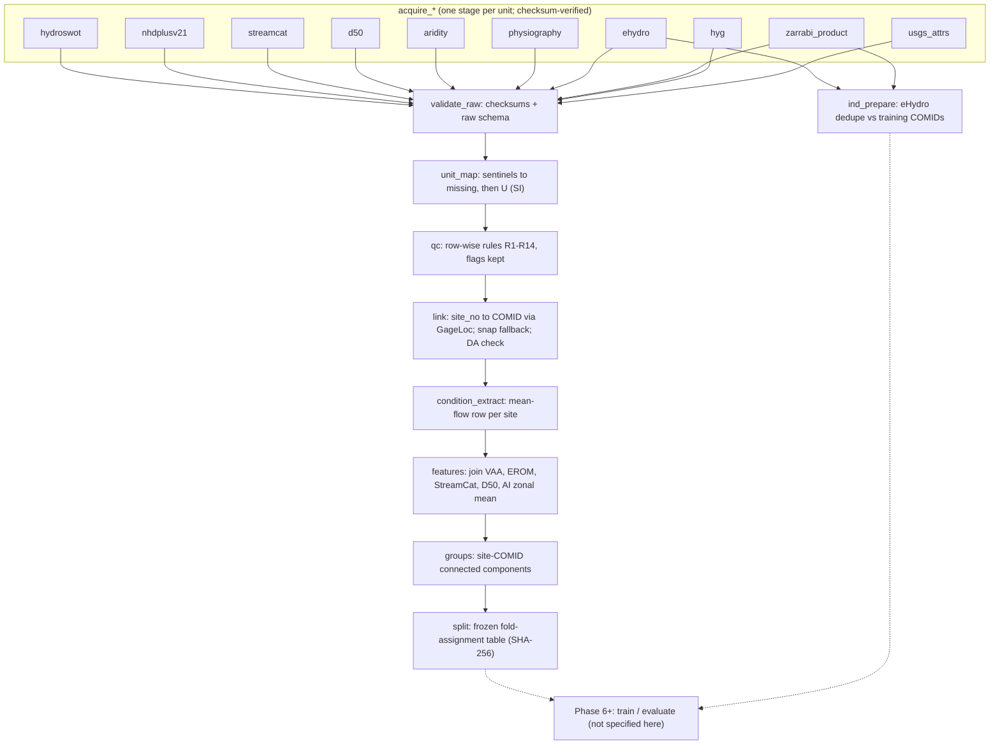

# Phase 3 Gate Deliverable: Experimental Protocol & Data Provenance

| Field | Value |
|---|---|
| S-SDLC phase | 3 (Experimental Protocol & Data Provenance) |
| Status | **Approved by the PI (2026-10-08)**: draft approved; O-1 to O-13 resolved as recommended, with O-2 (b) and O-5 (c) (§6). Subject to the PHASE_03 middle-prompt refinement and the gate review |
| Date | 2026-10-08 |
| Code-generation lock | 🔒 ON. No project code, installs or data downloads. Every command block below is a **non-executed specification** for Phase 5 (P3-D1 (a)). Evidence comes from dataset metadata (DataCite, Crossref, ScienceBase, Zenodo, figshare, GitHub APIs) and read-only text extraction of PDFs |
| Inputs | `0_point_zero.md` §3, §4, §6, §7; `0a_open_data_questions.md`; `1_literature_matrix.md` §4, §6; `2_mathematical_proofs.md` §1.2, §1.3, §7, §9.5, §10.3, §11 (frozen); design note `option_a_research_design.md` §5–§8 (leads only) |
| PI decisions | P3-D1 to P3-D9, answered 2026-10-08 (§8) |
| Frozen | H1–H4 wording (`0_point_zero.md` §3) and all of `2_mathematical_proofs.md`. This protocol fixes **numbers and procedures only** |
| Reference policy | Every key is DOI-verified (Crossref or DataCite, 2026-10-08) or ⚠️-flagged with a publisher URL |

**Notation** follows `2_mathematical_proofs.md` §1. Logs are natural logs. $w=\ln W$, $\ell=\ln\bar d$, $t=\ln(d_{\max}/\bar d)$, $\nu=\ln n$, $q=\ln Q$, $s=\ln S$.

---

## 1. Data lineage and provenance manifest

### 1.1 Manifest

Each source is a **DVC tracking unit**: one `acquire_*` stage whose output directory sits under `data/raw/<unit>/`. The file names, sizes and checksums are the publisher's values where published, read on 2026-10-08. Where no checksum is published, the SHA-256 is computed at acquisition (Phase 5) and recorded in `dvc.lock` (DVC MD5) and in `data/raw/<unit>/MANIFEST.sha256`.

| Unit | Source | Identifier | Version / pin | Licence or terms (verified) | Access | Files used (size; checksum) | Role |
|---|---|---|---|---|---|---|---|
| `hydroswot` | Canova, Fulton & Bjerklie (2016) [@Canova_2016_HYDROSWOT] | doi:10.5066/F7D798H6 → ScienceBase `57435ae5e4b07e28b660af55` | Single release (2016) | FGDC metadata: access constraints "none"; use constraints "none" | HTTPS, anonymous | `SWOT_ADCP_Dataset.txt` (87,445,985 B); `FieldDefinitions.txt` (7,156 B); `CodeDefinitions.txt` (3,342 B); `EquationDefinitions.txt` (2,965 B); `USGS_HYDRoSWOT_metadata.xml` (24,239 B); `ReadMe.txt` (2,295 B). No published checksum → SHA-256 at acquisition. The `.xlsx` copy (73 MB) is **not** acquired | Targets, QC, oracle-Q |
| `nhdplusv21` | NHDPlusV2.1 [@McKay_2012_NHDPlusV2] | ⚠️ **No DOI.** EPA NHDPlus distribution: https://www.epa.gov/waterdata/nhdplus-national-data | NHDPlusV2.1 national seamless geodatabase (Lower 48), or per-VPU attribute archives. User guide Data Model v2.1, 13 March 2019. Pin each file name and its embedded version number in `MANIFEST` | ⚠️ **No licence statement** in the user guide or on the EPA page (EPA disclaimers only). Treated as a U.S. Government work, cited with attribution (O-6) | HTTPS, anonymous | Flowline network attributes (VAA, EROM mean-annual `QE_MA`/`VE_MA` ≡ EROM_MA0001 `Q0001E`/`V0001E` ⚠️ equivalence to be asserted in Phase 5; `QC_MA` ≡ `Q0001C` for SA1), `ElevSlope.Slope`, `GageLoc` (`Source_Fea`, `FLComID`), flowline geometry. **No grids.** SHA-256 at acquisition | Q_E, slope, link, predictors |
| `streamcat` | StreamCat [@Hill_2016_StreamCat] | doi:10.1111/1752-1688.12372 (paper). Data: ⚠️ EPA URL https://www.epa.gov/national-aquatic-resource-surveys/streamcat-dataset | Metric files pinned by name and EPA release date in `MANIFEST` | ⚠️ EPA disclaimer only; no licence stated. EPA asks users to cite Hill et al. (2016) | HTTPS | Selected national metric files (list fixed in Phase 5 from §2.3 predictor list). SHA-256 at acquisition | Predictors (P3-D6) |
| `usgs_attrs` | Wieczorek et al. (2018), USGS NHDPlusV2.1 catchment attributes [@Wieczorek_2018_NHDPlusAttributes] | doi:10.5066/F7765D7V; parent ScienceBase item `5669a79ee4b08895842a1d47`. ⚠️ doi.org currently resolves to child item `66573d81d34ef3137d35edc8` | Parent release ver. 6.0 (August 2026). ⚠️ Zarrabi et al. used ver. 4.0 (August 2023). Pin the child-item files and the version in `MANIFEST` | ⚠️ No rights field on the parent item; the child items checked carry CC0. USGS data release (O-6) | HTTPS | Child items for dams, 2010 population density, seasonal EVI, soil clay/silt/sand and land cover (developed/forest/agriculture), as listed in Zarrabi Table 1. SHA-256 at acquisition | **M1 features only** (O-2 (b)) |
| `d50` | Abeshu et al. (2022) [@Abeshu_2022_D50]; data [@Li_2021_D50Map] | doi:10.5194/essd-14-929-2022; data doi:10.5281/zenodo.4921987 | Zenodo v1.1 | CC BY 4.0 (DataCite) | HTTPS | `NHDPlus_MediumResolution_D50.dbf` (244,912,011 B; md5 `3617b250addbab3cd81bad15cd93c262`). Optional `.shp` (1,906,768,684 B; md5 `d3f64d2dbcdde10ef1e0afab3069ad2b`) only if the COMID join needs geometry; `.prj`, `.cpg`, `.shx` with the published md5 values | Predictor; H4 (b) |
| `aridity` | Zomer, Xu & Trabucco (2022) [@Zomer_2022_GlobalAridityV3]; data [@Zomer_2025_GlobalAIv31] | doi:10.1038/s41597-022-01493-1; data doi:10.6084/m9.figshare.7504448.v7 | Global-AI v3.1 (figshare v7). ⚠️ Zarrabi et al. used v2 (Trabucco & Zomer 2019, figshare v3) | CC BY 4.0 (DataCite) | HTTPS | `Global-AI_ET0__annual_v3_1.zip` (645,783,906 B; md5 `ef3f6f53a082fb07365954b468cca55f`); `Global AI_ET0 v3.1 - Readme.docx` (645,897 B; md5 `ad026eba14bd5f50c6be2abc603ed74f`). Monthly files are **not** acquired | Predictor (zonal mean per catchment). Adopted (O-1) |
| `physiography` | USGS (2023), Physiographic divisions of the conterminous U.S. (digitized Fenneman & Johnson 1946 map) [@USGS_2023_PhysiographicDivisions] | doi:10.5066/P9B1S3K8 → ScienceBase `631405bbd34e36012efa304e` | 2023 release | ⚠️ No rights field in DataCite; USGS product, treated as a U.S. Government work (O-6) | HTTPS | `physio_shp.zip` (451,315 B; md5 `ba126a4526fb75ab5e13100e692613df`); `physio.xml` (18,470 B; md5 `1868489eb8f734eddbef4a4a954401cb`) | S-LRO regions (P3-D5); M0 regions |
| `ehydro` | USACE eHydro surveys, as processed by Zarrabi et al. (2025) [@Zarrabi_2025_ChannelGeometryCONUS] | ⚠️ No DOI. https://www.sam.usace.army.mil/Missions/Spatial-Data-Branch/eHydro/ | **Route O-5 (c).** The processed 76-location table is **not** on Zenodo or in the Zarrabi GitHub repo (checked 2026-10-08). (1) Request it, with an explicit licence, from the authors; (2) re-derive it from USACE eHydro in Phase 5 following Zarrabi §2.5, both to verify (1) and as the fallback if there is no reply | ⚠️ USACE (U.S. Government) data, treated as a U.S. Government work (O-6). The author-supplied table is used only under the licence they grant | HTTPS (USACE); e-mail (authors) | Author table (if granted) **and** re-derived survey rasters (60 surveys, 394 COMIDs, 25 rivers → 76 locations). SHA-256 at acquisition. The two versions are compared location by location before S-IND is frozen | **Sole independent set** S-IND (P3-D7) |
| `zarrabi_product` | Zarrabi et al. (2024) [@Zarrabi_2024_GeometryDataset] | doi:10.5281/zenodo.13883263 | Zenodo record (single file) | CC BY 4.0 (DataCite also lists MIT) | HTTPS | `Bankfull_Meanflow_CONUS.txt` (216,303,769 B; md5 `d7c22261bfdc4515ed8a6a627c034d5e`) | Comparator **on S-IND only** (`0_point_zero.md` §6) |
| `zarrabi_code` | Zarrabi et al. code [@Zarrabi_2024_Code] | ⚠️ No DOI. GitHub `Reizrb/Bankfull-and-mean-flow-channel-geometry-for-CONUS` | Commit `a30f1f53392ae0cb650e322b31357347d6ba9c4a` (HEAD, 2026-10-08) | **MIT** (LICENSE plus README: "Code: MIT. Data: CC-BY-4.0") | HTTPS | Notebooks read **as text** to recover the QC sequence and XGB hyperparameters. The `Best_Param/*` files are binary model objects and are **never deserialized** (pickle-type code-execution risk) | M1 fidelity |
| `hyg` | Enzminger, Minear & Livneh HyG [@Enzminger_2024_HyGDataset]; data [@Enzminger_2023_HyGData] | doi:10.5281/zenodo.7868764 | Zenodo record (2023) | CC BY 4.0 (DataCite) | HTTPS | `HyG_20230426.csv` (6,491,937 B; md5 `1847a0ef304e3403cfa091e5065d119b`) | S1 diagnostic only (P3-D9) |

**Not acquired** (P3-D7): the Zarrabi 11-source bankfull compilation and the NSL/NCCHE surveyed cross-sections. NHDPlus HR is not used (ADL-011).

**Correction recorded:** the design note attributes StreamCat to "Wieczorek et al. (2018)". StreamCat is Hill et al. (2016). Wieczorek, Jackson & Schwarz (2018; doi:10.5066/F7765D7V) is the **USGS NHDPlusV2.1 catchment-attribute release** that Zarrabi et al. used for their dams, population, EVI, soil and land-cover predictors (Zarrabi et al. 2025, Data Availability). ⚠️ The DataCite metadata for that DOI currently shows a child item's title ("…Difference between Precipitation Potential Evapotranspiration", Wieczorek & Staub, CC0), so the record has drifted. The parent ScienceBase item `5669a79ee4b08895842a1d47` still carries the DOI and the citation "Wieczorek, M.E., Jackson, S.E., Schwarz, G.E., Sekellick, A.J., and Staub, L.E., 2018, … (ver. 6.0, August 2026)". Adopted for M1 features only (O-2 (b)).

### 1.2 Versioning, checksums and immutability

1. **Raw data are immutable.** Each `acquire_*` stage downloads, verifies the publisher checksum where one exists, and writes `MANIFEST.sha256` together with the URL, the retrieval timestamp (UTC) and the HTTP `ETag`/`Last-Modified` headers. On a checksum mismatch the stage fails; it never overwrites.
2. **Processed data** are Parquet (tables) and GeoPackage (geometry, EPSG:5070 for distances, EPSG:4269 for storage), git-ignored and DVC-tracked. Every processed file records the `dvc.lock` hash of its inputs in its metadata.
3. **Frozen artefacts:** the post-QC site table and the fold-assignment table (§3.3). Their SHA-256 values are written into this protocol by a Phase 5 amendment (ADL row). Any later change needs a new ADL row and invalidates every downstream result.
4. **Archival (Phase 11):** Zenodo deposit of the processed site table, the fold table, the model outputs and the code release. Raw third-party data are cited, not redeposited, unless their licence allows it (CC BY 4.0 / CC0 / U.S. Government).

### 1.3 FAIR mapping

| Principle | Implementation |
|---|---|
| **F**indable | Every input carries a DOI or ⚠️ URL (§1.1). The Phase 11 output gets a Zenodo DOI. `CITATION.cff` is completed in Phase 11. The fold table and site table are identified by SHA-256 |
| **A**ccessible | All inputs are open HTTPS downloads without authentication. eHydro: an author request plus re-derivation from USACE (O-5 (c)). DVC remote: local (P3-D2); Zenodo for the final archive |
| **I**nteroperable | Parquet + GeoPackage; explicit EPSG codes; SI units after $\mathcal U$ (§2.1); `site_no` stored as a zero-padded string; COMID as int64; schema tables in §2.3 (P3-D3 (a)), implemented in Phase 4/5 with Pydantic plus Pandera or Great Expectations |
| **R**eusable | Licences recorded per unit; `dvc.lock` gives byte-level lineage; QC flags kept as columns rather than silently dropping rows; this protocol is the human-readable provenance record |

### 1.4 Data scale and storage (estimates; to be confirmed by the Phase 5 timing/size pilot)

| Unit | Raw size (est.) | Basis |
|---|---|---|
| hydroswot | ≈ 0.09 GB | Published sizes |
| nhdplusv21 | ≈ 5–10 GB compressed | ⚠️ Estimate. Attributes, GageLoc and flowlines for the Lower 48; no grids |
| streamcat | ≈ 1–3 GB | ⚠️ Estimate. ≈ 10–20 national metric files |
| d50 | 0.25 GB (dbf only) or 2.2 GB (with shp) | Published sizes |
| aridity | 0.65 GB | Published size (annual only) |
| physiography, hyg, zarrabi_product | ≈ 0.22 GB | Published sizes |
| usgs_attrs | ≈ 0.2–1 GB | ⚠️ Estimate; ≈ 8–12 child-item CSVs |
| ehydro | ≈ 0.001 GB (table) plus several GB (rasters) | O-5 (c) acquires both |
| **Raw total** | **≈ 8–16 GB** | |
| Processed (site table, features, folds) | < 0.5 GB | ≈ 2.6–4.6 k sites × ≈ 60 columns |
| Model outputs (OOF predictions, ensembles) | ≈ 2–5 GB | §4.8 |
| **DVC cache + local remote** | **≈ 25–45 GB** under `~/dvc_store/ANN_XS_Estimation/{cache,remote}` | Cache and remote each hold one copy |

The local machine is the Apple M4 Max (36 GB RAM; ADL-016). Peak RAM is dominated by the NHDPlus flowline attribute join (≈ 2.7 M rows) and the aridity zonal statistics. Both fit in memory if done per VPU.

### 1.5 DVC specification (P3-D1 (a), P3-D2 (a); non-executed)

**Layout.**

```text
PoC/Scripts/                      # git repo (on Google Drive)
├── data/raw/<unit>/              # DVC-managed links into the external cache; NOT synced by Drive
├── data/processed/               # DVC-managed links; NOT synced by Drive
├── data/checkpoints/             # DVC-managed (Phase 6+)
├── dvc.yaml, dvc.lock            # committed only after the phase is ≥ 4 (G2 hook blocks dvc.yaml while ≤ 3)
└── .dvc/config (shared), .dvc/config.local (machine paths; git-ignored by DVC)
~/dvc_store/ANN_XS_Estimation/cache    # DVC cache (outside Drive)
~/dvc_store/ANN_XS_Estimation/remote   # DVC local remote (outside Drive)
```

**Two Phase 5 issues the skeleton must resolve:**

1. **Pointer files vs `.gitignore`.** `data/raw/` is git-ignored (ADL-009, ADL-028), so `dvc add data/raw/x` would create a `.dvc` pointer inside an ignored directory, and Git would not see it. **Recommendation:** acquire through `dvc.yaml` stages, whose outputs are recorded in the tracked `dvc.lock`; no `.dvc` pointer files are needed. The alternative is to change `.gitignore` to `data/raw/*` plus `!data/raw/*.dvc`.
2. **Google Drive and links (P3-D2 follow-up).** The repo itself lives in a Drive-synced folder. Whether Drive for desktop uploads symlink targets is **unverified**. Before any real data, Phase 5 runs a dummy-file test: a symlinked 1 MB file is created and Drive's behaviour is observed. If Drive follows links, the fallback is to move the git working tree out of Drive (Drive is also a poor host for `.git`), or to make `data/` a single excluded link. The link type (`symlink` vs `hardlink`/`reflink`) is fixed in Phase 5.

**Command sequence (Phase 5 only; NOT executed in Phase 3):**

```bash
dvc init
dvc config --local cache.dir ~/dvc_store/ANN_XS_Estimation/cache
dvc config --local cache.type symlink        # final link type decided in Phase 5
dvc remote add --local -d localstore ~/dvc_store/ANN_XS_Estimation/remote
dvc repro                                     # runs the DAG below
dvc push
```

**`.dvcignore` (proposed):** `.DS_Store`, `**/.~lock.*`, `**/*.tmp`, `**/Icon?`, `**/.gdrive*`.

**Stage DAG.**



---

## 2. Data quality and schema rules

### 2.1 Unit map $\mathcal U$ (exact factors; extends `2_mathematical_proofs.md` §1.2)

$\lambda_L=0.3048$ m ft⁻¹ exactly. Sentinels become *missing* **before** $\mathcal U$ and are never scaled.

| Field (source) | Source unit | Factor (exact) | SI / model unit | Notes |
|---|---|---|---|---|
| `stream_wdth_va` → $W$ | ft | 0.3048 | m | |
| `mean_depth_va` → $\bar d$; `max_depth_va` → $d_{\max}$ | ft | 0.3048 | m | |
| `xsecond_area_va` → $A$ | ft² | 0.09290304 | m² | |
| `mean_vel_va` → $V$; `max_vel_va` | ft s⁻¹ | 0.3048 | m s⁻¹ | `max_vel_va` is used for QC only |
| `q_va` → $Q_{obs}$; `meas_q_va` | cfs | 0.028316846592 | m³ s⁻¹ | QC, condition extraction and oracle-Q only. **Never a predictor** (ADL-006) |
| `drain_area_va` | mi² | 2.589988110336 | km² | Link QC only; never a predictor |
| `QE_MA` (≡ `Q0001E`) → $Q_E$; `QC_MA` (≡ `Q0001C`, SA1) | cfs | 0.028316846592 | m³ s⁻¹ | EROM mean annual, 1971–2000 (user guide) |
| `VE_MA` (≡ `V0001E`) | ft s⁻¹ | 0.3048 | m s⁻¹ | Used in $A_J$ only. Not a predictor in M2/M5 (redundant; ADL-005) |
| `Slope` (ElevSlope; smoothed) → $S$ | m m⁻¹ | 1 | – | −9998 → missing |
| `TotDASqKm` | km² | 1 | km² | Feature (log) and size strata |
| Smoothed minimum elevation | cm | 0.01 | m | Feature |
| `D50` (Abeshu) | mm ⚠️ (Zarrabi Table 1 reports mm; confirm from the dbf) | 10⁻³ | m | |
| Global-AI v3.1 raster value | ⚠️ integer-scaled (confirm the scale factor from the v3.1 Readme) | per Readme | – | Zonal mean over the NHDPlusV2.1 catchment |
| `dec_lat_va`, `dec_long_va` + `coord_datum_cd` | degrees | datum transform to NAD83 | EPSG:4269 → EPSG:5070 | NAD27 rows are transformed, never mixed |

### 2.2 Bounds

| Quantity | Bound | Type | Source / rationale |
|---|---|---|---|
| $n$ transform bounds $[n_{\min},n_{\max}]$ | **[0.005, 0.6]**, so $\Delta_n=\ln120=4.7875$ | Model domain (P3-01) | Encloses the back-calculated range 0.006–0.537 of [@Heldmyer_2022_NWMChannelParameterization]. The effective $n$ absorbs slope and non-uniform-flow error (`0_point_zero.md` §4), so the transform band is deliberately wider than the physical range |
| $\mathcal N_{lit}$ (H4) | **[0.012, 0.33]** | Literature range (P3-16) | [@Arcement_1989_ManningSelection], Cowan procedure $n=(n_b+n_1+n_2+n_3+n_4)m$. Lower end: smallest natural-bed base value, sand 0.2 mm, 0.012 (Table 1). Upper end: largest base value (boulder, 0.070) plus the largest adjustments (0.020 + 0.015 + 0.050 + 0.100; Table 2) times the severe-meander factor 1.30 = 0.3315 → 0.33. $\mathcal N_{lit}\subsetneq[n_{\min},n_{\max}]$ ✓ |
| $r$ transform bounds | **[0.5, 10]** (provisional retained) | Model domain (P3-02) | $t\in[\ln1.1,\ln3]=[0.0953,1.0986]$. $r_{\min}=\tfrac12$ is the boundary case of Proposition 2.6; kept at 0.5 (O-9) |
| $S_{floor}$ | $10^{-5}$ m m⁻¹ | Data property (P3-03) | User guide: slopes "constrained to be greater than or equal to 0.00001 m/m". **(A1.1) confirmed** |
| Gross-error bounds (a priori; not tuned) | $0<W\le5000$ m; $0<\bar d\le50$ m; $0<d_{\max}\le70$ m; $0<V\le6$ m s⁻¹ | QC R5 | Rows outside are flagged $F_{bnd}$ and excluded; counts reported |
| $\epsilon_A$ | $\lvert\epsilon_A\rvert\le\ln1.05$ | QC R8 | Equivalent to HYDROSWOT flag q4 (±5 %) |

### 2.3 Schemas (Markdown; P3-D3 (a))

**`hydroswot_raw` (as delivered; tab-delimited).** Exact field names come from `FieldDefinitions.txt` (P3-05 closed):

| Field | Type | Unit | Use |
|---|---|---|---|
| `site_no` | string (keep leading zeros) | – | Key |
| `dec_lat_va`, `dec_long_va`, `coord_datum_cd` | float, float, string | deg | Location |
| `drain_area_va` | float | mi² | Link QC |
| `site_tp_cd` | string | – | Keep `ST` |
| `q_meas_no`, `q_meas_dt`, `q_meas_chan_nu` | string, datetime, int | – | Measurement identity; multi-channel exclusion |
| `q_va`, `meas_q_va`, `q_adj_va` | float | cfs | Discharge (QC, oracle) |
| `stream_wdth_va`, `xsecond_area_va`, `mean_depth_va`, `max_depth_va` | float | ft, ft², ft, ft | Targets |
| `mean_vel_va`, `max_vel_va` | float | ft s⁻¹ | Diagnostic target; QC |
| `q_meas_qual_cd`, `q_meas_used_fg`, `q_meas_type_cd`, `data_aging_cd` | string | – | Quality flags |
| `chan_mat_cd`, `chan_stability_cd`, `base_flw_cd` | string | – | **Diagnostic only** (`chan_mat_cd`: H4 (d)); never predictors |
| Built-in flags `q1`–`q10` (as named in the release) | int / string | – | QC R6–R9 |

**`site_table` (processed; one row per site after condition extraction).**

| Column | Type | Unit | Constraint |
|---|---|---|---|
| `group_id` | string (16 hex) | – | SHA-256 prefix of the sorted member `site_no` list of the component (§3.1) |
| `site_no` | string | – | unique |
| `comid` | int64 | – | present in NHDPlusV2.1 network |
| `link_method` | enum {`gageloc`, `snap`} | – | |
| `division` | string | – | F&J division (after the merge rule, §3.2) |
| `x5070`, `y5070` | float | m | |
| `q_meas_dt` | date | – | |
| `W`, `dbar`, `dmax`, `A`, `V` | float64 | m, m, m, m², m s⁻¹ | > 0 |
| `t_obs`, `eps_A` | float64 | – | `t_obs` ≥ 0 |
| `Q_obs`, `Q_meas`, `Q_E`, `Q_C`, `V_E` | float64 | m³ s⁻¹, m s⁻¹ | `Q_E` > 0 |
| `S` | float64 | – | ≥ 1e-5 |
| `DA_km2`, `stream_order`, `z_min_m` | float64, int8, float64 | | |
| StreamCat metrics (list fixed in Phase 5) | float64 | as published | no sentinel values |
| `D50_m`, `AI` | float64 | m, – | > 0 |
| `A_J` | float64 | m² | `Q_E / V_E` |
| Flags `F_S`, `F_Qsel`, `F_snap`, `F_DA`, `F_t`, `F_qual`, `F_eps`, `F_tout` | bool | – | §2.4 |

**`fold_assignment`** is specified in §3.3. **`ehydro_ind`**: `loc_id`, member COMIDs, river, `W`, `dbar`, `A` (= `W`·`dbar` by construction of the Zarrabi procedure), `dedupe_status`.

### 2.4 QC rules (order fixed; every rule logs counts of rows and sites removed or flagged)

Every rule is **row-wise and deterministic**. No rule uses thresholds estimated from the pooled data, so QC cannot leak across folds (L5).

| ID | Rule | Action | Rationale / source |
|---|---|---|---|
| R1 | `site_tp_cd = ST` | drop others | Zarrabi QC |
| R2 | Site inside the CONUS F&J polygons | drop others | S-LRO needs a division |
| R3 | `q_meas_chan_nu` indicates a multi-channel measurement | drop | Single-section geometry only |
| R4 | Null, zero or negative `drain_area_va`, `q_va`, `meas_q_va`, `stream_wdth_va`, `xsecond_area_va`, `mean_depth_va`, `max_depth_va`, `mean_vel_va`, `max_vel_va` | drop | Zarrabi QC; invariant 5 |
| R5 | Gross-error bounds (§2.2) | drop, flag $F_{bnd}$ | a priori |
| R6 | `mean_depth_va > max_depth_va` (flag q5 = fail) or `mean_vel_va > max_vel_va` | drop | Zarrabi QC; invariant 4 |
| R7 | Discharge consistency: any of the three pairs {`meas_q_va`, `q_va`}, {$A\cdot V$, `meas_q_va`}, {$A\cdot V$, `q_va`} outside ±5 % (HYDROSWOT q1/q2 flags) | drop | Exactly Zarrabi's three pairs (2025, §2.1) |
| R8 | **$\epsilon_A$ closure:** q4 outside ±5 % ($\lvert\epsilon_A\rvert>\ln1.05$) | drop from primary, keep in SA3 | Our addition. Proposition 7.1 (d): M5 cannot fit $\epsilon_A\ne0$ |
| R9 | `max_depth_va = mean_depth_va` ($t_{obs}=0$) | flag $F_t$, drop from primary, keep in SA3 | $r=\infty$; implausible for an ADCP section |
| R10 | `q_meas_qual_cd = POOR`, `q_meas_used_fg = N`, or provisional `data_aging_cd` | flag $F_{qual}$; retained | Reported; SA option |
| R11 | Duplicate (`site_no`, `q_meas_no`) rows | keep first, log | |
| R12 | Slope −9998 | site excluded (∉ 𝒟) | §1.3; never imputed |
| R13 | $Q_E\le0$ or missing (P3-04) | site excluded (∉ 𝒟) | §1.3 |
| R14 | Missing predictor after the join | site excluded; **no imputation**; counts per predictor reported | Avoids imputation leakage |
| – | $S=S_{floor}$ | flag $F_S$; retained; $F_S$ is an admissible feature (P3-03) | A1.1 confirmed. HyG notes most implausibly low $n$ occur at the slope floor |
| – | $t_{obs}\notin[0.0953,1.0986]$ | flag $F_{tout}$; retained (irreducible residual); share reported (P3-05) | §7.1 |

Rows that survive R1–R11 form `hydroswot_init` (the analogue of Zarrabi's HYDRoSWOT_init; ≈ 38 k rows at ≈ 4.6 k sites expected, plus our R2/R3/R5/R8/R9 removals).

### 2.5 Gage–reach link

1. **Primary:** `GageLoc.FLComID` where `GageLoc.Source_Fea = site_no` (string match).
2. **Fallback:** if there is no GageLoc record, the nearest network flowline within 500 m (EPSG:5070) whose drainage area passes check 3. Flag $F_{snap}$.
3. **Drainage-area check:** $\lvert\ln(\texttt{TotDASqKm}/(2.589988110336\cdot\texttt{drain\_area\_va}))\rvert\le\ln1.25$. Failures are flagged $F_{DA}$ and **excluded from the primary set** (likely mis-link), included in SA6.
4. **Diagnostic (ADL-011):** the k-NN-snap COMID is computed for every site, and the GageLoc vs k-NN disagreement rate is reported.

### 2.6 Condition extraction (mean flow; core)

- Following Zarrabi et al. (2025), the mean-flow row of each site is $\arg\min_i\lvert\ln(Q_{obs,i}/Q_E)\rvert$ over its `hydroswot_init` rows, with $Q_{obs}:=$ `q_va` (official discharge). **Q3 closed:** `q_va` is primary, `meas_q_va` is SA2.
- Ties go to the most recent `q_meas_dt`.
- Flag $F_{Qsel}$ if $\lvert\ln(Q_{obs}/Q_E)\rvert>\ln2$; SA4 drops these sites.
- The dataset therefore has **one row per site** ($\lvert I_j\rvert=1$, so $\omega_i=1/\lvert\mathcal J_{tr}\rvert$).
- Zarrabi aggregate to one value per COMID; we keep sites as rows and handle shared COMIDs through the group key (§3.1).
- Bankfull extraction (secondary stage only): IQR on width plus max-Q (Zarrabi), with the v1 width/depth-ratio variant as a sensitivity case (finding F1). Not executed before the core is complete.

### 2.7 Missing-value strategy (summary)

| Situation | Strategy |
|---|---|
| Sentinel (−9998, −9999, empty) | → missing before $\mathcal U$ |
| Target missing or non-positive | row dropped (R4) |
| Physics input missing ($Q_E$, $S$) | site ∉ 𝒟, excluded (R12, R13) |
| Predictor missing | site excluded (R14); counts reported per predictor and per division |
| Imputation | **none**, in any model |

---

## 3. Formal partitioning protocol

### 3.1 Grouping key (P3-D4 (i))

Build the bipartite graph $G=(\{\text{site\_no}\}\cup\{\text{COMID}\},E)$ with an edge for every final link (§2.5). **A group is a connected component of $G$.** Sites sharing a COMID, including renamed or co-located gages, are therefore always in the same fold. `group_id` = first 16 hex characters of SHA-256 over the sorted, comma-joined member `site_no` strings.

**No S-BLK family** (P3-D4). Residual spatial dependence between neighbouring reaches is an **accepted risk** (L3), mitigated by S-LRO, S-TAIL, the near-neighbour stratification and the autocorrelation audit (§3.6).

### 3.2 Split families

| Family | Role | Construction | Seeds |
|---|---|---|---|
| **S-ID** | In-distribution reference; H2 primary; $\mathrm M^*$ selection; UQ coverage target | `StratifiedGroupKFold`, $K=5$, $R=3$ repeats, groups = `group_id`, strata = drainage-area quintile of the group (max `TotDASqKm`) | 20261008, 20261009, 20261010 |
| **S-LRO** | H1 primary; H3 (LRO) | Leave one F&J division out [@USGS_2023_PhysiographicDivisions], the same divisions as Bieger et al. (2015) (P3-D5 (a)). A group is assigned to the division of its first-listed site. **Merge rule:** a division with < 50 groups after QC is merged into the neighbouring division sharing the longest boundary (expected: Laurentian Upland → Interior Plains). The merges are recorded in the fold table | deterministic |
| **S-TAIL-DA** | H3 (TAIL) primary | Train on drainage-area deciles 2–9; test on deciles 1 and 10. Decile cutpoints from `TotDASqKm` over the post-QC site set (covariate only, no target information) | deterministic |
| **S-TAIL-SO** | H3 (TAIL) secondary | Train on stream order ≤ 6; test on ≥ 7 | deterministic |
| **S-IND** | H1 corroboration | Models trained on **all** post-QC sites, evaluated on the eHydro set (76 locations) after deduplication (L8) | 20261008 |
| **S-RND** | Secondary only; a leakage illustration | Row-level random 75:25 on `hydroswot_init` (all measurements), mirroring Zarrabi's design. Never used for any hypothesis | 20261008 |

**Common support rule.** Every model is evaluated on the identical site set in every split. A site that any model cannot predict (for example, M0 without a division curve) gets the documented fallback (§4.1); it is not dropped for one model only.

### 3.3 Frozen fold-assignment table

`data/processed/splits/fold_assignment.parquet`, long format:

| Column | Type | Meaning |
|---|---|---|
| `group_id`, `site_no` | string | keys |
| `family` | enum {S-ID, S-LRO, S-TAIL-DA, S-TAIL-SO, S-IND, S-RND} | |
| `repeat` | int8 | 0–2 for S-ID, else 0 |
| `outer_fold` | int8 | held-out fold index (division index for S-LRO) |
| `inner_fold` | int8 | 0–2: grouped inner CV inside the outer training set |
| `es_member_{m}` | bool, m = 1–10 | membership of the member-specific grouped 10 % early-stopping split |
| `seed` | int64 | |
| `site_table_sha256` | string | hash of the input site table |

The table is generated once by the `split` stage. Its SHA-256 is recorded in `dvc.lock` and copied into this protocol through an ADL amendment in Phase 5. **No model code may create folds;** all code reads this table.

### 3.4 Split-then-scale and nested selection

1. Every transformation that learns parameters (standardization, log offsets, XGB/NN hyperparameters, early-stopping epochs, $\bar r$ for M3, M0 curve coefficients, M-null medians, size-class cutpoints inside M-null) is fitted on the **outer training set only**.
2. **Nested selection:** hyperparameters are chosen by grouped inner 3-fold CV inside each outer training set, using the inner-fold mean log-RMSE of $\bar d$ (NN models) or of the model's own targets (XGB). This is repeated for every outer fold of every family.
3. Final ensemble member $m$ trains on the outer training set minus its member-specific grouped 10 % early-stopping split (§3.3).
4. The outer test fold is touched **once**, for scoring.

### 3.5 Leakage audit (L1–L9 as requested; L10–L11 added from the provenance review)

| ID | Leakage channel | Where it could enter | Control | Residual risk / audit output |
|---|---|---|---|---|
| L1 | Same site in train and test | Multiple measurements per site | One row per site; grouped folds | Assert: no `group_id` in both train and test in any fold (Phase 7 test) |
| L2 | Co-located sites (same COMID, renamed gages) | Different `site_no` on one reach | Connected-component groups (§3.1) | Assert: no COMID in both train and test |
| L3 | Spatial and network autocorrelation (neighbouring reaches) | Upstream/downstream gages on the same level path | **Accepted risk** (no S-BLK, P3-D4). S-LRO and S-TAIL are the strong tests | Near-neighbour stratification: each S-ID test site is labelled "has a training site within 10 km of path length on the same `LevelPathI`" yes/no, and every S-ID metric is reported for both strata. Audit §3.6 |
| L4 | Target leakage through predictors | Measured discharge, `drain_area_va`, `chan_mat_cd`, HYDROSWOT velocity | Banned list in the feature schema; schema test rejects them | `VE_MA` excluded from M2/M5 inputs (redundant; used only in $A_J$) |
| L5 | Preprocessing leakage | Scalers, cutpoints, outlier thresholds | Split-then-scale (§3.4); QC is row-wise (§2.4) | Strata cutpoints use covariates only (DA), never targets |
| L6 | Selection leakage | Hyperparameters, early stopping, $\mathrm M^*$, thresholds | Nested inner grouped CV; $\mathrm M^*$ fixed on S-ID OOF **before** S-LRO, S-TAIL or S-IND are scored; H thresholds fixed in this protocol | Selecting $\mathrm M^*$ on S-ID favours the comparator, which is conservative for H1–H3 (§9.5) |
| L7 | Target-construction dependence | Mean-flow row chosen by closeness to $Q_E$, which is also an input | Within-site selection only (no cross-site information) | $F_{Qsel}$ flag; SA4; oracle-Q diagnostic decomposes the discharge mismatch (§7.3) |
| L8 | Independent-set overlap | eHydro locations on or next to HYDROSWOT training reaches; Zarrabi product trained at HYDROSWOT sites | Drop eHydro locations whose member COMIDs include a training COMID or lie within 1 km (EPSG:5070) of a training site. Zarrabi product compared **only** on S-IND | Report the number dropped. eHydro is large-river only (size-tail confound); report its DA distribution |
| L9 | Temporal mismatch | HYDROSWOT dates vs EROM 1971–2000 vs StreamCat/NLCD years | Not a forecasting problem; predictors are time-invariant | Documented, not controlled. Report the distribution of `q_meas_dt` |
| **L10** | Modelled-covariate circularity | Abeshu D50 is an XGBoost product trained on observed D50 at 1,691 flowlines with catchment predictors that overlap ours | Ablation A4 (without D50 and AI) | H4 (b) $\rho_S(\hat n,D_{50})$ may partly reflect shared predictors; reported as a caveat |
| **L11** | Gage-adjusted discharge | `QE_MA` (`Q0001E`) is adjusted with gage data, so at gauged HYDROSWOT sites $Q_E$ is more accurate than at ungauged reaches | SA1: rerun M5 and $\mathrm M^*$ with `QC_MA` (`Q0001C`, no gage adjustment) | All headline errors are optimistic for ungauged use. M5 is more exposed because $Q_E$ enters Φ directly. SA1 quantifies the gap |

### 3.6 Spatial autocorrelation audit (diagnostic only; it cannot change the splits)

1. **Residuals:** S-ID OOF log residuals $e_{\bar d}$, $e_W$, $e_t$ of M2-XGB and of M5, averaged over the three repeats per site.
2. **Euclidean semivariogram** in EPSG:5070: 20 distance bins up to 500 km (equal pair counts), Matheron estimator. Fit spherical and exponential models; report the range, the nugget/sill ratio and the AIC-preferred model.
3. **Moran's I** [@Moran_1950_Autocorrelation] with $k=8$ nearest-neighbour row-standardized weights; 999-permutation p-value.
4. **Network view:** residual correlation for site pairs on the same `LevelPathI`, as a function of path-length separation (bins 0–10, 10–50, 50–200, > 200 km).
5. **Interpretation rule (pre-registered):** if the variogram range exceeds the median nearest-neighbour distance between test and training sites, S-ID results are labelled "optimistic under spatial dependence", and the near-neighbour-stratified metrics (L3) are given equal prominence. **No split is changed** whatever the result; a change would need an ADL row and would be reported as a deviation.

---

## 4. Benchmark evaluation suite and metrics matrix

### 4.1 Model ladder

| Model | Definition in this study | Targets produced | Fallbacks |
|---|---|---|---|
| **M-null** (P3-D8) | Training-fold median of each log target per drainage-area quintile (cutpoints from the training fold) | $W,\bar d,d_{\max},A$ | – |
| **A_J** (P3-D8) | $A_J=Q_E/V_E$ (EROM; Jobson velocity). Training-free | $A$ only | – |
| **M0** | **Core (mean flow): refit** of the Bieger-form power law $\ln y=a_g+b_g\ln\mathrm{DA}$ per F&J division $g$ on the training fold [@Bieger_2015_RegionalCurves]. The published Bieger coefficients are **bankfull** curves, so they apply only to the secondary bankfull stage | $W,\bar d$; $A=W\bar d$ | Held-out division (S-LRO) or a division with < 30 training sites: pooled national curve from the training fold |
| **M1** | Zarrabi Tier-2 XGB [@Zarrabi_2025_ChannelGeometryCONUS] retrained on our folds. Feature set = Zarrabi Tier-2 list ($Q_E$, DA, $S$, stream order, $z_{\min}$, dams, population density, EVI ×4, clay/silt/sand, developed/forest/agriculture, D50, AI). The dams, population, EVI, soil and land-cover features come from the USGS release [@Wieczorek_2018_NHDPlusAttributes], as in Zarrabi (O-2 (b)); D50 and AI as for M2. Hyperparameter grid centred on the values read from their notebooks (text only) and re-tuned by inner CV. Target scale as in their notebooks (⚠️ verify in Phase 5); negative predictions floored at the 0.1th training percentile, with counts reported | $W,\bar d$; $A=W\bar d$ | – |
| **M2-MLP / M2-XGB** | Pure ML with **independent** log targets $\ln W,\ln\bar d,\ln d_{\max},\ln A$ (closure not enforced) on our full feature set. M2-MLP uses the shared backbone (§4.2) with a heteroscedastic Gaussian head per target | $W,\bar d,d_{\max},A$ | – |
| **M3** | Physics only (`2_mathematical_proofs.md` §7.9): $W$ regressor (shared backbone, $\mathcal L^{M3}=\sum\omega e_W^2$); $r=\bar r$ = training-fold median of $r_{obs}$ computed as $1/(e^{\mathrm{median}(t_{obs})}-1)$; $n_{emp}$ = Strickler ($S<S_J$) or Jarrett ($S\ge S_J$); depth via Φ (Jarrett branch via $\rho_J$, Proposition 7.5); $n$ projected onto $[n_{\min},n_{\max}]$ | all | – |
| **M4** (P3-09) | **Base M4 under $\mathcal I_{blind}$** (adopted, O-4): heads $(w,\ell,r,\nu)$, soft Manning residual, capped schedule $\lambda_M(\mathsf e)=\min(\lambda_0\gamma^{\mathsf e},\lambda_{\max})$ with $\lambda_0=1$, $\gamma=1.1$, $\lambda_{\max}\in\{10,10^2,10^3\}$ by inner CV; $\lambda_A$ not used (no M4⁺). Log $\Xi_{\mathsf e}$ every epoch (A7.3) | all | – |
| **M5** (primary) | Hard hybrid, full κ (P2-D3 (a)), heads $(w,r,\nu)$, $\mathcal L_{phys}\equiv0$, NLL per §9.1. $n$-head under $\mathcal I_{blind}$ (P3-11; O-4) | all | – |
| **M6** (P3-10) | **M6-E** (labels with $Q_E$; headline). **M6-NN primary** (shared backbone, heads $g_w,g_t,g_\nu$; $g_\nu$ under $\mathcal I_{blind}$ for parity with M5), M6-XGB secondary. Labels outside $[\nu_{\min},\nu_{\max}]$ are **retained** in training and projected by $\Pi$ at stage 3; their share is reported. Labels at $F_{tout}$ rows use $r_{obs}$ clipped to $[r_{\min},r_{\max}]$ for κ | all | – |
| **M5 ablations** | A1 κ ≡ 1; A2 $w_t=0$ (excluded from H4); A3-SP Strickler prior ($\tau_p=0.5\Rightarrow\lambda_p=2$); A3-SR logit residual ($\varpi=0.01$, $\lambda_\Delta=\lambda_p\Delta_n^2/16=2.865$, the Proposition 7.2 match at $\pi_S=\tfrac12$); A4 without D50 and AI (applied to M5 and $\mathrm M^*$); $w_A=1$ sensitivity | – | – |

**Information routing (P3-11; adopted, O-4).** Under $\mathcal I_{blind}$ the $n$-head receives every feature except $Q_E$, $S$, $F_S$ and $V_E$. The $W$- and $r$-heads receive the full feature set. Consequences (Propositions 6.5, 7.4): base M4 vs M5 is then a clean soft-vs-hard contrast, and M5 enforces the Manning elasticities in $Q$ and $S$ approximately (drainage area remains a $Q$ proxy). Under $\mathcal I_{full}$, base M4 degenerates and M4-S would be required.

**Strickler (P3-07; adopted, O-3).** $n_S=c_SD_{50}^{1/6}$ with $D_{50}$ in m and **$c_S=0.047$** [@Strickler_1923_Geschwindigkeitsformel]. ⚠️ The source has **no DOI** and the coefficient has not been verified from the original German report; it is recorded with the same ⚠️ status as McKay et al. (2012). No DOI-verified secondary source was found; WSP 2339 gives Limerinos ($d_{84}$-based), not Strickler. $\nu_S=\ln0.047+\tfrac16\ln D_{50}$.

**Jarrett (P3-08; verified from the full text).** [@Jarrett_1985_RoughnessColorado], eq. 6: $n=0.39\,S_f^{0.38}R^{-0.16}$ with $R$ in ft (worked example: $0.39(0.02)^{0.38}(2)^{-0.16}=0.079$). Valid for $0.002\le S\le0.04$ and $0.5\le R\le7$ ft; average standard error 28 %. "Higher-gradient" is defined there as $S>0.002$, so **$S_J=0.002$**. $a_J=0.38$, $b_J=-0.16<5/3$ ✓ (Proposition 7.5). SI form: $c_J'=0.39\cdot0.3048^{0.16}=0.3225$, so $n=0.3225\,S^{0.38}R_m^{-0.16}$. Rows outside the validity range are flagged and reported; nothing is clipped except by $\Pi$.

### 4.2 Shared NN configuration (P3-06, P3-12, P3-13, P3-14, P3-17)

| Item | Value |
|---|---|
| Backbone | MLP, 3 × 128, SiLU, **LayerNorm** (row-wise; no BatchNorm, so Proposition 3.4's scope holds) |
| Optimizer | AdamW, learning rate $10^{-3}$, cosine decay, batch 256, ≤ 500 epochs, early stopping with patience 50 on the member's grouped 10 % split |
| Inner grid | $\lambda_{wd}\in\{0,10^{-5},10^{-4},10^{-3}\}$ × learning rate $\{10^{-3},3\times10^{-4}\}$ (plus $\lambda_{\max}$ for M4) |
| Loss weights (P3-06) | $w_W=w_{\bar d}=w_t=1$, $w_A=0$ primary; $w_A=1$ sensitivity |
| Precision and device | **CPU, float64** for every model containing Φ or the Manning residual (M3, M4, M5, M6 stage 3), and for M2-MLP for parity. PyTorch MPS has no float64 (O-8) |
| Solver (P3-12) | $\tau_\ell=10^{-10}$ (log units), $K_{\max}=40$, per-row stopping (Proposition 3.4c); $\ln F$ via log1p of the integrated $F-1$ (Proposition 3.6 note) |
| Quadrature (P3-12) | Double-exponential (tanh-sinh) rule on the substituted integrand; node count fixed so that the Phase 7 test reproduces §10.2 E1–E5 to $\tau_Q=10^{-8}$ |
| UQ (P3-13) | Deep ensemble $M=10$; $\sigma_{\min}=0.01$; no correlation head ($\bar\varrho$ not used); β-NLL with $\beta_N=0.5$ [@Seitzer_2022_BetaNLL]; warm start of 20 epochs on MSE; $\alpha=0.10$ |
| Point predictor (P3-14) | Mixture median approximated by $\exp(\mu^*)$ with $\mu^*$ the ensemble mean of member means, everywhere (raw-space metrics included). The raw-space mean is not used |
| XGB grid | `max_depth` {4, 6, 8} × `eta` {0.03, 0.1} × `min_child_weight` {1, 5}; subsample 0.8; colsample 0.8; ≤ 2000 rounds, early stopping 100 |

### 4.3 Metrics matrix

Primary metrics are site-weighted (§9.5 definitions). Every cell is reported overall, by drainage-area quintile $\mathcal Q_1$–$\mathcal Q_5$ (cutpoints from post-QC `TotDASqKm`), by stream order and by division.

| Target ↓ / Split → | S-ID | S-LRO | S-TAIL-DA | S-TAIL-SO | S-IND (eHydro) | S-RND |
|---|---|---|---|---|---|---|
| $\bar d$ | P: RMSE$_{\log}$, $B$; S: MdAPE, $R^2_{\log}$, $R^2_{raw}$, RMSE$_{raw}$, APB % | P (H1) | P (H3) | S | P (H1 corroboration) | S only |
| $W$ | P / S as above | P | P | S | P | S only |
| $A$ | P (H1, k = A) | P | P | S | P (A = W·d̄) | S only |
| $d_{\max}$, $t$ | P: RMSE, $B$; $\rho_S(\hat r,r_{obs})$ | S | S | S | – (not observed) | – |
| $V$ (diagnostic) | $\hat V=Q_E/\hat A$ vs measured: RMSE$_{\log}$, $B$; oracle-Q decomposition (§7.3) | S | S | S | – | – |
| Consistency | Closure residual $\ln\hat A-\hat w-\hat\ell$ (M2, M1 n/a) and Manning residual $R_M$ (M0–M2, M4); identically 0 for M5 up to $\tau_\ell$ | S | S | S | – | – |
| UQ | Coverage $\hat C_{0.10}$, $\bar{\mathcal W}_{0.10}$, CRPS, PIT | descriptive | descriptive | descriptive | descriptive | – |

P = primary, S = secondary. APB %, $R^2_{raw}$ and RMSE$_{raw}$ follow Zarrabi's metrics for comparability.

### 4.4 Pre-registered hypothesis procedures (P3-15, P3-16)

**Common settings.**
- **$\mathrm M^*$:** for each target $k\in\{\bar d,A\}$, the model among {M1, M2-MLP, M2-XGB} with the lowest S-ID OOF RMSE$_{\log,k}$ (mean over the three repeats). Fixed before any other split is scored.
- **Bootstrap:** paired cluster bootstrap over sites [@Field_2007_ClusteredBootstrap], $B=10{,}000$, percentile CI, $\alpha_b=0.05$, stratified by division (sites resampled within division). Seed 20261008.
- **S-ID repeats:** in each bootstrap draw the statistic is computed per repeat and averaged over the three repeats.
- **S-IND:** cluster bootstrap over the 25 **rivers** (locations on one river are not independent). With 25 clusters the CI is wide; this is expected and reported.

| H | Primary statistic (frozen definitions, §9.5) | Data | **Supported iff** | **Falsified iff** (`0_point_zero.md` §3, verbatim logic) |
|---|---|---|---|---|
| **H1** | $\Delta^{H1}_{\bar d}=\mathrm{RMSE}_{\bar d}^{(M5)}-\mathrm{RMSE}_{\bar d}^{(\mathrm M^*)}$; $k=A$ reported alongside | **Primary:** pooled S-LRO OOF. **Corroboration:** S-IND | S-LRO 95 % CI upper bound < 0 **and** the S-IND CI does not lie entirely above 0 | S-LRO 95 % CI includes 0 or is positive. An S-IND CI entirely above 0 is reported as a contradiction |
| **H2** | $\Delta^{H2}=\lvert B_{\bar d}^{(M5)}(\mathcal Q_1)\rvert-\lvert B_{\bar d}^{(\mathrm M^*)}(\mathcal Q_1)\rvert$; signed biases also reported | **Primary:** S-ID OOF, sites in $\mathcal Q_1$. Secondary: S-LRO $\mathcal Q_1$ | 95 % CI upper bound < 0 | CI includes 0 or is positive |
| **H3** | $\Delta^{H3}=L^{(M5)}-L^{(\mathrm M^*)}$, $L=\mathcal S(\mathcal T_{ID})-\mathcal S(\mathcal T_{OOD})$, **$\mathcal S=-\mathrm{RMSE}_{\log,\bar d}$** (not $R^2$). $\mathcal T_{OOD}$ = OOD predictions; $\mathcal T_{ID}$ = S-ID OOF predictions **for the same sites**. Two-sample bootstrap as in §9.5 | Separately: **H3-LRO** (all sites) and **H3-TAIL** (DA deciles 1 + 10). S-TAIL-SO secondary | Both H3-LRO and H3-TAIL have 95 % CI upper bound < 0 | Either CI includes 0 or is positive. A one-split pass is reported as "partial" |
| **H4** | (a) $\pi^\nu_\partial(\vartheta)$, $\pi^r_\partial(\vartheta)$ with **$\vartheta=0.05$** (n < 0.0064 or n > 0.47 for ν), and $\pi_{lit}$ on $\mathcal N_{lit}=[0.012,0.33]$. (b) $\rho_S(\hat n,D_{50})$ and $\rho_S(\hat n,S)$; **expected signs positive** for both. (c) $\rho_S(\hat r,r_{obs})$, RMSE$_t$, $B_t$. Site-level $\hat\nu$ = mean over repeats of the ensemble-mean $\nu$ | M5 on S-ID OOF (primary); S-LRO reported | none of the falsification conditions holds | $\pi^\nu_\partial>0.10$ or $\pi^r_\partial>0.10$ (0.10 is the share a uniform spread over the band would give), or $\pi_{lit}<0.80$, or the bootstrap 95 % CI of any of $\rho_S(\hat n,D_{50})$, $\rho_S(\hat n,S)$, $\rho_S(\hat r,r_{obs})$ includes 0 or lies below 0 |

**H4 caveats (reported, not thresholds).** C2: slope error alone induces a positive $n$–$S$ association, so passing (b) for slope is weak evidence; it is also reported stratified by $F_S$. L10: D50 is modelled. (d) diagnostics: S1 (§4.6) and $\hat n$ grouped by `chan_mat_cd`. Comparisons across κ treatments use Proposition 7.6.

### 4.5 Secondary contrasts S2 (P3-15)

- **Family (4 contrasts):** M5 vs M6-E and M4 vs M5, each on $\Delta$RMSE$_{\log,\bar d}$, on S-ID and S-LRO.
- **Multiplicity rule (adopted, O-7):** **Bonferroni** simultaneous percentile CIs at level $1-0.05/4$ (98.75 %) [@Dunn_1961_MultipleComparisons]. This fits the CI-only framework, needs no p-values, and avoids the unresolvable Holm (1979) DOI (doi.org returns 404 for 10.2307/4615733).
- Stratification by aspect ratio $a$ (quintiles of $\hat\kappa$) and by ID/OOD is **descriptive only**.
- All other comparisons (ablations, sensitivity analyses, M0/M3/A_J/M-null) are **descriptive** and labelled as such.

### 4.6 UQ targets and diagnostics (P3-13, P3-18)

| Item | Target |
|---|---|
| Nominal level | $\alpha=0.10$ (90 % central interval of the mixture, §9.3) |
| Acceptance band | $\hat C_{0.10}\in[0.85,0.95]$ on pooled S-ID OOF for $\bar d$ (primary), $W$ and $t$ (secondary). This is a quality target, **not** a hypothesis |
| OOD coverage | S-LRO, S-TAIL, S-IND: reported descriptively, with no guarantee claimed |
| Also reported | $\bar{\mathcal W}_{0.10}$, CRPS (closed form, §9.4), PIT histograms, per division and per quintile |
| Conformal calibration | **Not adopted** (P2-D4 (a)); P3-18 closed |
| S1 (P3-D9) | Diagnostic only: $\rho_S$ and log-RMSE between $\hat n$ and HyG at-a-station $n$ at matching gages. HyG $n$ is back-calculated from the same USGS measurements and the same NHDPlusV2 slopes, so S1 is a **consistency check, not independent validation** |

### 4.7 Outcome decision matrix (carried from the design note §8; pre-registered)

| Outcome | Claim | Venue (ADL-015) |
|---|---|---|
| H1 and H3 supported (M5 ≈ M2 in-distribution, better OOD and on S-IND) | "Physics constraints improve transferability of national channel geometry" | escalate to WRR / HESS permitted |
| H1 falsified, H4 supported, and **accuracy not worse**, defined as an S-LRO 95 % CI upper bound of $\Delta^{H1}_{\bar d}$ below +0.05 log units (≈ 5 %) | "Hydraulically consistent geometry, shape, roughness and velocity at no loss of accuracy" | ASCE primary |
| H2 supported only | "Physics constraints reduce small-stream depth bias" | ASCE / JAWRA |
| M5 worse (S-LRO CI lower bound > 0) | Diagnose with the **pre-registered** ablations (A1, A3, M4, SA1, SA5) and report. No post-hoc headline switch: any new variant is labelled exploratory | ASCE; fallback per ADL-014 |

> [!IMPORTANT]
> The "no loss of accuracy" margin (+0.05 log units on $\Delta^{H1}_{\bar d}$) is a new number. It makes row 2 operational and was adopted as O-10.

### 4.8 Compute budget (ADL-016)

| Item | Count |
|---|---|
| Sites (one row each) | ≈ 2.6–4.6 k (Zarrabi: 4,607 after QC, 2,626 after linking) |
| Outer fits per model | S-ID 15 + S-LRO ≈ 7 + S-TAIL 2 + S-IND 1 ≈ 25 |
| Primary NN models (M2-MLP, M4, M5, M6-NN) | 4 × 25 × (24 inner + 10 members) ≈ 3,400 fits |
| Ablations (A1, A2, A3-SP, A3-SR, A4, $w_A$; reuse M5 hyperparameters) | 6 × 25 × 10 ≈ 1,500 |
| Sensitivity analyses SA1–SA5 (M5 and the $\mathrm M^*$-NN) | ≈ 2,000–2,500 |
| **NN total** | **≈ 7,000–7,500 fits** |
| Cost per fit (CPU float64, ≈ 3.5 k rows, batch 256, early stopping) | ≈ 15–35 s (estimate; Φ adds ≤ 40 fixed-point iterations per row) |
| Wall time, ≈ 10 parallel workers on the M4 Max performance cores | **≈ 4–7 h** per full run |
| XGB fits, bootstrap ($B=10^4$ on ≤ 5 k sites), audits | minutes |
| **Verdict** | **GO, local** (ADL-016 stands). A Phase 6 timing pilot (one outer fold of M5) confirms the per-fit cost; if it exceeds 120 s, $K_{\max}$ and the inner grid are revisited by ADL |

### 4.9 Sensitivity analyses (pre-registered, descriptive)

SA1 `QC_MA` instead of `QE_MA` (L11) · SA2 `meas_q_va` as $Q_{obs}$ · SA3 include R8/R9 rows · SA4 drop $F_{Qsel}$ sites · SA5 drop $F_S$ sites · SA6 include $F_{DA}$ sites.

---

## 5. Closure of the Phase 3 register (P3-01 to P3-19) and carry-overs

| ID | Item | Resolution | Section | Status |
|---|---|---|---|---|
| P3-01 | $n$ bounds | Transform [0.005, 0.6]; $\mathcal N_{lit}$ = [0.012, 0.33] (WSP 2339) | §2.2 | ✅ |
| P3-02 | $r$ bounds | [0.5, 10] retained; $F_{tout}$ share reported | §2.2 | ✅ (O-9) |
| P3-03 | Slope floor | $10^{-5}$ confirmed by the user guide (A1.1); −9998 excluded; $F_S$ flag and feature | §2.2, §2.4 | ✅ |
| P3-04 | $Q_E\le0$ / missing | Excluded (R13) | §2.4 | ✅ |
| P3-05 | Field names, units, $\epsilon_A$, $d_{\max}>\bar d$, $t_{obs}$ share | HYDROSWOT fields from `FieldDefinitions.txt`; EROM `Q0001E`/`V0001E` (≡ `QE_MA`/`VE_MA` ⚠️ Phase 5 assertion); R6, R8, R9; $F_{tout}$ | §2.1, §2.3, §2.4 | ✅ (D50/AI scale factors confirmed at acquisition) |
| P3-06 | Loss weights | $w_W=w_{\bar d}=w_t=1$, $w_A=0$; $\lambda_{wd}$ by inner CV | §4.2 | ✅ |
| P3-07 | Strickler | $c_S=0.047$ (Strickler 1923, ⚠️ no DOI); $\tau_p=0.5$, $\lambda_p=2$, $\lambda_\Delta=2.865$, $\varpi=0.01$ | §4.1 | ✅ (O-3; ⚠️ source) |
| P3-08 | Jarrett, $S_J$, $\bar r$ | $c_J'=0.3225$ (SI), $a_J=0.38$, $b_J=-0.16$, $S_J=0.002$; $\bar r$ from the training-fold median of $t_{obs}$ | §4.1 | ✅ |
| P3-09 | M4 variant and schedule | Base M4, capped schedule ($\lambda_0=1$, $\gamma=1.1$, $\lambda_{\max}$ by inner CV), AdamW, $\Xi_{\mathsf e}$ logged | §4.1 | ✅ with P3-11 (O-4) |
| P3-10 | M6 | M6-E headline; M6-NN primary, M6-XGB secondary; labels retained, then $\Pi$ | §4.1 | ✅ |
| P3-11 | Routing | $\mathcal I_{blind}$ for the $n$-head and $g_\nu$ | §4.1 | ✅ (O-4) |
| P3-12 | Solver and quadrature | $\tau_\ell=10^{-10}$, $K_{\max}=40$, per-row stopping, tanh-sinh, $\tau_Q=10^{-8}$, log1p | §4.2 | ✅ |
| P3-13 | UQ | $M=10$, $\sigma_{\min}=0.01$, no correlation head, β-NLL $\beta_N=0.5$, warm start, $\alpha=0.10$, band [0.85, 0.95] | §4.2, §4.6 | ✅ |
| P3-14 | Point predictor | $\exp(\mu^*)$ (median) everywhere | §4.2 | ✅ |
| P3-15 | H1–H3 settings; S2 | $\mathrm M^*$ rule, $B=10^4$, $\alpha_b=0.05$, division-stratified, $\mathcal S=-\mathrm{RMSE}_{\log}$, quintile source, splits and seeds; S2 Bonferroni | §3.2, §4.4, §4.5 | ✅ (O-7) |
| P3-16 | H4 | $\mathcal N_{lit}$, $\vartheta=0.05$, positive expected signs, S1 diagnostic only | §4.4, §4.6 | ✅ |
| P3-17 | Architecture | MLP 3 × 128, SiLU, LayerNorm (no batch coupling), AdamW | §4.2 | ✅ |
| P3-18 | Conformal | Not adopted | §4.6 | ✅ |
| P3-19 | Carry-overs | See below | – | ✅ (NHDPlus terms per O-6) |

**Carry-overs.**

| Item | Resolution |
|---|---|
| McKay et al. (2012) author list | **Closed.** The user guide's recommended citation, verbatim: "McKay, L., Bondelid, T., Dewald, T., Johnston, J., Moore, R., and Rea, A., 'NHDPlus Version 2: User Guide', 2012". Note: the guide's team list names "Craig Johnston", so the initial "J." is the guide's own inconsistency. The bib entry uses the recommended citation as printed and records the discrepancy |
| NHDPlusV2.1 licence | **Closed (O-6).** No licence or terms statement exists in the guide or on the EPA download page (EPA disclaimers only). It is treated as a U.S. Government work and cited with attribution; the absence of a statement is recorded here |
| Zarrabi code licence | **Closed: MIT** (LICENSE file plus README), pinned at commit `a30f1f5` |
| Q3 field | **Closed:** `q_va` is $Q_{obs}$; `meas_q_va` is SA2 |

---

## 6. Resolved protocol decisions (PI, 2026-10-08)

| ID | Item | Decision |
|---|---|---|
| O-1 | Aridity source | **Global-AI v3.1** (Zomer et al. 2022; CC BY 4.0), the product family Zarrabi used (v2) |
| O-2 | Catchment predictors for M1 | **(b)** M1 uses the USGS release (Wieczorek et al. 2018; ⚠️ drifted DataCite record) for fidelity to Zarrabi; M2, M4, M5 and M6 use the StreamCat set (P3-D6) |
| O-3 | Strickler coefficient | $c_S=0.047$ (D in m), Strickler (1923), ⚠️ no DOI |
| O-4 | P3-11 routing | $\mathcal I_{blind}$ for the $n$-head and $g_\nu$; base M4 |
| O-5 | eHydro acquisition | **(c)** author request (with licence) plus re-derivation from USACE eHydro in Phase 5; re-derivation verifies the author table and is the fallback |
| O-6 | NHDPlusV2.1, StreamCat, physiography and USACE terms | Treated as U.S. Government works with attribution; absence of a licence statement recorded |
| O-7 | S2 multiplicity | Bonferroni (Dunn 1961) |
| O-8 | Precision and device | CPU float64 for all NN models |
| O-9 | $r_{\min}$ | 0.5 kept |
| O-10 | "No loss of accuracy" margin | +0.05 log units on the S-LRO CI upper bound of $\Delta^{H1}_{\bar d}$ |
| O-11 | M0 for mean flow | Refit per division on training folds |
| O-12 | L11 sensitivity | SA1 (`QC_MA`) adopted |
| O-13 | Drive and symlinks | Phase 5 dummy-file test before any data; moving the working tree out of Drive is the fallback |

---

## 7. Proposed ADL rows (to be shown as a diff at the gate; not appended)

| ADL | Content |
|---|---|
| ADL-042 | Phase 3 decisions P3-D1 to P3-D9 recorded (§8) |
| ADL-043 | Group key = site–COMID connected components; no S-BLK; L3 accepted risk with near-neighbour stratification and audit |
| ADL-044 | eHydro is the sole independent set; acquisition by author request plus USACE re-derivation (O-5 (c)) |
| ADL-045 | Citation correction: StreamCat = Hill et al. (2016); Wieczorek et al. (2018) is the USGS catchment-attribute release, adopted for M1 only (O-2 (b)) |
| ADL-046 | Protocol decisions O-1 to O-13 (§6) |
| ADL-047 | Phase 3 gate record (after approval and commit) |

## 8. Decision record (PI, 2026-10-08)

| ID | Decision |
|---|---|
| P3-D1 | (a) DAG, `.dvcignore` and commands live in this protocol, not executed; skeleton `dvc.yaml`/`.dvcignore` committed (`chore(ops)`) only after the phase flips to 4; `dvc init` in Phase 5 |
| P3-D2 | (a) Cache and local remote at `~/dvc_store/ANN_XS_Estimation/{cache,remote}`; Zenodo for Phase 11. Follow-up: `data/raw` and `data/processed` must not sync in Drive; link type decided in Phase 5 |
| P3-D3 | (a) Markdown schemas; Pydantic plus Pandera or Great Expectations in Phase 4/5 |
| P3-D4 | (i) only: site–COMID connected components; no S-BLK; autocorrelation audit kept as a diagnostic |
| P3-D5 | (a) Bieger (2015) physiographic divisions |
| P3-D6 | NHDPlusV2.1 VAA + EROM, StreamCat, D50 (Abeshu 2022), aridity index (Global-AI v3.1, O-1); plus the "without D50/AI" ablation |
| P3-D7 | eHydro (76 locations) is the only independent set |
| P3-D8 | (a) M-null plus $A_J=Q_E/V_E$ |
| P3-D9 | S4: literature-anchored $n$ bounds, pre-registered, never fitted to test targets. S1: diagnostic only |

## 9. References

Cited keys (existing): @Canova_2016_HYDROSWOT, @Zarrabi_2025_ChannelGeometryCONUS, @Zarrabi_2024_GeometryDataset, @Bieger_2015_RegionalCurves, @Heldmyer_2022_NWMChannelParameterization, @Enzminger_2024_HyGDataset, @Jarrett_1984_HighGradientStreams, @Seitzer_2022_BetaNLL.

**New entries (to add identically to `master.bib` and `docs/references.bib` after approval):**

| Key | Reference | Identifier (verified 2026-10-08) |
|---|---|---|
| Hill_2016_StreamCat | Hill, R. A., Weber, M. H., Leibowitz, S. G., Olsen, A. R., & Thornbrugh, D. J. (2016). The Stream-Catchment (StreamCat) Dataset: A database of watershed metrics for the conterminous United States. *JAWRA*, 52(1), 120–128 | doi:10.1111/1752-1688.12372 (Crossref; online 2015) |
| Abeshu_2022_D50 | Abeshu, G. W., Li, H.-Y., Zhu, Z., Tan, Z., & Leung, L. R. (2022). Median bed-material sediment particle size across rivers in the contiguous US. *ESSD*, 14(2), 929–942 | doi:10.5194/essd-14-929-2022 (Crossref) |
| Li_2021_D50Map | Li, H.-Y., Abeshu, G., Zhu, Z., Tan, Z., & Leung, L. R. (2021). *A national map of riverine median bed-material particle size over CONUS* (v1.1) [Dataset]. Zenodo | doi:10.5281/zenodo.4921987 (DataCite; CC BY 4.0) |
| Zomer_2022_GlobalAridityV3 | Zomer, R. J., Xu, J., & Trabucco, A. (2022). Version 3 of the Global Aridity Index and Potential Evapotranspiration Database. *Scientific Data*, 9, 409 | doi:10.1038/s41597-022-01493-1 (Crossref) |
| Zomer_2025_GlobalAIv31 | Zomer, R., & Trabucco, A. (2025). *Global Aridity Index and Potential Evapotranspiration (ET0) Database: Version 3.1* [Dataset]. figshare | doi:10.6084/m9.figshare.7504448.v7 (DataCite; CC BY 4.0) |
| USGS_2023_PhysiographicDivisions | U.S. Geological Survey (2023). *Physiographic divisions of the conterminous U.S.* [Data release; after Fenneman & Johnson 1946] | doi:10.5066/P9B1S3K8 (DataCite) |
| Enzminger_2023_HyGData | Enzminger, T. L., Minear, J. T., & Livneh, B. (2023). *HyG: A hydraulic geometry dataset derived from historical stream gage measurements across the conterminous United States* [Dataset]. Zenodo | doi:10.5281/zenodo.7868764 (DataCite; CC BY 4.0) |
| Jarrett_1985_RoughnessColorado | Jarrett, R. D. (1985). *Determination of roughness coefficients for streams in Colorado*. USGS Water-Resources Investigations Report 85-4004 | doi:10.3133/wri854004 (resolves via doi.org; metadata from the USGS Publications Warehouse) |
| Arcement_1989_ManningSelection | Arcement, G. J., & Schneider, V. R. (1989). *Guide for selecting Manning's roughness coefficients for natural channels and flood plains*. USGS Water-Supply Paper 2339 | doi:10.3133/wsp2339 (Crossref title) |
| Moran_1950_Autocorrelation | Moran, P. A. P. (1950). Notes on continuous stochastic phenomena. *Biometrika*, 37(1–2), 17–23 | doi:10.1093/biomet/37.1-2.17 (Crossref) |
| Field_2007_ClusteredBootstrap | Field, C. A., & Welsh, A. H. (2007). Bootstrapping clustered data. *JRSS B*, 69(3), 369–390 | doi:10.1111/j.1467-9868.2007.00593.x (Crossref) |
| Dunn_1961_MultipleComparisons | Dunn, O. J. (1961). Multiple comparisons among means. *JASA*, 56, 52–64 | doi:10.1080/01621459.1961.10482090 (Crossref) |
| McKay_2012_NHDPlusV2 | McKay, L., Bondelid, T., Dewald, T., Johnston, J., Moore, R., & Rea, A. (2012). *NHDPlus Version 2: User Guide* (Data Model v2.1, 2019) | ⚠️ No DOI. https://www.epa.gov/system/files/documents/2023-04/NHDPlusV2_User_Guide.pdf |
| Zarrabi_2024_Code | Zarrabi, R., et al. *Bankfull-and-mean-flow-channel-geometry-for-CONUS* [Software], commit a30f1f5. MIT | ⚠️ No DOI. https://github.com/Reizrb/Bankfull-and-mean-flow-channel-geometry-for-CONUS |
| Wieczorek_2018_NHDPlusAttributes | Wieczorek, M. E., Jackson, S. E., Schwarz, G. E., Sekellick, A. J., & Staub, L. E. (2018). *Select attributes for NHDPlus Version 2.1 reach catchments and modified network routed upstream watersheds for the conterminous United States* (ver. 6.0, August 2026) [Data release]. U.S. Geological Survey | doi:10.5066/F7765D7V (citation from the parent ScienceBase item; ⚠️ the DataCite record and doi.org resolution point to a child item) |
| Strickler_1923_Geschwindigkeitsformel | Strickler, A. (1923). *Beiträge zur Frage der Geschwindigkeitsformel und der Rauhigkeitszahlen für Ströme, Kanäle und geschlossene Leitungen*. Mitteilungen des Eidgenössischen Amtes für Wasserwirtschaft, Bern | ⚠️ No DOI; bibliographic details from secondary sources; not verified from the original |

Not added: Holm (1979), Valavi et al. (2018), Ferguson (2010); verified this session but not cited.
